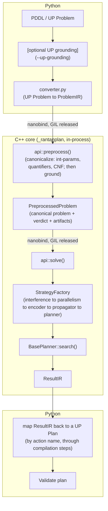

# Architecture overview

## What RantanPlan is

RantanPlan is a SAT/SMT-based automated planner: given a PDDL (or
[Unified Planning](https://unified-planning.readthedocs.io/), UP) problem, it
searches for a sequence — or partially-ordered set — of actions that
transforms the initial state into a goal state. Instead of a heuristic
forward search over states, it uses **planning as satisfiability**: encode
"does a plan of length *k* exist?" as a formula and hand it to cvc5. If the
formula is satisfiable, the model *is* a plan; if not, grow *k* and try
again (or use branch-and-bound over cost, for optimal planning).

This framing is why the codebase looks the way it does. There is no state
graph to search — there is a formula to build, incrementally, timestep by
timestep, and a solver to drive. Most of the core's complexity is about
building that formula *well*: compactly (grounding, pruning, folding static
fluents), correctly (frame axioms, interference-aware parallelism), and with
enough structure left over that the solver's own search can exploit it
(propagators, symmetry breaking, invariants as extra clauses). What that
formula concretely looks like — the variables, the clause schemas, a full
worked example — is [`the-encoding.md`](the-encoding.md), the next doc in
the reading order.

## Why three parallelism semantics

A plan doesn't have to be a strict sequence. If two actions don't interfere —
neither reads nor writes anything the other touches — they can execute in
the same timestep, shortening the plan and shrinking the formula (fewer
timesteps to encode). RantanPlan supports three semantics for what "the same
timestep" is allowed to mean:

- **Sequential** — exactly one action per timestep. Simplest encoding, no
  interference analysis needed, longest plans.
- **∀-step (forall)** — any subset of pairwise non-interfering actions may
  fire together. Requires knowing, for every pair of actions, whether they
  interfere.
- **∃-step (exists)** — any subset of actions that admits *some* consistent
  execution order may fire together, even if some pairs within it interfere
  pairwise, as long as there's an order where each sees the effects it
  needs. Strictly more permissive than ∀-step (shorter plans), at the cost
  of a more expensive interference/ordering analysis (cycle detection
  instead of a simple pairwise check).

This is a genuine expressiveness/cost tradeoff, not a strictly-better
option, which is why all three are first-class and selectable per strategy
— see [`preprocessing-and-strategy.md`](preprocessing-and-strategy.md) for
how a semantics choice becomes a `StrategySpec`, and
[`interference.md`](interference.md) for how
interference is actually computed under each.

## The two-layer split

### Layer 1: Python frontend / C++ core

The Python side owns everything PDDL- and UP-specific: parsing, the UP→IR
conversion, an optional UP cross-product grounding pass (`--up-grounding`), and
the UP `Engine` integration (`RantanPlanPlanner`, `RantanPlanOptimalPlanner`,
`RantanPlanAnytimePlanner` in `planner_wrapper.py`). Canonicalization that used
to be Python's job — quantifier removal, integer-parameter instantiation, CNF
normalization — now lives in the C++ pipeline. The C++ side owns the
canonicalization, encoding, and search. The
two communicate in-process — no subprocess, no serialization format on
disk — through a plain-data intermediate representation (`ProblemIR`) and a
nanobind extension module (`_rantanplan`). This replaced an earlier
protobuf-based subprocess design; see
[`python-cpp-boundary.md`](python-cpp-boundary.md) for why and how.

### Layer 2: preprocessor / backend, inside the C++ core

Within the C++ core itself, there's a second split, between work that's
useful regardless of which SAT encoding or planner you pick, and work that's
specific to one:

- **`api::preprocess(Problem, PreprocessorOptions) -> PreprocessedProblem`**
  — grounding, canonicalization, pruning, invariant/mutex discovery,
  symmetry detection, arithmetic profiling. Nothing here knows what an
  encoder or a planner is.
- **`api::solve(PreprocessedProblem) -> ResultIR`** — resolves the chosen
  strategy, builds interference analysis, wires up the encoder/parallelism/
  propagator/planner combination, and runs the search.

The output of preprocessing, `PreprocessedProblem`, is the one typed
contract between the two — see
[`preprocessing-and-strategy.md`](preprocessing-and-strategy.md).



## The basic pieces

Before the other docs go deeper, here's the vocabulary they all build on.

### The expression "AST": `ExprID` / `ExprPool` / `ExprKind`

Every precondition, effect, goal, and cost in the problem is an expression
tree, but RantanPlan doesn't represent that tree with pointers or a class
hierarchy of `Node` subtypes. Instead (`problem/expr_pool.hpp`):

- **`ExprKind`** (`problem/expr_enums.hpp`) is the small, closed set of node
  shapes: `CONSTANT`, `PARAMETER`, `FLUENT_SYMBOL`, `FUNCTION_SYMBOL`,
  `STATE_VARIABLE` (a fluent application, e.g. `(at robot room-a)`),
  `FUNCTION_APPLICATION` (e.g. `(+ 1 3)`), and `VARIABLE`. `ExprOperator` (a
  second, orthogonal enum) tags *which* operator a `FUNCTION_APPLICATION`
  node uses (`PLUS`, `EQUALS`, `AND`, ...).
- **`ExprNode`** is the actual node: a `kind`, an optional `op`, a `type_id`
  (index into the problem's type table), a payload
  (`std::monostate`/`bool`/`int64_t`/`double`/`std::string` — a
  `std::variant`, so a leaf carries exactly one of these), and a list of
  `ExprID` children.
- **`ExprID`** is a 32-bit handle — just an int wrapped for type safety —
  into one shared array of `ExprNode`s.
- **`ExprPool`** owns that array and *interns* every node: `intern(ExprNode)`
  builds a canonical string key from the node's shape and returns the
  existing `ExprID` if a structurally identical node already exists, or
  appends and returns a new one otherwise. Two occurrences of
  `(at robot room-a)` anywhere in the problem become the *same* `ExprID` —
  this is what makes `ExprID` equality O(1) (compare two ints) instead of a
  tree-equality check.

Two `ExprKind`s — `FUNCTION_APPLICATION` and `STATE_VARIABLE` — use a
"head + arguments" layout: `children[0]` is the operator/fluent symbol node,
`children[1..]` are the arguments. `ExprPool::arguments()`/`head_symbol_id()`
are the accessors for that convention; everything else just reads
`children()` directly.

**Constructing and walking.** Passes that build new nodes (quantifier
expansion, set lowering, CNF normalisation, static-fluent folding) do so through
one shared helper, `ExprBuilder` (`problem/expr_builder.hpp`): cached operator
head symbols plus folding `make_and`/`make_or`/`make_not`/`make_eq`/`make_count`/
`make_app`/`object_constant`/`reintern`, using the standard operator spelling so
rebuilt nodes dedup with the loader's — rather than each pass re-rolling its own
`op_head`. To *read* every expression a problem holds — for a survival check or
an analysis — use `for_each_expression` / `for_each_root_expression`
(`problem/expr_walk.hpp`), which enumerate the action preconditions/costs/
effects, goals, invariants, and initial state in one place.

**Example.** Take object `rob1` (type `robot`) and object `room-a` (type
`room`). The precondition `(at rob1 room-a)` interns as four nodes, built in
this order — the fluent symbol first, then each argument, then the
application that ties them together:

| ExprID | kind | type_id → type | payload / symbol | children |
|---|---|---|---|---|
| 0 | `FLUENT_SYMBOL` | `bool` | `"at"` | — |
| 1 | `CONSTANT` | `robot` | `"rob1"` | — |
| 2 | `CONSTANT` | `room` | `"room-a"` | — |
| 3 | `STATE_VARIABLE` | `bool` | — | `[0, 1, 2]` (head=`at`, args=`rob1`, `room-a`) |

Node 3 is what an action's `precondition_id()` would point to. If a second
action's precondition or effect also mentions `(at rob1 room-a)`, it reuses
`ExprID 3` — no new nodes are created. This is also the invariant
`converter.py`'s hand-rolled walker exists to preserve (see
[`python-cpp-boundary.md`](python-cpp-boundary.md)): children must be
interned before the parent that references them, so the head symbol `at`
(node 0) and the arguments (nodes 1, 2) come before the application node
that combines them (node 3).

**How it's checked.** `ExprPool::get(id)` asserts the ID is in range; there's
no way to construct an out-of-range `ExprID` other than corrupting memory,
since the only way to obtain one is `intern()` or a query method that
returns an existing one. Type consistency is checked at the `Problem` level,
not the pool level: `Problem::is_bool_type(id)`/`is_numeric_type(id)`/
`is_object_type(id)` look up the node's `type_id` in the problem's type
table — the pool itself doesn't know about types beyond storing the
`type_id` integer. A `Type`'s kind (bool / int / real / object / array / set)
is a single positive `TypeKind` field, set once at construction, that every
`is_*()` predicate reads — so `is_object()` is `kind == OBJECT`, not a
definition-by-exclusion. Going the other way, `Problem::type_id_of(const Type*)`
is the inverse of that `type_id` lookup.

### The problem model: `Problem` / `Action` / `Fluent` / `Effect` / `Plan`

Above the expression pool sits the ordinary object model a planner needs:

- **`Problem`** — the root: objects, fluents, actions, initial state (a list
  of `Assignment`s), goals, and the metric. Holds the shared `ExprPool` (via
  `shared_ptr`, so it's cheap to share across the immutable-transformation
  pipeline — grounding, pruning, and static-fluent folding each return a
  *new* `Problem` sharing the same pool rather than mutating one in place).
- **`Fluent`** — a state variable's *schema* (name, value type, parameters),
  not a grounded instance. `(at ?r ?l)` is a `Fluent`; `(at rob1 room-a)`
  is the `ExprID` of a `STATE_VARIABLE` application of it.
- **`Action`** — name, parameters, one precondition `ExprID` (the converter
  synthesizes a single `AND` conjunction if there were several conditions),
  a list of `Effect`s, and an optional cost `ExprID`.
- **`Effect`** — wraps an `EffectExpression`: which fluent, what kind of
  update (assign/increase/decrease), and optionally a condition or `forall`
  quantification for conditional/quantified effects.
- **`Plan`** — the result: literally a `std::vector<const Action*>`, nothing
  more. Ground `Action`s live in the `Problem` that produced them; a `Plan`
  just references them by pointer, in order.

Grounding (turning `(move ?r ?a ?b)` into concrete
`move(rob1, room-a, room-b)`, `move(rob1, room-b, room-a)`, ...) produces
a new `Problem` via `Problem::with_actions()` — fully-instantiated `Action`s
(empty `parameters()`, every `ExprID` referring to ground objects) replacing
the parametrized ones.

## Walking a problem through the pipeline

The story in the diagram above, made concrete. Take a two-room, one-robot
problem: object `rob1` (type `robot`), objects `room-a`/`room-b` (type
`room`), one predicate `(at ?r - robot ?l - room)`, one action:

```
action move(?r - robot, ?from - room, ?to - room)
  precondition: (at ?r ?from)
  effect: not (at ?r ?from), (at ?r ?to)
goal: (at rob1 room-b)
initial state: (at rob1 room-a)
```

1. **Python: parse and convert.** UP parses the PDDL into
   `InstantaneousAction`/`Fluent` objects. `converter.py`'s `_FNodeToIR`
   walks the precondition expression and interns it into `ProblemIR.nodes`
   exactly as shown in the AST example above. The result is one `ActionIR`
   named `"move"` with three `ParameterIR`s (`?r`, `?from`, `?to`), a
   `precondition` node index, and two `EffectIR`s (one `ASSIGN`-false on
   `at(?r, ?from)`, one `ASSIGN`-true on `at(?r, ?to)`).

2. **C++: load.** `ir_io.cpp`'s `load_problem_from_ir` interns the flat node
   array into a fresh `ExprPool` in one forward pass (nodes already
   topologically ordered by the converter) and builds one `Problem` with one
   parametrized `Action` named `"move"`.

3. **`api::preprocess()`:**
   - **Grounding** instantiates `move` over every `(robot, room, room)`
     combination consistent with parameter types — with 1 robot and 2 rooms,
     `move(rob1, room-a, room-b)` and `move(rob1, room-b, room-a)` are the
     only ones whose precondition can ever hold from a reachable state (a
     `move(rob1, room-a, room-a)` instance is grounded too, but pruned next).
   - **CWA / static fluent folding**: `at` isn't static (actions change it),
     so nothing folds here.
   - **Action pruning (RPG + goal relevance)**: the relaxed planning graph
     reaches `(at rob1 room-b)` one action away from the initial state, so
     `get_minimum_steps_lower_bound()` returns 1 — the pipeline now knows no
     plan shorter than 1 timestep can exist. Goal-relevance backward search
     keeps `move(rob1, room-a, room-b)` (it's on a path to the goal) and
     would prune any ground action that can't reach the goal even
     transitively.
   - **Mutex analysis**: discovers `(at rob1 room-a)` and
     `(at rob1 room-b)` are mutually exclusive (the robot is in exactly one
     room) and records it as a `MutexConstraint` — injected as an extra
     clause at every timestep, giving the SAT solver a fact it would
     otherwise have to rediscover by search.
   - **Arithmetic profile**: no numeric fluents here, so the problem is
     classified `LINEAR` (trivially).
   - Output: a `PreprocessedProblem` with the grounded, pruned `Problem`,
     `lower_bound = 1`, and the mutex in `state_constraints`.

4. **`api::solve()`:** resolves the chosen strategy (say `"seq"` —
   sequential, no interference analysis needed), builds a `GroundedEncoder`,
   and the `IncrementalHorizonPlanner` starts at `start_timestep = 1` (the
   lower bound just computed). It encodes the initial state
   (`at(rob1, room-a)` true at *t=0*), the frame axioms and action clauses
   for *t=0*, and a goal literal for *t=1* implying `at(rob1, room-b)` —
   the complete formula for exactly this problem is written out in
   [`the-encoding.md`](the-encoding.md). cvc5
   finds the model: `move(rob1, room-a, room-b)` fires at *t=0*.

5. **Plan extraction and mapping back.** `extract_plan()` reads which action
   variables are true in the model and builds a `Plan` (a vector of
   `Action*`). `ResultIR.plan` carries it back as
   `[("move", ["rob1", "room-a", "room-b"])]` — plain strings, not object
   references. Python's `_build_plan` looks `"move"` up in the compiled
   problem's action map, resolves `"rob1"`/`"room-a"`/`"room-b"` to UP
   objects, and maps the resulting `ActionInstance` back through whatever
   compilation steps ran before conversion.

This example is intentionally too small to show parallelism, propagators, or
numeric reasoning — see
[`preprocessing-and-strategy.md`](preprocessing-and-strategy.md),
[`interference.md`](interference.md), and
[`encoders-and-planners.md`](encoders-and-planners.md) for those.

## Design philosophy

A few decisions recur throughout the codebase and are worth stating
explicitly, since they explain a lot of "why is this structured this way"
questions before they come up:

**The strategy pattern is the organizing principle, not an add-on.**
Every backend configuration — which encoder, which parallelism semantics,
which interference analysis, which propagator modules, which planner — is a
`StrategySpec`: a plain data struct of enums. Named, validated combinations
live in one registry (`strategy_registry.cpp`). Adding a new backend
configuration is adding one entry there, not writing a new fused
encoder-and-planner class. See
[`preprocessing-and-strategy.md`](preprocessing-and-strategy.md).

**Plain-data contracts at every boundary.** The Python/C++ boundary is a
flat, index-based `ProblemIR` (no shared objects, no callbacks required to
build a problem). Inside the C++ core, every precondition, effect, and goal
is an `ExprID` — a 32-bit handle into an interned expression pool — rather
than a pointer or a shared object graph. The preprocessor/backend boundary
is `PreprocessedProblem`, a struct of canonical data plus artifacts, not a
live object with behavior. Plain data at a boundary is easy to reason about,
easy to serialize if that's ever needed again, and impossible to
accidentally couple to one side's internals.

**Make illegal states unrepresentable, not runtime-checked.** The
interference analysis interfaces are the clearest example: consumers that
need whole-graph access declare it in their *type* (they take an
`InterferenceGraphAnalysis&`, not an `InterferenceOracle&`), so passing a
lazy analyzer where a graph is required is a compile error instead of a
runtime throw. See
[`interference.md`](interference.md).

**A non-SAT consumer of the preprocessor should be conceivable, even if
none exists yet.** `PreprocessedProblem` never mentions an encoder, a
propagator, or cvc5 in its public contract (solver-using artifacts are
forward-declared behind `unique_ptr`s). The internal sanity check the
codebase uses for this is "the GBFS test": could a greedy best-first-search
planner be written against `PreprocessedProblem` alone — states/actions/
goals via `Problem`/`ExprPool`, pruning via the tightened bounds, heuristic
fuel via the fixpoint RPG/achievers — without including any encoder header
or calling any solver API? Today, yes. Keeping that true is why interference
analysis (which needs `SemanticsKind`) is built in
`api::solve`, not in the preprocessor.

## Try it

Run the pipeline you just read about (from the repo root, inside the venv):

```bash
rantanplan --list-strategies      # the strategy registry, one line each
rantanplan -d pddl/small-test/zenotravel/domain.pddl \
           -p pddl/small-test/zenotravel/instances/pfile13.pddl \
           --strategy elsc -v
```

The bracketed log tags are the pipeline stages, in order: `[Grounding I1]`…
(the reachability fixpoint, iteration by iteration), `[CWA]`,
`[StaticFluent]`, `[RPG.Numeric L0]`… and `[ActionPruning]`, `[MutexAnalysis]`
(mutex discovery), `[ArithProfile]` (which SMT logic the problem gets) —
everything up to there is `api::preprocess()`. Then `[Solving T3]`,
`[Solving T4]`, … is `api::solve()` — and note it starts at T3, the lower
bound preprocessing just proved, not at T1.

## Further reading

The execution history behind the current design — including alternatives
that were considered and explicitly rejected — is recorded in
[`../docs/specs/`](../docs/specs/) (not tracked in git; local development
notes). `modular-architecture.md` there covers the preprocessor/backend
split in detail, and `nanobind-in-process.md` covers the migration off
protobuf/subprocess.
