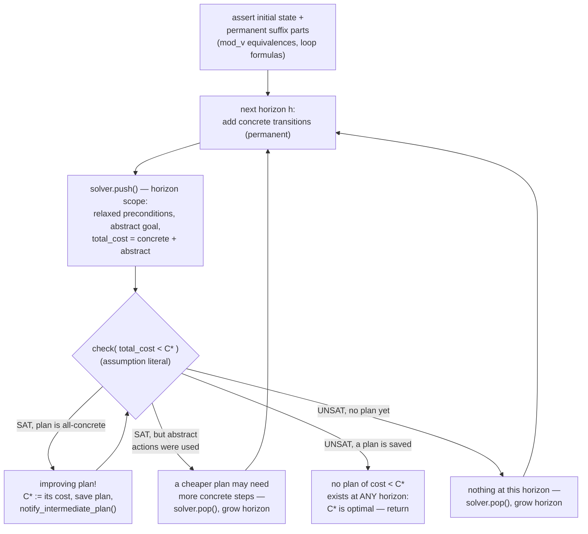

# The encoder and the planners

This doc covers the parts of a solve not already covered elsewhere: the
encoder that builds the formula, and the planner backend that drives the
search over it. See
[`preprocessing-and-strategy.md`](preprocessing-and-strategy.md) for how
these fit into `StrategySpec`/`StrategyFactory`, and
[`interference-and-propagators.md`](interference-and-propagators.md) for the
interference/propagator axes.

## The encoder

`GroundedEncoder` (`encoders/grounded_encoder.{hpp,cpp}`) is the single
state-space encoder — planners, propagator modules, and the abstract
suffix encoder all consume it directly (there is no encoder interface or
`EncoderFamily` axis to choose from). Its methods are the eight clause
schemas from [`the-encoding.md`](the-encoding.md), one set per ground
action per timestep, generated directly: `encode_initial_state()`,
`encode_actions(t)`, `encode_frames(t)`, `encode_goal(t)`,
`encode_parallelism(t)`, `encode_symmetries(t)`,
`encode_state_constraints(t)`, plus `extract_plan()` to turn a Z3 model
back into a `Plan`.

Internally, `encode_actions` composes per-action effect constraints
(`encode_non_cumulative_effects`) with a per-timestep
`encode_cumulative_effects(t)` that is a **no-op** — it is kept as the
seam where a future chained encoder would emit cumulative-effect chain
variables. Until then, several actions writing the same numeric fluent
cannot share a timestep: their effect equalities are jointly
unsatisfiable, so the solver simply never co-schedules them (sound, just
less parallel).

`encode_prefix_monotone(t)` encodes `(∀a. ¬a@t) → (∀a. ¬a@(t+1))`, forcing
active steps to the front of the plan. Combined with the horizon-schedule
batching described below, this is what lets a single goal literal at a
batched horizon `h` witness any shorter plan length in the batch — frame
axioms propagate a shorter plan's final state forward to `h` unchanged.

## Planner backends

`BasePlanner` (`planners/base_planner.hpp`) owns what every planner shares:
the Z3 solver, deadline/timeout handling (`init_deadline`,
`apply_solver_timeout`, `handle_unknown_result` — a `z3::unknown` result is
disambiguated into "genuinely timed out" vs. other causes), the horizon
schedule, and the intermediate-plan callback used for anytime results (see
[`python-cpp-boundary.md`](python-cpp-boundary.md)). Concrete planners:

- **`IncrementalHorizonPlanner`** (named `Sequential` in `PlannerKind` —
  the name predates this class and now refers to a strategy role, not a
  class) — satisficing search with a growing horizon, one SAT call per
  scheduled horizon.
- **`BranchAndBoundPlanner`** — the cost-optimal (and anytime) planner.
  Notably, it does **not** use `z3::optimize` — that API is incompatible
  with Z3 user propagators, which the forall and lazy exists strategies
  depend on. Instead it reformulates cost minimization as a sequence of
  plain `z3::solver` feasibility checks with progressively tighter cost
  bounds, preserving full propagator compatibility. The full algorithm is
  the "Optimal and anytime" section below.

## Search modes and how a planner gets picked

`SearchMode` (satisficing / optimal / anytime) is a CLI/`Config`-level
choice, orthogonal to the strategy's own declared `PlannerKind`.
`resolve_planner_kind(mode, spec)` (`config/strategy_spec.hpp`) reconciles
the two: satisficing mode uses whatever planner the strategy names;
optimal and anytime modes always force `BranchAndBoundPlanner`.

**Example.** Three `(mode, strategy)` combinations and what
`resolve_planner_kind` does with each (every registered strategy currently
names `Sequential` as its planner, so `BranchAndBound` is only ever
reached through the mode override):

| `SearchMode` | strategy's `PlannerKind` | Result |
|---|---|---|
| Satisficing | `Sequential` (e.g. `"els"`) | `Sequential` — unchanged, runs as `IncrementalHorizonPlanner` |
| Optimal | `Sequential` (e.g. `"seq --mode optimal"`) | `BranchAndBound` — forced, regardless of the strategy's own planner |
| Anytime | `Sequential` (e.g. `"els --mode anytime"`) | `BranchAndBound` — forced, streaming improving plans |

The forcing in rows 2–3 is why `"els"` under `--mode optimal` and `"els"`
under `--mode satisficing` run entirely different planner classes despite
being the same `StrategySpec` — cost-optimality is a search-algorithm
property, not an encoding one, so it overrides the strategy's default
rather than combining with it.

## Optimal and anytime: branch-and-bound with an abstract suffix

`BranchAndBoundPlanner` (`planners/branch_and_bound_planner.cpp`,
following Leofante et al., *"Optimal Planning Modulo Theories"*, IJCAI
2020) has to solve a problem the satisficing planners don't have: finding
a plan of cost 25 at horizon 8 proves nothing about horizon 12, where a
cheaper plan might exist. Growing the horizon forever is not a
termination strategy — the planner needs a way to prove, at a *finite*
horizon, that no cheaper plan exists at *any* horizon.

### The abstract suffix

That proof device is the **abstract suffix** (`AbstractSuffixEncoder`,
`encoders/abstract_suffix_encoder.hpp`): after the concrete prefix of *h*
timesteps, one extra layer over-approximates *every possible
continuation* of any length at once —

- one Boolean `a^abs` per ground action: "this action fires somewhere in
  the suffix," at no particular time and with no ordering,
- one flag `mod_v` per fluent: `mod_v ⇔ (some a^abs that writes v is
  set)`,
- **relaxed preconditions**: an abstract action needs each precondition to
  hold at state *h* *or* be modifiable by the suffix (`φ@h ∨ ⋁ mod_v`),
- an **abstract goal**: each goal holds at *h* or is modifiable by the
  suffix,
- **loop formulas** (SCC-based) that stop a cycle of abstract actions
  from justifying each other's preconditions with no external support,
- **deferral and non-emptiness axioms**: each concrete action must be
  justified against the suffix (axiom 6 — under non-sequential semantics
  its deferral sets come from a `SyntacticInterference` the suffix builds
  for itself, `analysis/syntactic_interference.{hpp,cpp}`; sequential
  semantics justifies deferral by the action chain instead), and if any
  abstract action fires, every concrete step must be non-empty (axiom 7).

The suffix's cost contribution is a lower bound on any real continuation:
exact for constant action costs; for SDAC costs it uses the per-action
lower bounds `ActionPruningPass` computed from the RPG's fixpoint
intervals — this is precisely the artifact `consume_artifacts()` moves
out of `PreprocessedProblem` for this planner. Because the suffix only
ever *under*-counts the remaining cost, an UNSAT answer is trustworthy
across all horizons.

### The search loop



The inner loop keeps re-checking with the same assumption-gated bound
`total_cost < C*` as `C*` drops, so one horizon can yield several
improving plans before the search moves on. The push/pop discipline —
concrete transitions permanent and outside the scope, suffix constraints
inside it — is the `push()`/`pop()` usage described in
[`z3-control-and-interruption.md`](z3-control-and-interruption.md).

Exit statuses map directly onto how the loop ends: `SOLVED_OPTIMALLY`
(the UNSAT-with-saved-plan branch — optimality *proven*),
`SOLVED_SATISFICING` (a plan was found but timeout/`max_steps` ran out
before the proof), `UNSOLVABLE_INCOMPLETELY` (no plan within limits).
`optimality_proven()` and `best_cost()` carry the distinction back
through `ResultIR`.

What gets minimized: the problem's metric if it's action costs
(constant or state-dependent), otherwise — including when no metric is
given — every action costs 1 and branch-and-bound minimizes plan length.

One soundness corner: under ∃-step semantics, actions sharing a timestep
each "see" a different intermediate state of the serialization, but costs
are evaluated at the timestep state `x_t` — for SDAC that can
under-estimate the true cost and produce false optimality claims. The
factory's `adjust_spec` therefore *downgrades* an exists-step strategy to
forall semantics when SDAC meets branch-and-bound, logging why. The
downgraded spec unconditionally gets the `ForallLazy` propagator module
(replacing `ExistsCycle` where present): forall has no encoded
parallelism path, so even the propagator-free `e` picks up the lazy
forall module.

### Anytime = the same search, streamed

Anytime mode runs the identical branch-and-bound; the only difference is
what happens on the `improving plan!` edge of the diagram:
`notify_intermediate_plan()` fires the callback installed via
`BasePlanner::set_intermediate_plan_callback`, which nanobind forwards to
the Python `on_plan` callable (GIL re-acquired for the call), and UP's
`AnytimePlanner` generator yields it as an `INTERMEDIATE` result — see
the sequence diagram in
[`python-cpp-boundary.md`](python-cpp-boundary.md). The final result
still reports `SOLVED_OPTIMALLY` if the proof completed, so "anytime" is
strictly extra visibility, not a weaker search. On satellite pfile2
(≈4 s):

```bash
rantanplan -d pddl/small-test/satellite/domain.pddl \
           -p pddl/small-test/satellite/instances/pfile2.pddl \
           --strategy els --mode anytime --timeout 60
# Improving plan found (18 actions)
# Improving plan found (18 actions)
# Improving plan found (17 actions)
# Improving plan found (17 actions)
# *** OPTIMAL PLAN FOUND: horizon=9, actions=17, cost=17.000000 ***
# Status: PlanGenerationResultStatus.SOLVED_OPTIMALLY
```

Each `Improving plan found` line is one traversal of that edge — the plan
was already usable when it printed; the remaining runtime is spent
*proving* nothing cheaper exists.

## The horizon schedule

`HorizonSchedule` (`planners/base_planner.hpp`) controls which horizons
actually get a SAT call versus which just get their transitions filled in
without a goal check: `linear` (every horizon, +1), `arithmetic` (+5),
`geometric` (×1.5), `doubling` (×2). Skipping goal checks at intermediate
horizons is safe *only* because the prefix-monotone encoding guarantees any
shorter valid plan is representable within a later batch's horizon — the
schedule changes how often you ask "is there a plan yet," not whether a
shorter plan would be missed.

**Example.** `HorizonSchedule::next(current, max)` always advances by at
least 1 and never exceeds `max`. For `doubling` (`n = max(current+1,
current*2)`) starting from horizon 0 with `max = 20`, the sequence of
horizons that actually get a goal check is:

```
0 → 1 → 2 → 4 → 8 → 16 → 20
```

(`next(16, 20)` computes `max(17, 32) = 32`, then clamps to `min(32, 20) =
20`.) Transitions for timesteps 0 through 19 are still all added to the
solver as the schedule advances — only the *goal literal* is skipped at 3,
5, 6, 7, 9–15, 17–19. If a plan of length 6 exists, the solver won't be
asked "is there a plan at horizon 6?" directly; it gets asked at horizon 8
instead, and finds it there because the prefix-monotone encoding lets a
length-6 plan sit at the front of an 8-slot formula with 2 empty trailing
steps.

## Try it

The schedule batching, live (zenotravel pfile13 needs 8 timesteps under
∃-step, and preprocessing proves a lower bound of 3):

```bash
rantanplan -d pddl/small-test/zenotravel/domain.pddl \
           -p pddl/small-test/zenotravel/instances/pfile13.pddl \
           --strategy els -v 2>&1 | grep Solving
rantanplan -d pddl/small-test/zenotravel/domain.pddl \
           -p pddl/small-test/zenotravel/instances/pfile13.pddl \
           --strategy els -v --horizon-schedule doubling 2>&1 | grep Solving
```

The linear run checks `T3` through `T8` and finds the plan at 8. The
doubling run checks `T3, T6, T12` — three SAT calls instead of six — and
finds a plan at horizon 12: a length-8 plan fits there, front-loaded with
empty trailing steps, which is exactly the prefix-monotone batching that
makes skipping the goal checks at horizons 7–11 safe.
