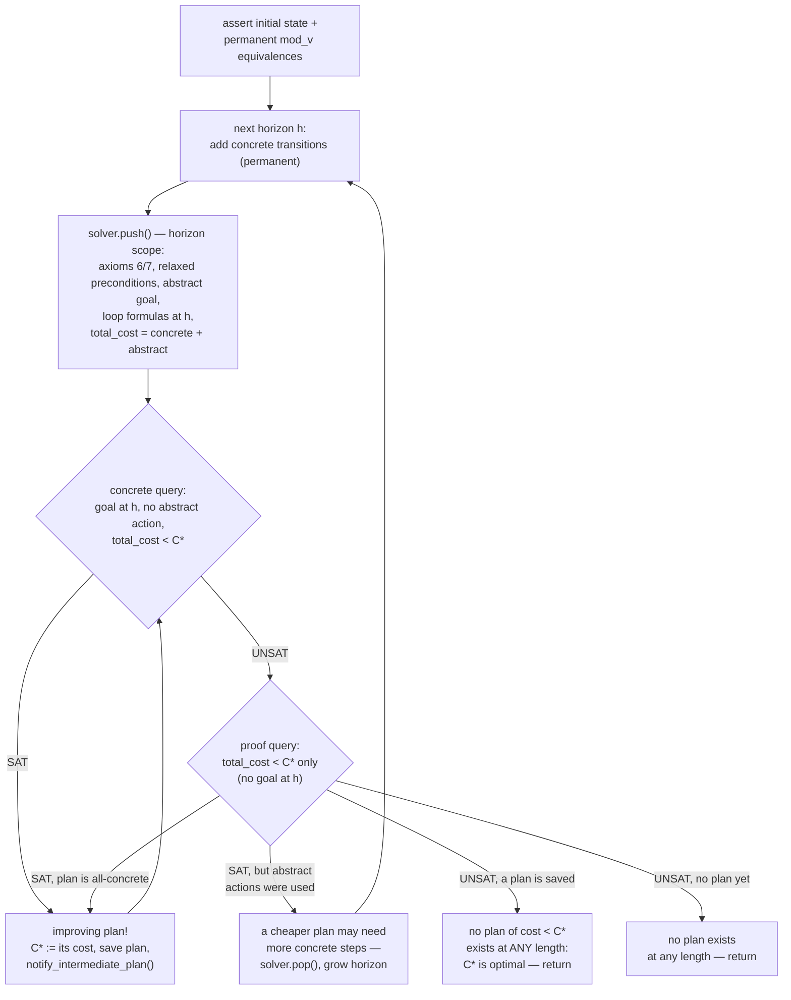

# Encoders and planners

This doc covers the two axes of a `StrategySpec` not already covered
elsewhere: which SAT encoder builds the formula, and which planner backend
drives the search over it. See
[`preprocessing-and-strategy.md`](preprocessing-and-strategy.md) for how
these fit into `StrategySpec`/`StrategyFactory`, and
[`interference-and-propagators.md`](interference-and-propagators.md) for the
interference/propagator axes.

## Encoder families

`BaseEncoder` (`encoders/base_encoder.hpp`) is the interface every encoding
strategy implements: `encode_initial_state()`, `encode_actions(t)`,
`encode_frames(t)`, `encode_goal(t)`, `encode_parallelism(t)`,
`encode_symmetries(t)`, `encode_state_constraints(t)`, plus
`extract_plan()` to turn a Z3 model back into a `Plan`. Three families exist
(`EncoderFamily` in `config/strategy_spec.hpp`):

- **Grounded** (`grounded_encoder.{hpp,cpp}`) — the baseline: the eight
  clause schemas from [`the-encoding.md`](the-encoding.md), one set per
  ground action per timestep, generated directly.
- **Chained** (`chained_grounded_encoder.{hpp,cpp}`) — extends Grounded
  with **chain variables for cumulative numeric effects**, so several
  actions writing the same numeric fluent can legally share a timestep
  (see the section below). This is the encoder behind the
  `elsc`/`elsc-dt`/`elsc-fp` family and the
  `flsc`/`flsc-dt`/`fgsc`/`egsc` family, the only strategies with semantic
  interference — a single encoder implementation serves the incremental,
  double-tail and branch-and-bound planners alike, which is the strategy
  pattern's component-reuse payoff described in
  [`architecture-overview.md`](architecture-overview.md): the contributor
  unit is "one encoder," not "one encoder-planner pair."
- **R2E** (`r2e_grounded_encoder.{hpp,cpp}`) — the R²∃-step ("relaxed
  ∃-step") encoding (`r2e` strategy): a fixed global action order replaces
  both the frame axioms and the parallelism constraints (see below).

### Chained: cumulative numeric effects via ζ chains

Under parallel semantics, the baseline encoding breaks on numeric fluents
with more than one writer. Take the commuting pair from
[`interference-and-propagators.md`](interference-and-propagators.md) —
`refuel_a` (`fuel += 5`) and `refuel_b` (`fuel += 3`), which semantic
interference happily allows in the same timestep. Grounded's per-action
effect equalities

```
refuel_a@t → fuel@t+1 = fuel@t + 5
refuel_b@t → fuel@t+1 = fuel@t + 3
```

are jointly unsatisfiable when both fire — `fuel@t+1` can't equal two
different values — so the encoding would *forbid* exactly the parallelism
the interference analysis just permitted, silently forcing longer plans.
With equal amounts it is worse: two `fuel += 3` writers give the same
equality twice, both can fire, and the step counts one increase, so the plan
is invalid. This is why `StrategyFactory::validate` accepts semantic
interference only with the Chained encoder; syntactic interference keeps
two writers of one numeric fluent in different steps, so it is sound with
the Grounded encoder.
`ChainedGroundedEncoder` (implementing Section 5.2 of the
semantic-interference paper, *"Relaxing non-interference requirements in
parallel plans"*) fixes this by threading each multi-written numeric
fluent through intermediate **chain variables** ζ, one per writer:

```
ζ₀ = fuel@t                              -- eq. (7): chain starts at the timestep state
ζ₁ = ite(refuel_a@t, ζ₀ + 5, ζ₀)         -- eq. (8): each writer transforms
ζ₂ = ite(refuel_b@t, ζ₁ + 3, ζ₁)         --          or passes through
fuel@t+1 = ζ₂                            -- eq. (9): chain ends at the next state
```

A firing action applies its effect to its chain position; a non-firing one
passes the value through unchanged. Both fire → `fuel@t+1 = fuel@t + 8`;
one fires → `+5` or `+3`; neither → unchanged (and the ordinary frame
axioms, which Chained keeps, still demand a cause for any change). Boolean
fluents and single-writer numeric fluents keep the plain Grounded
equalities — chains are created only where cumulative writes are possible
(the `encoder.chained_variables` stat counts them).

### R2E: a fixed global order instead of frames and mutexes

`R2EGroundedEncoder` commits, up front, to one global order *L* over all
ground actions (declaration order or RPG-layer order — `ActionOrdering`),
and lets *any* set of actions share a timestep as long as executing them
in that order is valid. The whole transition relation becomes chain
substitution: an action's precondition is evaluated not at the timestep
state but at the intermediate state left by the previous modifier in *L*
(`a@t → pre(σ_prev)`), its effects write the next chain position, and
per-variable linking constraints tie `x@t+1` to the last chain position.
`encode_frames` and `encode_parallelism` both return `true` — persistence
and ordering are built into the chain structure, so there are no frame
axioms, no mutex clauses, and no ordering propagator.

Two consequences worth knowing: R2E asserts none of the state constraints
the preprocessor derives (`encode_state_constraints` returns `true`; they
are redundant and only ever cost or buy speed), but declared bounds of
bounded int/real types define which plans are valid, so
`encode_declared_bounds` asserts them on every chain variable (the header
comment records this; declared state invariants are refused, as for every
strategy but `seq` and `seq-dt`); and SDAC (state-dependent action cost)
costs must
be evaluated at the chain-substituted state each action actually
observes — `convert_cost_to_z3()`'s default, evaluating the cost
expression at the start-of-timestep state, would silently miscompute them,
which is why `R2EGroundedEncoder` overrides it. If you touch cost
handling, that override is the detail to know.

`encode_prefix_monotone(t)` is specific to `IncrementalHorizonPlanner`: it
encodes `(∀a. ¬a@t) → (∀a. ¬a@(t+1))`, forcing active steps to the front of
the plan. Combined with the horizon-schedule batching described below, this
is what lets a single goal literal at a batched horizon `h` witness any
shorter plan length in the batch — frame axioms propagate a shorter plan's
final state forward to `h` unchanged. `DoubleTailPlanner` doesn't use it: its
forward and backward stacks are structurally disjoint, so there's no single
uniform "front" to chain.

## Planner backends

`BasePlanner` (`planners/base_planner.hpp`) owns what every planner shares:
the Z3 solver, deadline/timeout handling (`init_deadline`,
`apply_solver_timeout`, `handle_unknown_result` — a `z3::unknown` result is
disambiguated into "genuinely timed out" vs. other causes), the horizon
schedule, and the intermediate-plan callback used for anytime results (see
[`python-cpp-boundary.md`](python-cpp-boundary.md)). Concrete planners:

- **`IncrementalHorizonPlanner`** (named `Sequential` in `PlannerKind` —
  the name predates this class and now refers to a strategy role, not a
  class) — satisficing search with a growing horizon, one SAT call per
  scheduled horizon.
- **`DoubleTailPlanner`** — the double-tail incremental encoding from
  Gocht & Balyo, *"Accelerating SAT Based Planning with Incremental SAT
  Solving"* (ICAPS 2017): builds the formula from **both** ends at once
  (forward from the initial state, backward from the goal), alternating
  which end extends each iteration and connecting the two with link
  constraints; iteration `i` tests for plans of exactly length `i`:

  ```mermaid
  flowchart LR
      subgraph fwd["forward stack — grows →"]
          I[initial state] --> S1[state 1] --> S2[state 2]
      end
      subgraph bwd["backward stack — grows ←"]
          T2[state k−2] --> T1[state k−1] --> G[goal]
      end
      S2 -. link constraints<br/>join the frontiers .- T2
  ```

  Because it has no single linear horizon to schedule non-uniformly, it's
  incompatible with non-linear horizon schedules (`StrategyFactory::validate`
  enforces this, and the Python engine refuses the combination first, as a
  `UPUsageError`) and cannot run under optimal/anytime search modes
  (`resolve_planner_kind` raises if you try).
- **`BranchAndBoundPlanner`** — the cost-optimal (and anytime) planner.
  Notably, it does **not** use `z3::optimize` — that API is incompatible
  with Z3 user propagators, which every strategy with propagator modules
  depends on. Instead it reformulates cost minimization as a sequence of
  plain `z3::solver` feasibility checks with progressively tighter cost
  bounds, preserving full propagator compatibility. The full algorithm is
  the "Optimal and anytime" section below.
- **CGB** (`CGBPlanner`, core-guided lazy activation) was removed, with
  the `cgb` strategy, in 0a35759.

## Search modes and how a planner gets picked

`SearchMode` (satisficing / optimal / anytime) is a CLI/`Config`-level
choice, orthogonal to the strategy's own declared `PlannerKind`.
`resolve_planner_kind(mode, spec)` (`config/strategy_spec.hpp`) reconciles
the two: satisficing mode uses whatever planner the strategy names;
optimal and anytime modes always force `BranchAndBoundPlanner`, and raise
`std::invalid_argument` up front if the strategy is double-tail, which is
structurally satisficing-only, not something the search loop could
accommodate. (Through the Python engines the combination is refused
earlier, as a `UPUsageError` when the engine is created.)

**Example.** Four `(mode, strategy)` combinations and what
`resolve_planner_kind` does with each:

| `SearchMode` | strategy's `PlannerKind` | Result |
|---|---|---|
| Satisficing | `Sequential` (e.g. `"elsc"`) | `Sequential` — unchanged, runs as `IncrementalHorizonPlanner` |
| Satisficing | `DoubleTail` (e.g. `"elsc-dt"`) | `DoubleTail` — unchanged, runs as `DoubleTailPlanner` |
| Optimal | `Sequential` (e.g. `"seq --mode optimal"`) | `BranchAndBound` — forced, regardless of the strategy's own planner |
| Optimal or Anytime | `DoubleTail` | throws `std::invalid_argument` at resolution time, before any solving starts |

The forcing in row 3 is why `"elsc"` under `--mode optimal` and `"elsc"`
under `--mode satisficing` run entirely different planner classes despite
being the same `StrategySpec` — cost-optimality is a search-algorithm
property, not an encoding one, so it overrides the strategy's default
rather than combining with it.

## Optimal and anytime: branch-and-bound with an abstract suffix

`BranchAndBoundPlanner` (`planners/branch_and_bound_planner.cpp`,
following Leofante et al., *"Optimal Planning Modulo Theories"*, IJCAI
2020) has to solve a problem the satisficing planners don't have: finding
a plan of cost 25 at horizon 8 proves nothing about horizon 12, where a
cheaper plan might exist. Growing the horizon forever is not a
termination strategy — the planner needs a way to prove, at a *finite*
horizon, that no cheaper plan exists at *any* horizon.

### The abstract suffix

That proof device is the **abstract suffix** (`AbstractSuffixEncoder`,
`encoders/abstract_suffix_encoder.hpp`): after the concrete prefix of *h*
timesteps, one extra layer over-approximates *every possible
continuation* of any length at once —

- one Boolean `a^abs` per ground action: "this action fires somewhere in
  the suffix," at no particular time and with no ordering,
- one flag `mod_v` per fluent: `mod_v ⇔ (some a^abs that writes v is
  set)`,
- **relaxed preconditions**: an abstract action needs each precondition to
  hold at state *h* *or* be modifiable by the suffix (`φ@h ∨ ⋁ mod_v`),
- an **abstract goal**: each goal holds at *h* or is modifiable by the
  suffix,
- **loop formulas** (SCC-based) that stop a cycle of abstract actions
  from justifying each other's preconditions with no external support. A
  loop is supported by an action that modifies it with its preconditions
  holding at state *h*, up to fluents outside the loop, so the formulas
  are built per horizon.

Inside the horizon scope the planner also adds the paper's per-step
axioms 6 (no arbitrary deferral of an action) and 7. Axiom 6 is left out
with state-dependent costs under parallel semantics: there, moving an
action to an earlier step changes the state its cost is read in, so the
front-loading it assumes is not cost-preserving.

The suffix's cost contribution is a lower bound on any real continuation:
exact for constant action costs; for SDAC costs it uses the per-action
lower bounds `ActionPruningPass` computed from the RPG's fixpoint
intervals — this is precisely the artifact `consume_artifacts()` takes
from `PreprocessedProblem` for this planner. Because the suffix only
ever *under*-counts the remaining cost, an UNSAT answer is trustworthy
across all horizons.

### The search loop



Each horizon asks two kinds of query, both under assumption literals. The
**concrete query** assumes the goal at *h* and that no abstract action is
used: a SAT answer is a plan that ends at *h* and is cheaper than `C*`, so
it improves the bound, and the query is asked again. Once it is UNSAT, the
**proof query** drops both assumptions, so the abstract suffix (whose goal
is relaxed) stands in for every plan longer than *h*: UNSAT proves that no
cheaper plan exists at any length, or, before any plan was found, that
none exists at all. The proof query must not assume the goal at *h*; when
it did, its UNSAT only meant that no cheaper plan ends at *h*, and the
cheapest plan of the first solvable horizon was reported as optimal
(fixed in 6877cb0). One horizon can therefore yield several improving
plans before the search moves on. The push/pop discipline —
concrete transitions permanent and outside the scope, suffix constraints
inside it — is the `push()`/`pop()` usage described in
[`z3-control-and-interruption.md`](z3-control-and-interruption.md).

Exit statuses map directly onto how the loop ends: `SOLVED_OPTIMALLY`
(the UNSAT-with-saved-plan branch — optimality *proven*),
`SOLVED_SATISFICING` (a plan was found but timeout/`max_steps` ran out
before the proof), `UNSOLVABLE_INCOMPLETELY` (no plan within limits, and
also when the proof query is UNSAT before any plan was found: the planner
logs `*** UNSOLVABLE_PROVEN: no plan exists ***` and returns no plan, but
`api::solve` has no proven-unsolvable flag to read from a planner, so the
status is the same).
Because the proof covers plans of every length, it can take far longer
than finding the plans.
`optimality_proven()` and `best_cost()` carry the distinction back
through `ResultIR`.

What gets minimized: the problem's metric if it's action costs
(constant or state-dependent), otherwise — including when no metric is
given — every action costs 1 and branch-and-bound minimizes plan length.

One soundness corner: under ∃-step semantics, actions sharing a timestep
each "see" a different intermediate state of the serialization, but costs
are evaluated at the timestep state `x_t` — for SDAC that can
under-estimate the true cost and produce false optimality claims. The
factory's `adjust_spec` therefore *downgrades* an exists-step strategy to
forall semantics when SDAC meets branch-and-bound (swapping the
`ExistsCycle` propagator module for `ForallLazy`, and `e-lin`'s chains for
pairs), logging why.

### Anytime = the same search, streamed

Anytime mode runs the identical branch-and-bound; the only difference is
what happens on the `improving plan!` edge of the diagram:
`notify_intermediate_plan()` fires the callback installed via
`BasePlanner::set_intermediate_plan_callback`, which nanobind forwards to
the Python `on_plan` callable (GIL re-acquired for the call), and UP's
`AnytimePlanner` generator yields it as an `INTERMEDIATE` result — see
the sequence diagram in
[`python-cpp-boundary.md`](python-cpp-boundary.md). The final result
still reports `SOLVED_OPTIMALLY` if the proof completed, so "anytime" is
strictly extra visibility, not a weaker search. On the transport instance
of the test suite (under a second; output abridged):

```bash
rantanplan -d pddl/test/transport-sequential-optimal-strips/domain.pddl \
           -p pddl/test/transport-sequential-optimal-strips/problem.pddl \
           --strategy elsc --mode anytime --timeout 60
#   Improved plan: cost=176.000000, horizon=3, actions=8
#   Improved plan: cost=126.000000, horizon=3, actions=7
#   Improved plan: cost=98.000000, horizon=4, actions=7
#   Improved plan: cost=54.000000, horizon=4, actions=5
# *** OPTIMAL PLAN FOUND: horizon=4, actions=5, cost=54.000000 (total time: 0.547528s) ***
# Status: PlanGenerationResultStatus.SOLVED_OPTIMALLY
```

Each `Improved plan` line is one traversal of that edge — the plan was
already usable when it printed; the remaining runtime is spent *proving*
nothing cheaper exists. The last two plans need a fourth step: before
6877cb0 the proof stopped at horizon 3 and reported 126 as optimal. On
larger instances the proof can outlast the time limit: `mprime` pfile05 of
`pddl/small-test` improves from 29 to 26 actions within 60 s and ends
`SOLVED_SATISFICING`.

## The horizon schedule

`HorizonSchedule` (`planners/base_planner.hpp`) controls which horizons
actually get a SAT call versus which just get their transitions filled in
without a goal check: `linear` (every horizon, +1), `arithmetic` (+5),
`geometric` (×1.5), `doubling` (×2). Skipping goal checks at intermediate
horizons is safe *only* because the prefix-monotone encoding guarantees any
shorter valid plan is representable within a later batch's horizon — the
schedule changes how often you ask "is there a plan yet," not whether a
shorter plan would be missed. This is also the concrete reason non-linear
schedules and `DoubleTailPlanner` don't mix: double-tail's iteration `i`
*is* "test for plans of exactly length `i`" — there's no batching concept
to schedule non-linearly.

**Example.** `HorizonSchedule::next(current, max)` always advances by at
least 1 and never exceeds `max`. For `doubling` (`n = max(current+1,
current*2)`) starting from horizon 0 with `max = 20`, the sequence of
horizons that actually get a goal check is:

```
0 → 1 → 2 → 4 → 8 → 16 → 20
```

(`next(16, 20)` computes `max(17, 32) = 32`, then clamps to `min(32, 20) =
20`.) Transitions for timesteps 0 through 19 are still all added to the
solver as the schedule advances — only the *goal literal* is skipped at 3,
5, 6, 7, 9–15, 17–19. If a plan of length 6 exists, the solver won't be
asked "is there a plan at horizon 6?" directly; it gets asked at horizon 8
instead, and finds it there because the prefix-monotone encoding lets a
length-6 plan sit at the front of an 8-slot formula with 2 empty trailing
steps.

## Try it

The schedule batching, live (zenotravel pfile13 needs 5 timesteps under
∃-step, and preprocessing proves a lower bound of 3):

```bash
rantanplan -d pddl/small-test/zenotravel/domain.pddl \
           -p pddl/small-test/zenotravel/instances/pfile13.pddl \
           --strategy elsc -v 2>&1 | grep Solving
rantanplan -d pddl/small-test/zenotravel/domain.pddl \
           -p pddl/small-test/zenotravel/instances/pfile13.pddl \
           --strategy elsc -v --horizon-schedule doubling 2>&1 | grep Solving
```

The linear run checks `T3, T4, T5` and finds the plan at 5. The doubling
run checks `T3, T6` — two SAT calls instead of three — and finds the *same*
plan at horizon 6, front-loaded into the first 5 slots with one empty
trailing step, exactly the prefix-monotone batching described above. Swap
in `--strategy elsc-dt` while keeping `--horizon-schedule doubling` and
the command line refuses the options before solving, with exit status 2:
*"rantanplan: error: horizon_schedule 'doubling' is incompatible with the
double-tail strategy 'elsc-dt'; use one without -dt, or the linear
schedule"* (the engine's option check; `StrategyFactory::validate` makes
the same check on the C++ side).
