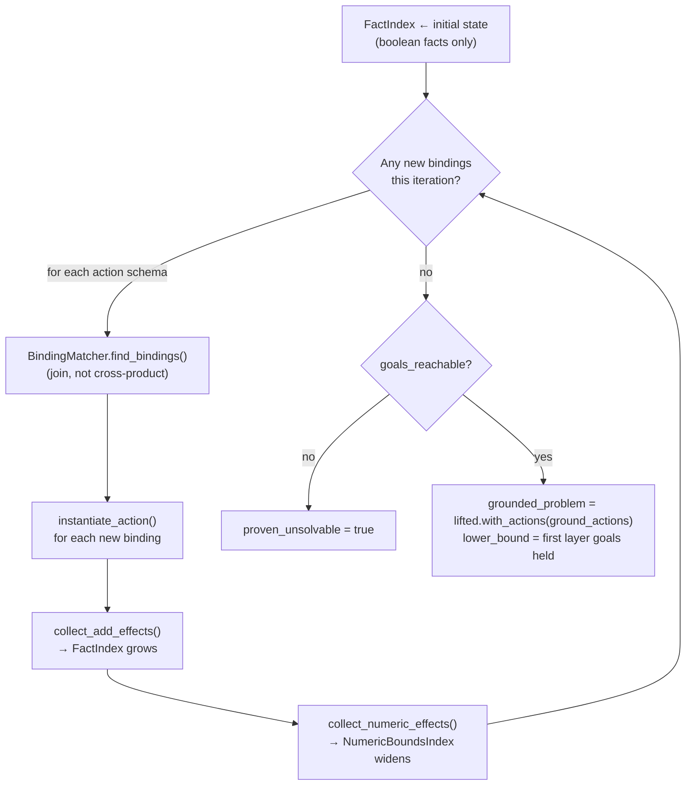

# Grounding

Grounding turns lifted (parametrized) actions like `drive(?v - vehicle,
?from - loc, ?to - loc)` into fully-instantiated ground actions like
`drive(truck1, depot, siteA)` — the form every downstream encoder needs,
since the SAT/SMT encoding has no notion of a variable ranging over
objects. `ReachabilityGrounder` (`grounding/reachability_grounder.{hpp,cpp}`,
driven by `GroundingPass`) does this, but it does something more useful than
naive instantiation: it only produces the ground actions that are actually
*reachable* from the initial state, and it gets a plan-length lower bound
and an unsolvability check for free in the same pass.

By the time grounding runs, the two canonicalization passes ahead of it
(`IntParameterInstantiationPass`, `QuantifierExpansionPass`) have already
compiled away integer action parameters and every quantifier / `forall`-effect,
so the grounder only ever sees ordinary object parameters over quantifier-free
actions — it never has to reason about integer parameters or nested quantifiers
(see [`preprocessing-and-strategy.md`](preprocessing-and-strategy.md)).

## Why not just enumerate every combination

The naive approach — for each action schema, try every combination of
objects consistent with parameter types — is a cross product:
`drive(?v, ?from, ?to)` over 100 vehicles and 100 locations is
100 × 100 × 100 = 1,000,000 candidate instantiations, the overwhelming
majority of which will never be reachable from the initial state (most
vehicles never visit most locations). `ReachabilityGrounder` instead
computes reachability and grounding *together*, as one **delete-relaxation**
fixpoint — "delete relaxation" meaning delete effects are ignored, so facts
only ever accumulate and reachability becomes a cheap monotone computation
rather than a search: start from the initial state's facts, ground only the action
instances whose preconditions are already satisfied, apply their effects to
grow the fact set, and repeat until nothing new is reachable.

## The core algorithm



Three parallel indices track reachability for the three kinds of fluent a
PDDL/UP problem can have — a boolean predicate, an object-valued fluent, or
a numeric fluent — because each needs different reachability semantics:

- **`FactIndex`** — the set of ground boolean facts known reachable, e.g.
  `at(truck1, depot)`. Indexed by fluent schema ID for O(1) lookup of "all
  known tuples for this predicate," which is exactly what the join needs.
- **`ObjectFluentIndex`** — for object-valued fluents (e.g.
  `location(rover0) = waypoint3`), the *set* of values ever reachable per
  ground instance — under delete-relaxation values only accumulate, they're
  never retracted, even though a real plan would only ever have one value
  at a time.
- **`NumericBoundsIndex`** — an `[lower, upper]` `Interval` (the same
  `Interval` type used throughout preprocessing, see
  [`relaxed-planning-graph.md`](relaxed-planning-graph.md)) per ground
  numeric fluent, updated by convex union as effects fire, with
  *directional widening*: after a fluent's bound has expanded a few times
  in a row on the same side, that side snaps to ±infinity so the fixpoint
  is guaranteed to terminate even for effects like `fuel += fuel * 0.1`
  that would otherwise creep upward forever.

Numeric preconditions and effects are otherwise **skipped for
reachability**: a numeric condition is assumed satisfiable unless the
numeric-bounds check (see below) can prove it can't be, which is the
standard delete-relaxation over-approximation — it can only make the
grounder keep actions it doesn't strictly need, never drop one it does.

## The join, not the cross product: `BindingMatcher`

`BindingMatcher::find_bindings()` is what makes this feasible at scale. It
treats matching a precondition against the `FactIndex` like a database
join rather than nested loops over every object:

1. **Extract atoms** — pull every boolean fluent application out of the
   precondition tree (`at(?v, ?from)`, `road(?from, ?to)`, ...), tagging
   each with which of its argument positions are action parameters versus
   constants, and whether it's negated.
2. **Order by selectivity** — process the atom with the fewest matching
   `FactIndex` tuples per newly-bound parameter first, so partial bindings
   are pruned as early as possible.
3. **Extend incrementally** — starting from one empty binding, for each
   atom in turn, look up its matching tuples and extend every
   still-alive partial binding; bindings that can't be extended (no
   matching tuple, or a type mismatch) are simply dropped.
4. **Fill unbound parameters** — any parameter that never appeared in a
   boolean precondition atom (only in a numeric condition or an effect) is
   filled by a small Cartesian product over just *those* parameters, not
   all of them.
5. **Post-filter** — equality/inequality constraints between parameters,
   negated atoms (must *not* be in the `FactIndex`), and object-fluent
   equality patterns (`(= (location ?r) ?p)`) are checked last, against
   the surviving bindings only.

### Worked example

Two vehicles, `truck1` and `truck2`; three locations, `depot`, `siteA`,
`siteB`. Static fact `road` never changes (no action has it as an effect).
One action:

```
action drive(?v - vehicle, ?from - loc, ?to - loc)
  precondition: (at ?v ?from) AND (road ?from ?to)
  effect: not (at ?v ?from), (at ?v ?to)
initial state: (at truck1 depot), (road depot siteA), (road siteA siteB)
goal: (at truck1 siteB)
```

Naive grounding would try all `2 × 3 × 3 = 18` `(vehicle, loc, loc)`
combinations. The fixpoint instead runs:

| Iteration | `FactIndex` before | New bindings found | Ground action added |
|---|---|---|---|
| 1 | `{at(truck1,depot), road(depot,siteA), road(siteA,siteB)}` | `{v=truck1, from=depot, to=siteA}` (join: `at`'s one tuple extended by `road`'s matching tuple) | `drive(truck1, depot, siteA)` |
| 2 | `+ at(truck1,siteA)` | `{v=truck1, from=siteA, to=siteB}` | `drive(truck1, siteA, siteB)` |
| 3 | `+ at(truck1,siteB)` | none (no `road` tuple starts at `siteB`) | — fixpoint |

`truck2` never appears in *any* binding — it has no `at(truck2, ...)` fact
to join against, ever — so the grounder never even considers
`drive(truck2, *, *)`, let alone has to prune it afterward. Two ground
actions come out, not eighteen. The goal `at(truck1, siteB)` first appears
in the `FactIndex` after iteration 2, so `lower_bound = 2` and
`proven_unsolvable = false`.

## Numeric pruning is provisional, boolean facts aren't

One asymmetry worth knowing if you touch this code: a binding rejected
because its precondition's numeric part is *provably* unsatisfiable against
the current `NumericBoundsIndex` is **not** permanently marked seen — it's
retried every iteration, because a later action might still widen the
relevant bound (e.g. a `refuel` action increasing `fuel`) and make it
satisfiable. Boolean-only bindings, once accepted, go into a permanent
`seen_bindings` set and are never reconsidered — boolean facts only
accumulate, so a binding that matched once will always match. The numeric
bounds fixpoint additionally re-applies every already-accepted ground
action's numeric effects each iteration until *those* stabilize too, since
numeric effects aren't idempotent (an increase whose delta itself widened
needs to be re-applied).

## What this grounder is *not*

`ReachabilityGrounder`'s own fixpoint gives a boolean-fact-reachability
lower bound and an unsolvability check as a side effect of grounding, but
it is deliberately coarse — one flat set of "ever reachable" facts and
interval bounds, not a genuine layer-by-layer graph. The finer-grained
analysis used later in the pipeline for tighter bounds, goal-relevance
pruning, and achiever tracking is a separate structure,
`NumericRelaxedPlanningGraph`, built fresh (over the now-ground problem)
by `ActionPruningPass` — see
[`relaxed-planning-graph.md`](relaxed-planning-graph.md).

## Try it

The worked example's iteration table, on a real domain:

```bash
rantanplan -d pddl/small-test/zenotravel/domain.pddl \
           -p pddl/small-test/zenotravel/instances/pfile13.pddl \
           --strategy elsc -v 2>&1 | grep Grounding
```

```
[Grounding     ]  initial facts: 13  |  action schemas: 5
[Grounding I1  ]  new actions: 19   |  new facts: 5   |  total facts: 18   |  numeric pruned: 46
[Grounding I2  ]  new actions: 178  |  new facts: 56  |  total facts: 74   |  numeric pruned: 12
[Grounding I3  ]  new actions: 328  |  new facts: 34  |  total facts: 108  |  numeric pruned: 12
[Grounding I4  ]  new actions: 42   |  new facts: 0   |  total facts: 108  |  numeric pruned: 12
[Grounding I5  ]  new actions: 0    |  new facts: 0   |  total facts: 108  |  numeric pruned: 12
[Grounding     ]  fixpoint: 5 iterations  |  actions: 567  |  reachable facts: 108
[Grounding     ]  lower bound: 3
```

Each `I` line is one round of the flowchart above: the join finds new
bindings, their add-effects grow the `FactIndex`, and the loop repeats
until iteration 5 finds nothing new. The `numeric pruned` column is the
provisional numeric rejection at work — 46 bindings rejected in iteration 1
get retried (and mostly accepted) once refueling widens the fuel bounds.
For contrast, the full typed cross product for these 5 schemas is 579
instances (which is what `--up-grounding`, Python-side UP grounding,
produces): zenotravel is small and dense, so reachability only shaves it
to 567 — on sparser domains (mprime: 20% activation) the gap is the whole
point.
