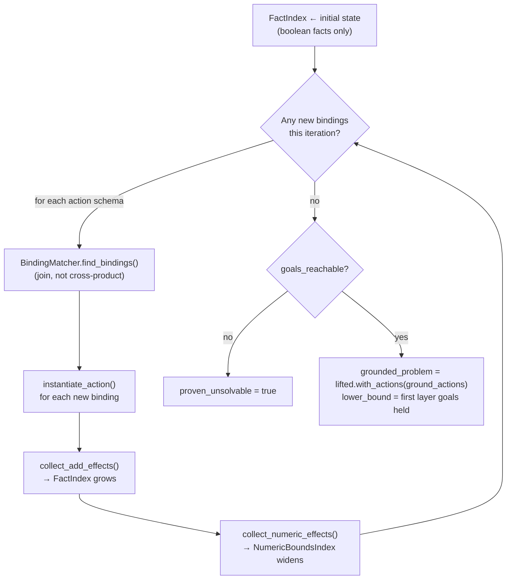

# Grounding

Grounding turns lifted (parametrized) actions like `drive(?v - vehicle,
?from - loc, ?to - loc)` into fully-instantiated ground actions like
`drive(truck1, depot, siteA)` — the form every downstream encoder needs,
since the SAT/SMT encoding has no notion of a variable ranging over
objects. `ReachabilityGrounder` (`grounding/reachability_grounder.{hpp,cpp}`,
driven by `GroundingPass`) does this, but it does something more useful than
naive instantiation: it only produces the ground actions that are actually
*reachable* from the initial state, and it gets a plan-length lower bound
and an unsolvability check for free in the same pass.

By the time grounding runs, the canonicalization passes ahead of it
(`IntParameterInstantiationPass`, `QuantifierExpansionPass`,
`TermResolutionPass`, and — when the problem has array or set fluents —
`ArrayLoweringPass` / `SetLoweringPass`) have already compiled away integer
action parameters, every quantifier / `forall`-effect, every nested fluent
term and state-dependent index, and every structured access, so the grounder
only ever sees ordinary object parameters over quantifier-free, array-free
actions — it never has to reason about integer parameters, nested
quantifiers, or array structure (see
[`preprocessing-and-strategy.md`](preprocessing-and-strategy.md)). Term
resolution is described in
[Term resolution](#term-resolution-before-the-lowerings) and the array
lowering in [Array lowering](#array-lowering-before-grounding) below.

## Term resolution (before the lowerings)

FSTRIPS-style **nested fluent terms** — a fluent application used as an
*argument* of another fluent application, `connections(card_at[r][c], N)` or
`safe(loc(r))` — violate the shape every post-grounding consumer assumes
(a ground atom's arguments are object constants). `TermResolutionPass`
(`passes/term_resolution_pass.{hpp,cpp}`) restores that shape before
grounding, by two mechanisms:

- **Ghost parameters** (object-valued inner terms). Each distinct inner term
  in an action gets a fresh action parameter of its value type, appended
  after the declared signature and pinned by an equality precondition:
  `move_north(r, c)` with `connections(card_at[r][c], N)` becomes
  `move_north(r, c, ?g: Card)` with `card_at[r][c] = ?g ∧ connections(?g, N)`.
  The equality is exactly the object-fluent pattern the grounder's
  `BindingMatcher` joins, so `?g` is enumerated only over the cell's
  *reachable* values — not the whole type — and every downstream pass,
  analysis, and encoder sees stock shapes. Ground instances carry ghost
  values as trailing parameters, which the Python plan mapping drops (it
  zips against the lifted UP signature). Inner terms resolve
  innermost-first, so `f(g(h(x)))` chains ghost equalities. Object fluents
  are total under CWA (an uninitialised one is a hard error), so a ghost
  never introduces undefinedness.

- **Per-position instance splitting** (state-dependent indices, `a[ptr]` /
  `a[b[i]]`). An int-typed ghost has no grounder join to enumerate it, so
  the action is instead split: one instance per position `p` of the indexed
  dimension, with precondition `e = p` and the index replaced by the
  constant — which the array lowering below then handles as an ordinary
  constant-index access — plus one **boundary instance** (`e < 0 ∨ e ≥ n`,
  index replaced by the statically out-of-bounds constant `n`) that the
  array lowering resolves per the undefinedness semantics at compile time.

**Undefinedness (⊥) semantics** — the non-strict (permissive) reading of
Davesa et al. Def. 9, stated once and cited by every lowering:

1. *Statically decidable* ⊥ (constant indices): ⊥ propagates strictly
   through every operator except OR and COUNT; a ⊥ *conditional* effect is
   dropped (the action stays applicable — the guarded one-past-the-end
   write); a ⊥ *unconditional* effect or a ⊥-collapsed precondition
   discards the instance. Goals, invariants, and the initial state are
   strict: ⊥ there is a hard modelling error.
2. *Runtime* definedness (state-dependent indices): re-stated as
   conditions via the split above — an out-of-bounds pointer state
   satisfies no in-range instance ("read of ⊥ ⇒ inapplicable" as an
   ordinary precondition), while the boundary instance restores the
   non-strict cases (OR absorption, dropped guarded writes) by reducing
   them to statically decidable ones. No runtime ⊥ checks exist anywhere
   in the encoding.
3. A nested object-valued term in a *goal* is expanded by value-universe
   disjunction — `φ` becomes `⋁_o (t = o ∧ φ[t → o])`, the Exists-rewrite
   done mechanically (sound and exhaustive because object fluents are
   total). State-dependent indices in goals, and any nesting in
   invariants/initial state, are rejected with a rewrite hint, since
   nothing there can host a split.

Two shapes are resolved by the pass but currently unreachable through the
UP API, which refuses fluent-containing effect *targets*
(`loc(owner(x)) := l`, `a[ptr] := v`); tests pin the upstream behaviour so
the coverage gets added if the fork starts accepting them.

## Array lowering (before grounding)

Some problems carry **array fluents** — fixed-size, array-valued state
variables from the high-level modelling language (they have no PDDL surface
syntax; they arrive through Unified Planning's `ARRAY_FLUENTS` kind). A fluent
`board : int[3]` is one variable holding three integers; `grid : int[2][3]` is
a 2-D array. An access is the structured operator `ARRAY_INDEX(array, index)`,
nested per dimension (`grid[r][c]`).

RantanPlan does **not** carry array structure into the encoder. `ArrayLoweringPass`
(`passes/array_lowering_pass.{hpp,cpp}`, implementation in
`grounding/array_lowering.{hpp,cpp}`) runs immediately before the grounder and
compiles arrays into ordinary scalar fluents:

- Each array fluent becomes **one scalar cell fluent per defined position**,
  minted in row-major order (`board` → `board[0]`, `board[1]`, `board[2]`);
  the array fluent schema itself is dropped. Positions listed as `undefined`
  are never minted.
- Each **constant-index access** `a[c]` — in a precondition, effect target,
  effect value, cost, goal, invariant, or initial-state entry — is rewritten
  to its cell (rules L1/L3). A cell of an array whose element type is bounded
  (`int[0,9]`) inherits those bounds and the array's scalar default.

Why lower *before* grounding, on the lifted problem? Because by that point the
two earlier canonicalization passes have turned every index into ground
constant arithmetic (object-parameterised array fluents like `grid(P)[r][c]`
are rejected in Phase 1, so no index depends on an object parameter), and
constant index arithmetic folds — `a[1-1]` becomes `a[0]`. The pass ends by
asserting no `ARRAY_INDEX` node survives, so nothing downstream ever has to
know arrays existed.

**Strict-⊥ inapplicability.** An out-of-bounds or undefined-position access
*inside an action* discards that ground instance — exactly as int-parameter
instantiation discards an infeasible binding; after instantiation a literal
`a[7]` and an `a[i]` folded to `i = 7` are indistinguishable. The same access
in a goal or the initial state is a hard error (the model is ill-formed). An
intra-action collision where two effects fold onto the *same* cell also
discards the instance; if *every* instance of a schema collides, that's an unconditionally
broken model and a hard error.

**Why this needs no downstream changes.** A cell is an ordinary scalar
grounded fluent, so with constant indices the lowered problem is bit-for-bit
what a hand-written scalar model would produce — every pass, analysis, and
encoder is already sound for it. (The one shape arrays newly make common,
`a[1] := a[0]` — a *non-constant* boolean/expression assign — needed the
reachability and mutex analyses to treat such an assign as a *may-add* rather
than "neither add nor delete"; that fix is general, not array-specific.)
Whole-array operations (`eq(a,b)`, whole-array assignment) and array constants
outside the initial state are rejected in Phase 1.

> **Phase 2 (not yet implemented)** will keep a genuine decision/quantified
> index *symbolic* — a symbolic read becomes a bounded read-result variable
> plus an element constraint, a symbolic write becomes per-cell conditional
> effects — and, because a symbolic access can touch any cell, the lowering
> will then have to interleave with the reachability fixpoint below rather
> than run entirely ahead of it.

## Set lowering (before grounding)

Other problems carry **set fluents** — set-valued state variables from the
high-level language (again no PDDL surface syntax; they arrive through Unified
Planning's `SET_FLUENTS` kind). A fluent `pin : set{Package}` holds a subset of
the packages; operations are the structured `SET_*` family — `member(x, S)`,
`subseteq`/`disjoint`, `cardinality(S)`, and the set-valued `add`/`remove`/
`union`/`intersect`/`difference`/constant — and they compose arbitrarily
(`cardinality(union(pin(t1), pin(t2)))`).

As with arrays, RantanPlan does **not** carry set structure into the encoder.
`SetLoweringPass` (`passes/set_lowering_pass.{hpp,cpp}`) runs adjacent to array
lowering, before the grounder, and compiles sets into **boolean membership
cells** using the *characteristic-function* encoding:

- Each set fluent `s(params): set{T}` becomes a boolean fluent
  `s(?e: T, params): bool` — the element type prepended to the signature — and
  the set fluent schema is dropped. The grounder then grounds the new element
  parameter like any object-parameterised predicate, so a set over `n` packages
  becomes `n` ordinary membership atoms per instance.
- Every operation lowers through **one compositional membership formula**
  `⟦S⟧_e` ("is element `e` in set expression `S`?"): a fluent → the cell atom
  `s(e, args)`; `add(x, S)` → `⟦S⟧_e ∨ (e = x)`; `remove` → `∧ ¬(e = x)`;
  `union`/`intersect`/`difference` → `∨`/`∧`/`∧¬` of the operands. `member(x, S)`
  in a condition is `⟦S⟧_x`; `subseteq`/`disjoint`/set-equality expand to a
  conjunction over the element domain; **`cardinality(S)`** becomes the existing
  `COUNT` operator over the membership formulas — so `|S| < 2` is a pseudo-
  boolean at-most-1 and `|S1| < |S2|` a sum comparison, with no helper state
  fluent to maintain.
- **Effects** split by RHS shape: an add/remove *chain onto the target set
  itself* (`s := add(x, s)`) lowers to a single-cell write `s(x, args) := true`
  (no enumeration — this keeps `load`-style actions at cell granularity for the
  frame and interference); a *monotone union onto the target* (`s := s ∪ Q`) to
  one per-element conditional add `⟦Q⟧_e → s(e, args) := true`; anything else
  (intersect/difference, a third-set union, `s := {}`, `s := {c}`) to one
  expression-valued boolean assign `s(e, args) := ⟦S⟧_e` per element. An initial
  `SET_CONSTANT` value becomes the true membership cells, CWA supplying the
  false rest.

The pass ends by asserting no `SET_*` node (nor set-typed state variable)
survives. **Why this needs no downstream changes:** membership cells are
ordinary boolean grounded fluents and the effects are the same shapes the array
work already taught every pass to handle, so mutexes, invariants, the RPG,
achievers, and both interference analyses digest them unchanged — and
exists-step parallelism falls out at *cell* granularity (two `add`s of different
elements co-fire; an `add` and a `remove` of the same element correctly
serialise). User-type elements only in v1; int and nested-set elements, and
set-typed action parameters, are rejected at conversion.

## Why not just enumerate every combination

The naive approach — for each action schema, try every combination of
objects consistent with parameter types — is a cross product:
`drive(?v, ?from, ?to)` over 100 vehicles and 100 locations is
100 × 100 × 100 = 1,000,000 candidate instantiations, the overwhelming
majority of which will never be reachable from the initial state (most
vehicles never visit most locations). `ReachabilityGrounder` instead
computes reachability and grounding *together*, as one **delete-relaxation**
fixpoint — "delete relaxation" meaning delete effects are ignored, so facts
only ever accumulate and reachability becomes a cheap monotone computation
rather than a search: start from the initial state's facts, ground only the action
instances whose preconditions are already satisfied, apply their effects to
grow the fact set, and repeat until nothing new is reachable.

## The core algorithm



Three parallel indices track reachability for the three kinds of fluent a
PDDL/UP problem can have — a boolean predicate, an object-valued fluent, or
a numeric fluent — because each needs different reachability semantics:

- **`FactIndex`** — the set of ground boolean facts known reachable, e.g.
  `at(truck1, depot)`. Indexed by fluent schema ID for O(1) lookup of "all
  known tuples for this predicate," which is exactly what the join needs.
- **`ObjectFluentIndex`** — for object-valued fluents (e.g.
  `location(rover0) = waypoint3`), the *set* of values ever reachable per
  ground instance — under delete-relaxation values only accumulate, they're
  never retracted, even though a real plan would only ever have one value
  at a time.
- **`NumericBoundsIndex`** — an `[lower, upper]` `Interval` (the same
  `Interval` type used throughout preprocessing, see
  [`relaxed-planning-graph.md`](relaxed-planning-graph.md)) per ground
  numeric fluent, updated by convex union as effects fire, with
  *directional widening*: after a fluent's bound has expanded a few times
  in a row on the same side, that side snaps to ±infinity so the fixpoint
  is guaranteed to terminate even for effects like `fuel += fuel * 0.1`
  that would otherwise creep upward forever.

Numeric preconditions and effects are otherwise **skipped for
reachability**: a numeric condition is assumed satisfiable unless the
numeric-bounds check (see below) can prove it can't be, which is the
standard delete-relaxation over-approximation — it can only make the
grounder keep actions it doesn't strictly need, never drop one it does.

## The join, not the cross product: `BindingMatcher`

`BindingMatcher::find_bindings()` is what makes this feasible at scale. It
treats matching a precondition against the `FactIndex` like a database
join rather than nested loops over every object:

1. **Extract atoms** — pull every boolean fluent application out of the
   precondition tree (`at(?v, ?from)`, `road(?from, ?to)`, ...), tagging
   each with which of its argument positions are action parameters versus
   constants, and whether it's negated.
2. **Order by selectivity** — process the atom with the fewest matching
   `FactIndex` tuples per newly-bound parameter first, so partial bindings
   are pruned as early as possible.
3. **Extend incrementally** — starting from one empty binding, for each
   atom in turn, look up its matching tuples and extend every
   still-alive partial binding; bindings that can't be extended (no
   matching tuple, or a type mismatch) are simply dropped.
4. **Fill unbound parameters** — any parameter that never appeared in a
   boolean precondition atom (only in a numeric condition or an effect) is
   filled by a small Cartesian product over just *those* parameters, not
   all of them.
5. **Post-filter** — equality/inequality constraints between parameters,
   negated atoms (must *not* be in the `FactIndex`), and object-fluent
   equality patterns (`(= (location ?r) ?p)`) are checked last, against
   the surviving bindings only.

### Worked example

Two vehicles, `truck1` and `truck2`; three locations, `depot`, `siteA`,
`siteB`. Static fact `road` never changes (no action has it as an effect).
One action:

```
action drive(?v - vehicle, ?from - loc, ?to - loc)
  precondition: (at ?v ?from) AND (road ?from ?to)
  effect: not (at ?v ?from), (at ?v ?to)
initial state: (at truck1 depot), (road depot siteA), (road siteA siteB)
goal: (at truck1 siteB)
```

Naive grounding would try all `2 × 3 × 3 = 18` `(vehicle, loc, loc)`
combinations. The fixpoint instead runs:

| Iteration | `FactIndex` before | New bindings found | Ground action added |
|---|---|---|---|
| 1 | `{at(truck1,depot), road(depot,siteA), road(siteA,siteB)}` | `{v=truck1, from=depot, to=siteA}` (join: `at`'s one tuple extended by `road`'s matching tuple) | `drive(truck1, depot, siteA)` |
| 2 | `+ at(truck1,siteA)` | `{v=truck1, from=siteA, to=siteB}` | `drive(truck1, siteA, siteB)` |
| 3 | `+ at(truck1,siteB)` | none (no `road` tuple starts at `siteB`) | — fixpoint |

`truck2` never appears in *any* binding — it has no `at(truck2, ...)` fact
to join against, ever — so the grounder never even considers
`drive(truck2, *, *)`, let alone has to prune it afterward. Two ground
actions come out, not eighteen. The goal `at(truck1, siteB)` first appears
in the `FactIndex` after iteration 2, so `lower_bound = 2` and
`proven_unsolvable = false`.

## Numeric pruning is provisional, boolean facts aren't

One asymmetry worth knowing if you touch this code: a binding rejected
because its precondition's numeric part is *provably* unsatisfiable against
the current `NumericBoundsIndex` is **not** permanently marked seen — it's
retried every iteration, because a later action might still widen the
relevant bound (e.g. a `refuel` action increasing `fuel`) and make it
satisfiable. Boolean-only bindings, once accepted, go into a permanent
`seen_bindings` set and are never reconsidered — boolean facts only
accumulate, so a binding that matched once will always match. The numeric
bounds fixpoint additionally re-applies every already-accepted ground
action's numeric effects each iteration until *those* stabilize too, since
numeric effects aren't idempotent (an increase whose delta itself widened
needs to be re-applied).

## What this grounder is *not*

`ReachabilityGrounder`'s own fixpoint gives a boolean-fact-reachability
lower bound and an unsolvability check as a side effect of grounding, but
it is deliberately coarse — one flat set of "ever reachable" facts and
interval bounds, not a genuine layer-by-layer graph. The finer-grained
analysis used later in the pipeline for tighter bounds, goal-relevance
pruning, and achiever tracking is a separate structure,
`NumericRelaxedPlanningGraph`, built fresh (over the now-ground problem)
by `ActionPruningPass` — see
[`relaxed-planning-graph.md`](relaxed-planning-graph.md).

## Try it

The worked example's iteration table, on a real domain:

```bash
rantanplan -d pddl/small-test/zenotravel/domain.pddl \
           -p pddl/small-test/zenotravel/instances/pfile13.pddl \
           --strategy els -v 2>&1 | grep Grounding
```

```
[Grounding     ]  initial facts: 13  |  action schemas: 5
[Grounding I1  ]  new actions: 19   |  new facts: 5   |  total facts: 18   |  numeric pruned: 46
[Grounding I2  ]  new actions: 178  |  new facts: 56  |  total facts: 74   |  numeric pruned: 12
[Grounding I3  ]  new actions: 328  |  new facts: 34  |  total facts: 108  |  numeric pruned: 12
[Grounding I4  ]  new actions: 42   |  new facts: 0   |  total facts: 108  |  numeric pruned: 12
[Grounding I5  ]  new actions: 0    |  new facts: 0   |  total facts: 108  |  numeric pruned: 12
[Grounding     ]  fixpoint: 5 iterations  |  actions: 567  |  reachable facts: 108
[Grounding     ]  lower bound: 3
```

Each `I` line is one round of the flowchart above: the join finds new
bindings, their add-effects grow the `FactIndex`, and the loop repeats
until iteration 5 finds nothing new. The `numeric pruned` column is the
provisional numeric rejection at work — 46 bindings rejected in iteration 1
get retried (and mostly accepted) once refueling widens the fuel bounds.
For contrast, the full typed cross product for these 5 schemas is 579
instances (which is what `--up-grounding`, Python-side UP grounding,
produces): zenotravel is small and dense, so reachability only shaves it
to 567 — on sparser domains (mprime: 20% activation) the gap is the whole
point.
