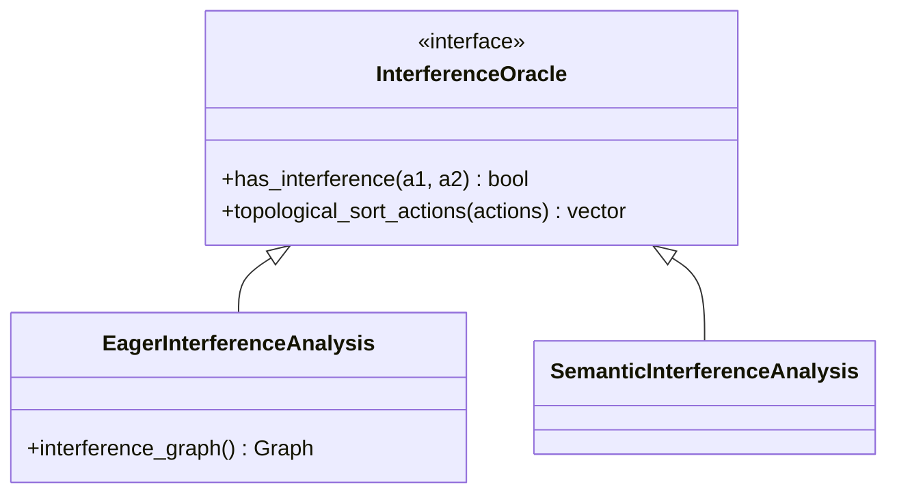
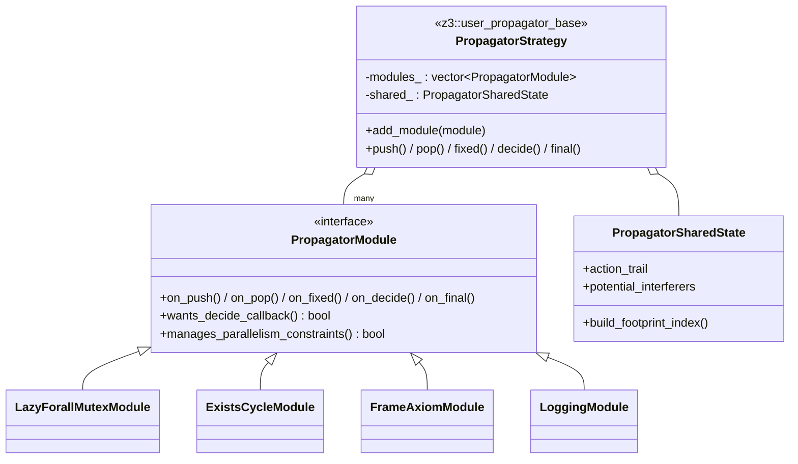

# Interference analysis and propagators

## What interference means here

Two actions **interfere** if executing them "together" (in the same
parallel step) would be unsound — one's effects would clobber the other's
precondition or effect, or otherwise change what the other observes.
Sequential semantics doesn't need this at all (one action per timestep, by
definition nothing runs alongside anything else); ∀-step and ∃-step both
need to know, for pairs or groups of actions, whether they can safely share
a timestep — see
[`architecture-overview.md`](architecture-overview.md) (see "Why three
parallelism semantics") for why those semantics exist at all.

**Interference is directional.** `has_interference(A, B)` asks whether
executing `A` would prevent `B` from executing correctly, or corrupt what
`B` reads or writes — not whether the pair interferes symmetrically.
`has_interference(A, B) != has_interference(B, A)` in general. This shows
up again in `topological_sort_actions()`, which returns actions in
*execution order*, not standard topological order: if `A` interferes with
`B`, `B` must appear before `A` in the result, because executing in that
order means `A`'s effects land after `B` has already read/acted on the
pre-`A` state.

## One interface, two implementations

`analysis/interference_analysis.hpp` defines a single pure interface,
**`InterferenceOracle`**: `has_interference()` (by `Action` or by node ID)
and `topological_sort_actions()`, nothing else. Consumers (propagator
modules, plan extraction) stay ignorant of how the answers are computed.
Exactly two implementations exist, chosen by `InterferenceKind` in
`StrategyFactory::create_interference`:

- **`EagerInterferenceAnalysis`** (`analysis/eager_interference_analysis.hpp`)
  — eager syntactic: at construction it materializes the syntactic check
  into a complete interference `Graph` (O(n²) pairwise checks up front,
  O(1) lookups per query), and exposes that graph via a concrete
  `interference_graph()` accessor that is *not* part of the interface.
- **`SemanticInterferenceAnalysis`**
  (`analysis/semantic_interference_analysis.hpp`) — lazy semantic: computes
  each pair on demand through `SemanticInterferencePredicate` and caches
  the boolean result.

Whole-graph access is deliberately *outside* the interface: the one
consumer that needs the whole graph — the encoded ∃-step mutexes of
strategy `e` (`ExistsSemantics::encode_parallelism`) — takes a
`const EagerInterferenceAnalysis*` directly, so handing it a lazy analyzer
(which has no graph to give back) is a compile error, not a runtime throw.
This is the same "make illegal states unrepresentable" instinct mentioned in
[`architecture-overview.md`](architecture-overview.md) (see "Design philosophy").

The syntactic check itself lives in a standalone value type,
**`SyntacticInterference`** (`analysis/syntactic_interference.{hpp,cpp}`):
per-action fluent read/write sets computed once at construction, plus the
directional `interferes()` set-intersection check. It sits outside the
oracle hierarchy on purpose and has two consumers —
`EagerInterferenceAnalysis` materializes it into the graph, and
`AbstractSuffixEncoder` owns its own instance for the axiom-6 deferral
sets, which need a cheap sound overapproximation regardless of how precise
the strategy's own interference oracle is.

## Syntactic vs semantic

`InterferenceKind` has three values — `None` (sequential only),
`EagerSyntactic`, and `LazySemantic`. The eager/lazy pairing is not a free
axis: the syntactic check is cheap enough to run eagerly over all pairs,
while the semantic check is only worth paying per query, so each
computation style comes with its natural evaluation time.

**Syntactic** interference is a sound *overapproximation*: it intersects
precondition/effect fluent sets (positive/negative boolean, numeric,
conditional-effect fluents, numeric-effect RHS dependencies — see
`SyntacticInterference::ActionAnalysis` for the exact sets collected per
action) and may report interference for pairs that don't actually conflict
semantically, but never misses a pair that does. It's cheap: no Z3 calls.

**Semantic** interference asks Z3 directly whether the pair can genuinely
conflict, which is precise but costlier per query. The lazy analyzer trades
build-once cost for per-query cost — worthwhile when the search only ever
asks about a subset of all pairs (`els`, `els-fp`, and `fls` all use lazy
semantic interference).

**The semantic definition lives once.** The analyzer is a thin
materializer over a single `SemanticInterferencePredicate`
(`analysis/semantic_interference_predicate.{hpp,cpp}`), which owns the Z3
infrastructure and the actual affects-relation check (`affects_source`):
`check1` (can a1's effects falsify a2's precondition?) and `check2_source`
(do a1 and a2's effects fail to commute?). `SemanticInterferenceAnalysis`
just caches the per-pair boolean. **Change the semantic check in the
predicate, not in the wrapper.**
One subtlety worth flagging, because it was a real soundness
bug: `check2_source` compares the *parallel happening* σ_h against a serialization, and
σ_h must be the **function of compositions** (Bofill et al. 2016, Def 5) — compose
only the per-variable assignments, so a variable an effect merely *reads* (a
velocity fluent in `x += v·3`) stays at its pre-state value — *not* the
composition of whole-state functions, which would let one action's write flow into
the other's read and under-report interference on velocity/rate-style numeric
domains. See `docs/specs/exists-step-semantic-interference-soundness.md`.

**Example: where syntactic and semantic disagree.** Take two actions that
both increase the same numeric fluent: `refuel_a` does
`fuel(truck1) := fuel(truck1) + 5` and `refuel_b` does
`fuel(truck1) := fuel(truck1) + 3`. Syntactic analysis sees `fuel(truck1)`
in both actions' `numeric_effects` sets and — conservatively, without
reasoning about *what* the effects do — flags the pair as interfering: two
writers to the same fluent look unsafe to run in the same step. Semantic
analysis instead asks Z3 whether the two orderings actually differ:
`(fuel + 5) + 3 == (fuel + 3) + 5` is a tautology, so Z3 proves they commute
and reports no real interference. The difference has the most bite under ∀-step, where pairwise interference
blocks co-scheduling outright with no escape valve: syntactic interference
would permanently forbid `refuel_a` and `refuel_b` from ever sharing a
timestep, while semantic interference lets them run together freely. (Under
∃-step the gap is narrower — a merely-commuting pair like this one already
admits *some* execution order, so the cycle-detection propagator wouldn't
block it either way; semantic precision matters most there for pairs where
no order is obviously safe on paper but Z3 can still prove one is.) This is
the concrete payoff of paying Z3's per-query cost — more parallelism, hence
shorter plans, on exactly the pairs where the cheap check is too coarse.

## Propagators: one Z3 slot, many composable modules

Z3 allows exactly **one** `user_propagator_base` per solver. Rather than
writing one monolithic propagator per strategy, `PropagatorStrategy`
(`planners/propagators/propagator_strategy.hpp`) owns that one slot and
dispatches each Z3 callback (`push`, `pop`, `fixed`, `decide`, `final`) to
an ordered list of `PropagatorModule`s:

`PropagatorSharedState` holds what every module might need to read: the
action trail (which actions are fixed true, and at which decision level, for
`push`/`pop` bookkeeping), and a **footprint index** —
`potential_interferers`, a precomputed map from each action to the other
actions that share a fluent with it — built lazily once and shared
read-only, so modules don't each redo the same fluent-overlap scan. Each
module additionally keeps its own private trail for its own concern (e.g.
which edge literals it introduced), rather than polluting the shared state
with per-module bookkeeping.

**Conflict short-circuit**: when any module calls `module_conflict()`
(routed through `PropagatorStrategy` rather than Z3's API directly, so the
host can track it), the remaining modules are skipped for that callback
invocation. Propagations (unit implications via `module_propagate()`) do
*not* short-circuit — multiple modules can each propagate independently
within one callback.

**Example.** Say a strategy runs `{ExistsCycle, FrameAxiom}` together (like
`els-fp`). The solver fixes three action variables true at the same
timestep — `A`, `B`, `C` — where `A` interferes with `B`, `B` interferes
with `C`, and `C` interferes with `A`: a genuine 3-cycle, meaning no
execution order of the three is safe (each would need to come both before
and after another). `ExistsCycleModule::on_fixed()` runs its DFS over the
interference subgraph of currently-active actions, finds the cycle, and
calls `module_conflict({A, B, C})`. `PropagatorStrategy` sets
`conflict_raised_ = true` and returns without dispatching `on_fixed()` to
`FrameAxiomModule` for this callback — there is no point computing frame
axioms for a partial assignment Z3 is about to backtrack out of anyway.
Had `ExistsCycleModule` instead found only a safe partial order (no cycle),
it would call nothing, and `FrameAxiomModule::on_fixed()` would run
normally afterward.

`wants_decide_callback()` gates whether the (expensive) Z3 decide callback
gets registered at all — only modules that actually need `on_decide`
notifications should return `true`, since every module pays the cost of the
callback being registered if any one of them needs it.

### The module kinds

`PropagatorModuleKind` (`config/strategy_spec.hpp`) lists the composable
units: `ForallLazy` (`LazyForallMutexModule` — mutex-based blocking for
∀-step, used by `fls` and by the SDAC exists→forall downgrade),
`ExistsCycle` (cycle detection for ∃-step — a candidate parallel step is
valid iff its interference subgraph is acyclic; `els`, `els-fp`), and
`FrameAxiom` (supplies frame axioms lazily from the propagator instead of
the encoding, for the `els-fp` strategy). A `StrategySpec`'s `propagator`
field is a `std::set<PropagatorModuleKind>` — strategies can combine
modules (e.g. `els-fp` uses `{ExistsCycle, FrameAxiom}` together).

Both parallelism modules return `true` from
`manages_parallelism_constraints()`, which suppresses the encoder-side
`encode_parallelism` assertion (`BasePlanner::add_timestep_constraints`) —
with such a module attached, the parallelism semantics is enforced only
during search. ∀-step is *only* enforceable this way
(`ForallSemantics::encode_parallelism` throws;
`StrategyFactory::validate` requires every Forall spec to carry a
parallelism-managing module). The propagator-free exists strategy `e` is
the converse case: no module, so `ExistsSemantics::encode_parallelism`
asserts a-priori fixed-order/SCC mutexes derived from the eager
interference graph (the Rintanen et al. 2006 fixed-order approximation) —
which is why `validate` requires `EagerSyntactic` interference for
propagator-free exists specs.
