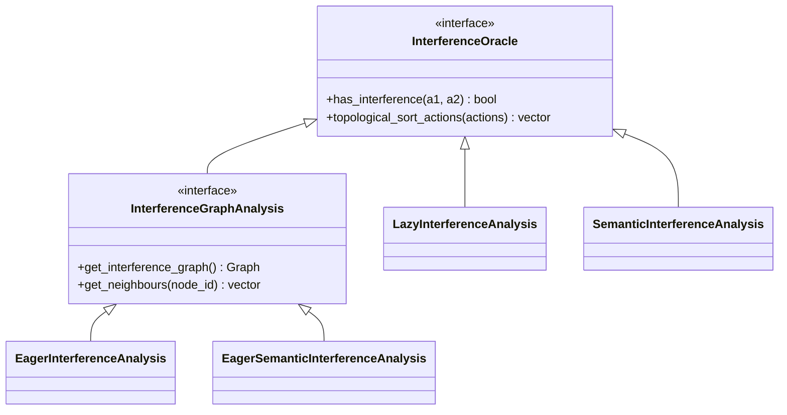
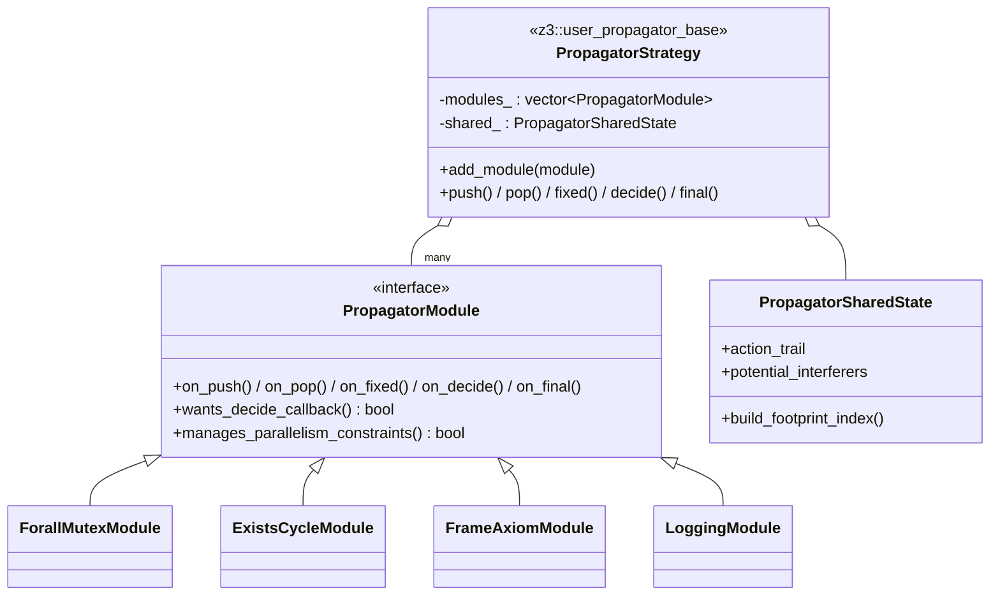

# Interference analysis and propagators

## What interference means here

Two actions **interfere** if executing them "together" (in the same
parallel step) would be unsound — one's effects would clobber the other's
precondition or effect, or otherwise change what the other observes.
Sequential semantics doesn't need this at all (one action per timestep, by
definition nothing runs alongside anything else); ∀-step and ∃-step both
need to know, for pairs or groups of actions, whether they can safely share
a timestep — see
[`architecture-overview.md`](architecture-overview.md) (see "Why three
parallelism semantics") for why those semantics exist at all.

**Interference is directional.** `has_interference(A, B)` asks whether
executing `A` would prevent `B` from executing correctly, or corrupt what
`B` reads or writes — not whether the pair interferes symmetrically.
`has_interference(A, B) != has_interference(B, A)` in general. This shows
up again in `topological_sort_actions()`, which returns actions in
*execution order*, not standard topological order: if `A` interferes with
`B`, `B` must appear before `A` in the result, because executing in that
order means `A`'s effects land after `B` has already read/acted on the
pre-`A` state.

## Two interfaces, not one, and it's a compile-time distinction

`analysis/interference_analysis.hpp` defines two interfaces:

- **`InterferenceOracle`** — the universal surface every implementation
  provides: `has_interference()` (by `Action` or by node ID) and
  `topological_sort_actions()`. Both eager and lazy analyzers satisfy this.
- **`InterferenceGraphAnalysis : InterferenceOracle`** — adds whole-graph
  access: `get_interference_graph()`, `get_neighbours()`,
  `output_interference_graph_dot()`. **Only eager implementations derive
  from this.**



Why split it at all: a consumer that needs neighbour lists or the whole
graph (the ∀-step encoding, the eager forall-mutex propagator module)
*cannot function* against a lazy analyzer — there's no graph to hand back.
An earlier version of this code had one interface with graph methods that
*threw at runtime* on lazy implementations, guarded by a runtime `is_lazy()`
flag consumers were supposed to check first. The split turns that into a
compile error: `ForallMutexModule` takes a `const InterferenceGraphAnalysis&`
at construction, so passing a lazy analyzer there simply doesn't compile.
This is the same "make illegal states unrepresentable" instinct mentioned in
[`architecture-overview.md`](architecture-overview.md) (see "Design philosophy").

## The eager/lazy × syntactic/semantic matrix

`InterferenceKind` has five values — `None` (sequential only) and a 2×2
matrix of eager/lazy crossed with syntactic/semantic:

| | Syntactic | Semantic |
|---|---|---|
| **Eager** | `EagerInterferenceAnalysis` — builds the full graph once, using fast fluent-set-intersection checks | `EagerSemanticInterferenceAnalysis` — builds the full graph once, using Z3-checked precision |
| **Lazy** | `LazyInterferenceAnalysis` — queries pairs on demand, syntactic checks | `SemanticInterferenceAnalysis` — queries pairs on demand, Z3-checked |

**Syntactic** interference is a sound *overapproximation*: it intersects
precondition/effect fluent sets (positive/negative boolean, numeric,
conditional-effect fluents, numeric-effect RHS dependencies — see
`InterferenceOracle::ActionAnalysis` for the exact sets collected per
action) and may report interference for pairs that don't actually conflict
semantically, but never misses a pair that does. It's cheap: no Z3 calls.

**Semantic** interference asks Z3 directly whether the pair can genuinely
conflict, which is precise but costlier per query. Lazy analyzers trade
build-once cost for per-query cost — worthwhile when the encoding only ever
asks about a subset of all pairs (e.g. `elsc`/`elsc-dt`, the chained-encoder
strategies, use lazy semantic interference).

One documented soundness-relevant scheduling detail: eager-semantic
interference is built *after* `Config::set_all_integer` runs on a problem
where static-fluent folding made costs constant, so its Z3 queries use `Int`
sorts rather than mixed sorts — this yields fewer spurious edges (still
sound, just more precise) than building it earlier in the pipeline would.

**The semantic definition lives once.** Both semantic analyzers are thin
materializers over a single `SemanticInterferencePredicate`
(`analysis/semantic_interference_predicate.{hpp,cpp}`), which owns the Z3
infrastructure and the actual affects-relation check: `check1` (can a1's effects
falsify a2's precondition?) and `check2` (do a1 and a2's effects fail to
commute?). The lazy `SemanticInterferenceAnalysis` caches per-pair results; the
eager `EagerSemanticInterferenceAnalysis` builds the whole graph then discards
the predicate's Z3 state. **Change the semantic check in the predicate, not in
either wrapper.** One subtlety worth flagging, because it was a real soundness
bug: `check2` compares the *parallel happening* σ_h against a serialization, and
σ_h must be the **function of compositions** (Bofill et al. 2016, Def 5) — compose
only the per-variable assignments, so a variable an effect merely *reads* (a
velocity fluent in `x += v·3`) stays at its pre-state value — *not* the
composition of whole-state functions, which would let one action's write flow into
the other's read and under-report interference on velocity/rate-style numeric
domains. See `docs/specs/exists-step-semantic-interference-soundness.md`.

**Example: where syntactic and semantic disagree.** Take two actions that
both increase the same numeric fluent: `refuel_a` does
`fuel(truck1) := fuel(truck1) + 5` and `refuel_b` does
`fuel(truck1) := fuel(truck1) + 3`. Syntactic analysis sees `fuel(truck1)`
in both actions' `numeric_effects` sets and — conservatively, without
reasoning about *what* the effects do — flags the pair as interfering: two
writers to the same fluent look unsafe to run in the same step. Semantic
analysis instead asks Z3 whether the two orderings actually differ:
`(fuel + 5) + 3 == (fuel + 3) + 5` is a tautology, so Z3 proves they commute
and reports no real interference. The difference has the most bite under ∀-step, where pairwise interference
blocks co-scheduling outright with no escape valve: syntactic interference
would permanently forbid `refuel_a` and `refuel_b` from ever sharing a
timestep, while semantic interference lets them run together freely. (Under
∃-step the gap is narrower — a merely-commuting pair like this one already
admits *some* execution order, so the cycle-detection propagator wouldn't
block it either way; semantic precision matters most there for pairs where
no order is obviously safe on paper but Z3 can still prove one is.) This is
the concrete payoff of paying Z3's per-query cost — more parallelism, hence
shorter plans, on exactly the pairs where the cheap check is too coarse.

## Propagators: one Z3 slot, many composable modules

Z3 allows exactly **one** `user_propagator_base` per solver. Rather than
writing one monolithic propagator per strategy, `PropagatorStrategy`
(`planners/propagators/propagator_strategy.hpp`) owns that one slot and
dispatches each Z3 callback (`push`, `pop`, `fixed`, `decide`, `final`) to
an ordered list of `PropagatorModule`s:



`PropagatorSharedState` holds what every module might need to read: the
action trail (which actions are fixed true, and at which decision level, for
`push`/`pop` bookkeeping), and a **footprint index** —
`potential_interferers`, a precomputed map from each action to the other
actions that share a fluent with it — built lazily once and shared
read-only, so modules don't each redo the same fluent-overlap scan. Each
module additionally keeps its own private trail for its own concern (e.g.
which edge literals it introduced), rather than polluting the shared state
with per-module bookkeeping.

**Conflict short-circuit**: when any module calls `module_conflict()`
(routed through `PropagatorStrategy` rather than Z3's API directly, so the
host can track it), the remaining modules are skipped for that callback
invocation. Propagations (unit implications via `module_propagate()`) do
*not* short-circuit — multiple modules can each propagate independently
within one callback.

**Example.** Say a strategy runs `{ExistsCycle, FrameAxiom}` together (like
`elsc-fp`). The solver fixes three action variables true at the same
timestep — `A`, `B`, `C` — where `A` interferes with `B`, `B` interferes
with `C`, and `C` interferes with `A`: a genuine 3-cycle, meaning no
execution order of the three is safe (each would need to come both before
and after another). `ExistsCycleModule::on_fixed()` runs its DFS over the
interference subgraph of currently-active actions, finds the cycle, and
calls `module_conflict({A, B, C})`. `PropagatorStrategy` sets
`conflict_raised_ = true` and returns without dispatching `on_fixed()` to
`FrameAxiomModule` for this callback — there is no point computing frame
axioms for a partial assignment Z3 is about to backtrack out of anyway.
Had `ExistsCycleModule` instead found only a safe partial order (no cycle),
it would call nothing, and `FrameAxiomModule::on_fixed()` would run
normally afterward.

`wants_decide_callback()` gates whether the (expensive) Z3 decide callback
gets registered at all — only modules that actually need `on_decide`
notifications should return `true`, since every module pays the cost of the
callback being registered if any one of them needs it.

## Try it

The syntactic/semantic tradeoff, quantified — run the same instance under
eager syntactic (`f`) and eager semantic (`fgs`) interference and compare
the graph stats:

```bash
rantanplan -d pddl/small-test/zenotravel/domain.pddl \
           -p pddl/small-test/zenotravel/instances/pfile13.pddl \
           --strategy f   --stats-file /tmp/stats_f.txt
rantanplan -d pddl/small-test/zenotravel/domain.pddl \
           -p pddl/small-test/zenotravel/instances/pfile13.pddl \
           --strategy fgs --stats-file /tmp/stats_fgs.txt
grep interference /tmp/stats_f.txt /tmp/stats_fgs.txt
```

On the same 531 ground actions, syntactic builds **85,032** interference
edges in **~27 ms**; semantic asks Z3 about every pair and builds
**21,852** edges in **~22 s** — roughly 800× the build cost for a graph
four times sparser. Every edge that disappeared is a pair like the
`refuel_a`/`refuel_b` example above: syntactically overlapping, semantically
commuting — and each one is a mutex clause ∀-step no longer has to emit,
which is the whole bet the semantic strategies make.

### The module kinds

`PropagatorModuleKind` (`config/strategy_spec.hpp`) lists the composable
units: `ForallEager` and `ForallLazy` (mutex-based blocking for ∀-step,
differing in whether they consume an eager or lazy interference graph),
`ExistsCycle` (cycle detection for ∃-step — a candidate parallel step is
valid iff its interference subgraph is acyclic), and `FrameAxiom` (supplies
frame axioms lazily from the propagator instead of the encoding, for the
`-fp` strategies). A `StrategySpec`'s `propagator` field is a
`std::set<PropagatorModuleKind>` — strategies can combine modules (e.g.
`elsc-fp` uses `{ExistsCycle, FrameAxiom}` together).

The `-fp` family adds `FrameAxiom` to an existing strategy and changes
nothing else, so each one pairs with a baseline for ablation: `e-fp` with
`e` (eager syntactic interference), `els-fp` with `els` (lazy semantic), and
`elsc-fp` with `elsc` (lazy semantic, chained encoder). `StrategyFactory`
calls `encoder.set_lazy_frames(true)` whenever `FrameAxiom` is present, which
makes `GroundedEncoder::encode_frames()` return `true` and hands all frame
reasoning to the module.

### What the propagators report

Every module writes its counters in `cleanup()`, which the planners call on
all exit paths, so `--stats-file` captures them for solved, unsolved and
horizon-exhausted runs alike. `PropagatorStrategy::cleanup()` adds
dispatcher-level numbers first:

| Key | Meaning |
| --- | --- |
| `propagator.fixed_calls`, `.final_calls`, `.decide_calls` | Z3 callback counts (all modules) |
| `propagator.push_calls`, `.pop_calls`, `.pop_scopes` | backtracking traffic through the module trails |
| `propagator.callback_ms` | wall-clock inside all propagator callbacks |
| `propagator.callback_time_fraction` | that time over `planner.solve_time` |

The two timing keys are **absent** for a strategy with no modules (`seq`,
`seq-dt`). Those still receive every `fixed()` callback — hundreds of
millions of them on a large instance — but have no module work to attribute,
so the clock reads are skipped rather than spent measuring the measurement.
Absent, not zero: an unmeasured propagator must not read as one that spent no
time.
| `propagator.registered_vars` | distinct variables watched |

`FrameAxiomModule::cleanup()` adds the frame-specific view:

| Key | Meaning |
| --- | --- |
| `frame_prop.clauses_created` | frame clauses monitored (one per fluent-with-modifiers per transition) |
| `frame_prop.persistence_propagations` | "no explainer left ⇒ fluent persists" |
| `frame_prop.unit_propagations` | "fluent changed and one explainer left ⇒ it fired" |
| `frame_prop.propagations` | sum of the two above |
| `frame_prop.conflicts` | frame conflicts raised |
| `frame_prop.final_conflicts`, `.final_propagations` | the subset caught by the `final` sweep rather than during `fixed` |
| `frame_prop.callback_ms` | wall-clock inside this module's callbacks |
| `frame_prop.f_eager_axioms` | frame axioms the eager encoding would have posted — matches `encoder.frame_axioms` of the non-`fp` baseline |
| `frame_prop.f_eager_literals` | their total width (explainers summed over axioms) |
| `frame_prop.clauses_materialized` / `.f_lazy` | *distinct* frame clauses that ever produced a lemma |
| `frame_prop.f_lazy_over_f_eager` | the two above as a ratio, always ≤ 1 |
| `frame_prop.f_lazy_emissions`, `.emissions_over_f_eager` | the same counted *with* repetitions, which can exceed `f_eager` by orders of magnitude |
| `frame_prop.static_persistence` | fluents no action writes, given `f^{t+1} = f^t` directly instead of a clause |

The two lazy/eager ratios answer different questions: `f_lazy_over_f_eager`
is the share of the eager frame encoding the search ever needed at all (the
measure comparable to the mutex generation ratio), while
`emissions_over_f_eager` is how much repeated work the lazy scheme does on
the clauses it does touch.
