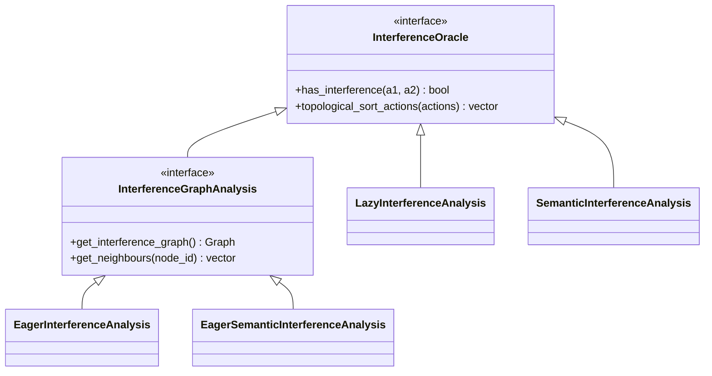

# Interference analysis

## What interference means here

Two actions **interfere** if executing them "together" (in the same
parallel step) would be unsound — one's effects would clobber the other's
precondition or effect, or otherwise change what the other observes.
Sequential semantics doesn't need this at all (one action per timestep, by
definition nothing runs alongside anything else); ∀-step and ∃-step both
need to know, for pairs or groups of actions, whether they can safely share
a timestep — see
[`architecture-overview.md`](architecture-overview.md) (see "Why three
parallelism semantics") for why those semantics exist at all.

**Interference is directional.** `has_interference(A, B)` asks whether
executing `A` would prevent `B` from executing correctly, or corrupt what
`B` reads or writes — not whether the pair interferes symmetrically.
`has_interference(A, B) != has_interference(B, A)` in general. This shows
up again in `topological_sort_actions()`, which returns actions in
*execution order*, not standard topological order: if `A` interferes with
`B`, `B` must appear before `A` in the result, because executing in that
order means `A`'s effects land after `B` has already read/acted on the
pre-`A` state.

## Two interfaces, not one, and it's a compile-time distinction

`analysis/interference_analysis.hpp` defines two interfaces:

- **`InterferenceOracle`** — the universal surface every implementation
  provides: `has_interference()` (by `Action` or by node ID) and
  `topological_sort_actions()`. Both eager and lazy analyzers satisfy this.
- **`InterferenceGraphAnalysis : InterferenceOracle`** — adds whole-graph
  access: `get_interference_graph()`, `get_neighbours()`,
  `output_interference_graph_dot()`. **Only eager implementations derive
  from this.**



Why split it at all: a consumer that needs neighbour lists or the whole
graph (the ∀-step encoding, and the eager in-search mutex check)
*cannot function* against a lazy analyzer — there's no graph to hand back.
An earlier version of this code had one interface with graph methods that
*threw at runtime* on lazy implementations, guarded by a runtime `is_lazy()`
flag consumers were supposed to check first. The split turns that into a
compile error: `ForallMutexModule` takes a `const InterferenceGraphAnalysis&`
at construction, so passing a lazy analyzer there simply doesn't compile.
This is the same "make illegal states unrepresentable" instinct mentioned in
[`architecture-overview.md`](architecture-overview.md) (see "Design philosophy").

## The eager/lazy × syntactic/semantic matrix

`InterferenceKind` has five values — `None` (sequential only) and a 2×2
matrix of eager/lazy crossed with syntactic/semantic:

| | Syntactic | Semantic |
|---|---|---|
| **Eager** | `EagerInterferenceAnalysis` — builds the full graph once, using fast fluent-set-intersection checks | `EagerSemanticInterferenceAnalysis` — builds the full graph once, using SMT-checked precision |
| **Lazy** | `LazyInterferenceAnalysis` — queries pairs on demand, syntactic checks | `SemanticInterferenceAnalysis` — queries pairs on demand, SMT-checked |

**Syntactic** interference is a sound *overapproximation*: it intersects
precondition/effect fluent sets (positive/negative boolean, numeric,
conditional-effect fluents, numeric-effect RHS dependencies — see
`InterferenceOracle::ActionAnalysis` for the exact sets collected per
action) and may report interference for pairs that don't actually conflict
semantically, but never misses a pair that does. It's cheap: no SMT calls.

**Semantic** interference asks the solver directly whether the pair can genuinely
conflict, which is precise but costlier per query. Lazy analyzers trade
build-once cost for per-query cost — worthwhile when the encoding only ever
asks about a subset of all pairs (e.g. `elsc`/`elsc-dt`, the chained-encoder
strategies, use lazy semantic interference).

One documented soundness-relevant scheduling detail: eager-semantic
interference is built *after* `Config::set_all_integer` runs on a problem
where static-fluent folding made costs constant, so its SMT queries use `Int`
sorts rather than mixed sorts — this yields fewer spurious edges (still
sound, just more precise) than building it earlier in the pipeline would.

**The semantic definition lives once.** Both semantic analyzers are thin
materializers over a single `SemanticInterferencePredicate`
(`analysis/semantic_interference_predicate.{hpp,cpp}`), which owns the SMT
infrastructure and the actual affects-relation check: `check1` (can a1's effects
falsify a2's precondition?) and `check2` (do a1 and a2's effects fail to
commute?). The lazy `SemanticInterferenceAnalysis` caches per-pair results; the
eager `EagerSemanticInterferenceAnalysis` builds the whole graph then discards
the predicate's solver state. **Change the semantic check in the predicate, not in
either wrapper.** One subtlety worth flagging, because it was a real soundness
bug: `check2` compares the *parallel happening* σ_h against a serialization, and
σ_h must be the **function of compositions** (Bofill et al. 2016, Def 5) — compose
only the per-variable assignments, so a variable an effect merely *reads* (a
velocity fluent in `x += v·3`) stays at its pre-state value — *not* the
composition of whole-state functions, which would let one action's write flow into
the other's read and under-report interference on velocity/rate-style numeric
domains. See `docs/specs/exists-step-semantic-interference-soundness.md`.

**Example: where syntactic and semantic disagree.** Take two actions that
both increase the same numeric fluent: `refuel_a` does
`fuel(truck1) := fuel(truck1) + 5` and `refuel_b` does
`fuel(truck1) := fuel(truck1) + 3`. Syntactic analysis sees `fuel(truck1)`
in both actions' `numeric_effects` sets and — conservatively, without
reasoning about *what* the effects do — flags the pair as interfering: two
writers to the same fluent look unsafe to run in the same step. Semantic
analysis instead asks the solver whether the two orderings actually differ:
`(fuel + 5) + 3 == (fuel + 3) + 5` is a tautology, so the solver proves they commute
and reports no real interference. The difference has the most bite under ∀-step, where pairwise interference
blocks co-scheduling outright with no escape valve: syntactic interference
would permanently forbid `refuel_a` and `refuel_b` from ever sharing a
timestep, while semantic interference lets them run together freely. (Under
∃-step the gap is narrower — a merely-commuting pair like this one already
admits *some* execution order, so cycle detection wouldn't
block it either way; semantic precision matters most there for pairs where
no order is obviously safe on paper but the solver can still prove one is.) This
is the concrete payoff of paying the per-query cost — more parallelism, hence
shorter plans, on exactly the pairs where the cheap check is too coarse.

## Try it

The syntactic/semantic tradeoff, quantified — run the same instance under
eager syntactic (`f`) and eager semantic (`fgs`) interference and compare
the graph stats:

```bash
rantanplan -d pddl/small-test/zenotravel/domain.pddl \
           -p pddl/small-test/zenotravel/instances/pfile13.pddl \
           --strategy f   --stats-file /tmp/stats_f.txt
rantanplan -d pddl/small-test/zenotravel/domain.pddl \
           -p pddl/small-test/zenotravel/instances/pfile13.pddl \
           --strategy fgs --stats-file /tmp/stats_fgs.txt
grep interference /tmp/stats_f.txt /tmp/stats_fgs.txt
```

On the same 531 ground actions, syntactic builds **85,032** interference
edges in **~27 ms**; semantic asks the solver about every pair and builds
**21,852** edges in **~22 s** — roughly 800× the build cost for a graph
four times sparser. Every edge that disappeared is a pair like the
`refuel_a`/`refuel_b` example above: syntactically overlapping, semantically
commuting — and each one is a mutex clause ∀-step no longer has to emit,
which is the whole bet the semantic strategies make.

## Where in-search reasoning lives now: `THEORY_PLAN`

Interference is only half the story. Something has to *act* on it during the
search — block a parallel step whose actions cannot be ordered. This doc used
to describe how that worked: a `PropagatorStrategy` occupying the solver's
single user-propagator slot, dispatching callbacks to composable
`PropagatorModule`s (`ForallMutexModule`, `ExistsCycleModule`,
`FrameAxiomModule`, `LoggingModule`).

**All of that is gone.** `src/planners/propagators/` was deleted at M4, because
the same reasoning belongs inside the solver as a theory rather than outside it
as a callback client. The replacement is `THEORY_PLAN`, a theory in the cvc5
**fork** this project requires (`../cvc5`, `src/theory/plan/`, public surface in
`include/cvc5/cvc5_plan.h`). Recover the old implementation from git history
(`origin/main @ c8518db`) if you need it as reference.

### What the theory owns

Three atom kinds, each carrying an `(entityId, timestep, sort)` payload as an
*operator index* rather than as child terms — deliberately, since Integer
children would be owned by the arithmetic theory and would drag it into the
logic of every planning problem, including purely propositional ones:

| Atom | Sort | Meaning |
| --- | --- | --- |
| `PLAN_DOES(a, t)` | Bool | action `a` executes at `t` |
| `PLAN_FLUENT(f, t)` | any | state of fluent `f` at `t` |
| `PLAN_AUX(k, t)` | Bool | encoder-private auxiliary |

Identity already matches ours: `a` is `Action::id()`, `f` is the problem's
dense ground-fluent id.

The theory reasons only when an interference oracle is registered, so an
encoding that fixes its parallelism up front shares these atoms and pays
nothing. Which semantics is enforced is the embedder's choice, because both are
decided from the same relation and differ only in what they demand of it:

- **`ExistsStep`** — actions must be orderable *somehow*, i.e. the relation
  restricted to them is acyclic. A cycle is the conflict.
- **`ForallStep`** — actions must be orderable *any* way, so one interfering
  pair in either direction is already the conflict.

Backtracking is the solver's own: the active-action list is a `CDList` on the
SAT context, so what an external propagator needed an explicit trail,
decision-level stack and push/pop bookkeeping for is here just a choice of
container. Conflicts are their own explanation — every literal in one is
currently true — so the theory needs no `explain()`.

### Migration status

| Deleted module | `THEORY_PLAN` status |
| --- | --- |
| `ExistsCycleModule` | **Done** — `findInterferenceCycle`, under `PlanSemantics::ExistsStep` |
| `ForallMutexModule` | **Done** — `findInterferingPartner`, under `PlanSemantics::ForallStep` |
| `FrameAxiomModule` | **Not started** — no frame or fluent handling in `theory_plan.cpp` yet |
| `LoggingModule` | Dropped for good (backlog B3) |

### Our side of the boundary

Implement `PlanInterferenceOracle` — a single virtual,
`interferes(uint32_t a, uint32_t b)`, directional and not symmetric — over
`SemanticInterferencePredicate`, then call
`Solver::configurePlanTheory(semantics, oracle)`. The predicate is already
exactly that shape. Two contract terms, both satisfied today:

1. The verdict must be **assignment independent**. Interference is a property
   of an action pair, not of a state — do not "improve" it with anything that
   reads the current assignment.
2. The oracle **must not call back into the asking solver**. Ours runs its own
   `TermManager`/`Solver`, which is why it can.

The footprint prefilter stays on our side, inside the predicate: the theory asks
per ordered pair, so filtering there is what makes the n² sweep cheap — and,
more importantly, what keeps search and plan extraction reasoning about the
*same* relation. When that filter lived in `ExistsCycleModule` instead, the two
disagreed, and `topological_sort_actions` silently emitted a non-order.

### Frames are the open question, and it is about sorts

A lazy frame axiom must notice `f^t != f^{t+1}` and name the actions that could
explain it, so the theory has to observe fluent *values*:

- **Bool** `PLAN_FLUENT` is a literal owned by `THEORY_PLAN`, so it reaches
  `preNotifyFact`. Boolean frames are implementable with what is already there,
  plus an EPC index handed over alongside the oracle.
- **Non-Bool** `PLAN_FLUENT` is a *term*. Its value lives in the arithmetic
  theory, and `TheoryPlan::needsEqualityEngine()` returns `false`, so nothing
  delivers it. Numeric frames need an equality engine, arithmetic coupling, or a
  different formulation.

This lines up with the chained encoder: `ChainedGroundedEncoder::is_chained()`
already drops the eager frame axiom for every modified *numeric* fluent (its
chain defines the successor totally), so a lazy frame module would be left
enforcing predominantly the *boolean* case — exactly what the theory can already
see. Worth confirming before investing in arithmetic coupling.

It also means the old `-fp` measurements should not be inherited as a verdict.
They were dominated by user-propagator callback overhead, which a theory does
not pay. See the notes in `api/strategy_factory.cpp`, which is where the wiring
will go.
