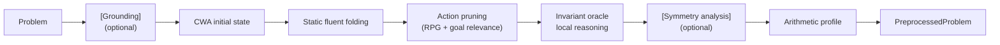
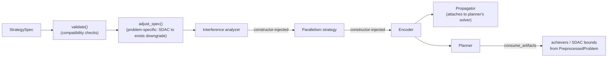

# Preprocessing and the strategy system

## The contract: `PreprocessedProblem`

`preprocessing/preprocessed_problem.hpp` is the one typed boundary between
`api::preprocess()` and `api::solve()`. It holds:

- The **canonical problem** — grounded, CWA-complete initial state, static
  fluents folded, pruned.
- A **verdict** — `proven_unsolvable` (and which pass proved it) and
  `lower_bound`, the tightest horizon lower bound any pass established. This
  drives `Config::planner.start_timestep`, so search doesn't waste time on
  horizons already known too short.
- **Strategy-independent artifacts** — tightened numeric bounds,
  conservation laws, state constraints (mutexes), symmetry data, a
  pre-built achiever analysis, and a fixpoint relaxed planning graph.

The header has one hard rule: **it must compile with no Z3 include path.**
Artifact types that use Z3 internally (`AchieversAnalysis`,
`NumericRelaxedPlanningGraph`) appear only as forward-declared classes
behind `unique_ptr` members, with the constructors/destructor/move
operations defined out-of-line in the `.cpp` so the header never needs the
type complete. This isn't about hiding Z3 for its own sake — it's what makes
the "GBFS test" in
[`architecture-overview.md`](architecture-overview.md) (see "Design philosophy")
true: a consumer of `PreprocessedProblem` that never wants to touch Z3 can
include this header without pulling Z3 in transitively.

Artifacts are also **single-consumer**: `BasePlanner::consume_artifacts()`
*moves* what a planner needs (achievers for PDLA, SDAC cost bounds for
branch-and-bound) out of the bundle. A `PreprocessedProblem` cannot feed a
second `solve()` call — this is enforced at the nanobind layer too (the
`Preprocessed.consumed` flag; see
[`python-cpp-boundary.md`](python-cpp-boundary.md)).

## The pass pipeline

`api::preprocess()` (`api/solver_api.cpp`) runs a fixed pipeline of
`Pass`es, each reading and updating the `PreprocessedProblem` in place:



Passes marked optional are gated by `PreprocessorOptions` flags
(`enable_grounding`, `enable_symmetries`). The pipeline short-circuits as
soon as any pass sets `proven_unsolvable` — later passes don't run on a
problem already known to have no plan.

`Pass` (`passes/pass.hpp`) is deliberately minimal: `apply(PreprocessedProblem&)`
and `name()` (for logging). Passes are **stateless** — every pass-specific
knob is constructor-injected from `PreprocessorOptions`, not read from a
singleton. To add a pass: subclass `Pass`, add it to `CMakeLists.txt`, and
insert it at the right point in this list (the ordering constraints are
documented inline at the insertion site in `solver_api.cpp` — for example,
static fluent folding must run before the invariant oracle, or invariants
would be computed over fluents the encoding won't emit).

## `Config` vs `PreprocessorOptions`

`Config` (`config/config.hpp`) is the CLI-facing singleton: sectioned
(`Global`, `RPG`, `Planner`, `Symmetry`, `FormulaExport`, `Logging`,
`LocalReasoning`), parsed by `CLIParser`, validated by `Config::validate()`.
It is read by the backend (`api::solve`) and the driver — **passes never
read it**.

`PreprocessorOptions` is what passes take instead: a feature-level
vocabulary ("run symmetry detection", "cost fluents in the RPG",
`SearchMode`) that never mentions encoders, semantics, or planner kinds.
There is exactly one place that builds one from a `Config`:
`PreprocessorOptions::from_config()`. This is a one-way rule stated
precisely in the header comment: *the spec may inform options; options
never contain a spec.* The preprocessor cannot know or care which encoder
will eventually consume its output — if it did, it couldn't be called as a
library function ahead of a strategy choice, which is the entire point of
the preprocessor/backend split (see
[`architecture-overview.md`](architecture-overview.md)).

Why this matters in practice: it's what makes `preprocess()` genuinely
reusable — the nanobind `Preprocessed` handle, a future heuristic-search
consumer, or a `--list-strategies` inspection tool can all call
`api::preprocess()` without first deciding on a `StrategySpec`.

## The strategy system

A **strategy** is a named, validated combination of five axes, expressed as
a plain `StrategySpec` (`config/strategy_spec.hpp`):

| Axis | Enum | What it controls |
|---|---|---|
| Encoder | `EncoderFamily` | Grounded, Chained, R2E |
| Semantics | `SemanticsKind` | Sequential, Forall, Exists |
| Interference | `InterferenceKind` | None / Eager·Lazy × Syntactic·Semantic |
| Propagator modules | `PropagatorFlags` (a `std::set<PropagatorModuleKind>`) | ForallEager, ForallLazy, ExistsCycle, FrameAxiom |
| Planner | `PlannerKind` | Sequential, DoubleTail, BranchAndBound, PDLA family |

`StrategyRegistry` (`config/strategy_registry.cpp`) maps CLI strategy names
(`"elsc"`, `"fl-dt"`, `"pdla"`, …) to `StrategyEntry { spec, description }`.
This table is the single place a new strategy gets added — see the
`/add-strategy` skill. `--list-strategies` and `test.py`'s strategy
discovery both read this registry; neither hardcodes a strategy list.

`StrategyFactory` (`api/strategy_factory.{hpp,cpp}`) turns a resolved
`StrategySpec` into live, wired objects at solve time:



**Wiring discipline**, stated in the `StrategyFactory` header comment and
worth internalizing: mandatory dependencies are constructor-injected
(interference → parallelism → encoder), so a half-wired encoder — one with
no interference analyzer at all — cannot exist as a value. Genuinely
optional inputs (symmetry data, state constraints) are applied via setters
after construction. Planners declare what preprocessing artifacts they need
via `BasePlanner::consume_artifacts()` rather than the caller
`dynamic_cast`-ing to find out (an earlier version of this code did exactly
that, for both PDLA and branch-and-bound, before being cleaned up). The one
ordering Z3 itself imposes — the propagator must attach to the planner's
solver, so the propagator is created after the planner — is the caller's
(`api::solve`'s) responsibility, not the factory's.

### Example: unpacking one strategy

The registry entry for `"elsc"` (`config/strategy_registry.cpp`) is one
line:

```cpp
{"elsc", {{E::Chained, S::Exists, I::LazySemantic, {M::ExistsCycle}, K::Sequential},
          "Exists-step, lazy semantic interference, chained encoder"}},
```

That one line packs five independent decisions. Reading the `StrategySpec`
field by field, and what `StrategyFactory` turns each one into:

| Field | Value | `StrategyFactory` builds |
|---|---|---|
| `encoder` | `EncoderFamily::Chained` | a `ChainedGroundedEncoder` |
| `semantics` | `SemanticsKind::Exists` | an `ExistsSemantics` parallelism strategy, constructor-injected into the encoder |
| `interference` | `InterferenceKind::LazySemantic` | a `SemanticInterferenceAnalysis` (see [`interference-and-propagators.md`](interference-and-propagators.md) for the eager/lazy × syntactic/semantic matrix), constructor-injected into the parallelism strategy |
| `propagator` | `{PropagatorModuleKind::ExistsCycle}` | one `ExistsCycleModule`, added to the `PropagatorStrategy` |
| `planner` | `PlannerKind::Sequential` | resolved (via `resolve_planner_kind`, satisficing mode) to an `IncrementalHorizonPlanner` — note this enum value names a *strategy role* ("use the strategy's normal single-ended search"), not the `IncrementalHorizonPlanner` class, which used to be named `SequentialPlanner` before a rename (see [`encoders-and-planners.md`](encoders-and-planners.md)) |

`elsc-dt` is the same first four fields with `planner: DoubleTail` instead —
one field changes, and it becomes a structurally different search algorithm
over the same encoder/interference/propagator combination. That's the reuse
payoff the strategy pattern is for: nobody wrote a
"chained-exists-lazy-semantic-doubletail encoder" class.

`resolve_planner_kind(SearchMode, StrategySpec)` in `strategy_spec.hpp`
handles the interaction between the CLI's search mode and the strategy's
declared planner: satisficing mode uses whatever planner the strategy names,
but optimal/anytime mode always forces `BranchAndBound` — and raises if the
strategy is double-tail or PDLA, which cannot run under those modes at all
(see [`encoders-and-planners.md`](encoders-and-planners.md) for why).

## Extension points

| To add a… | You touch… |
|---|---|
| preprocessing pass | subclass `Pass`, insert into the pass list in `api::preprocess` |
| encoder | subclass `BaseEncoder`, one case in `StrategyFactory` |
| planner | subclass `BasePlanner`, one case in `StrategyFactory` |
| strategy (combination of existing pieces) | one entry in `strategy_registry.cpp` (see the `elsc` breakdown above) |
| non-SAT planner | a new consumer of `PreprocessedProblem` — no encoder or Z3 header required |

The sketches below are illustrative shape, not complete compiling code —
`BaseEncoder` in particular has more pure virtuals than shown (see
[`encoders-and-planners.md`](encoders-and-planners.md)); copy an existing
minimal implementation (`GroundedEncoder`, `IncrementalHorizonPlanner`) as
the real starting point.

### Preprocessing pass

```cpp
// passes/action_count_pass.hpp
class ActionCountPass : public Pass {
public:
    void apply(PreprocessedProblem& result) const override {
        Logger::instance().info(
            "Ground actions remaining: " +
            std::to_string(result.problem.action_count()));
    }
    std::string name() const override { return "ActionCountPass"; }
};
```

Add `src/passes/action_count_pass.cpp` to `CMakeLists.txt`, then in
`api::preprocess()` (`api/solver_api.cpp`): construct one
`ActionCountPass action_count_pass;` and `passes.push_back(&action_count_pass);`
at whatever point in the pipeline order makes sense (here: after action
pruning, so it reports the post-pruning count).

### Encoder

```cpp
// encoders/my_encoder.hpp
class MyEncoder : public BaseEncoder {
public:
    MyEncoder(const Problem& problem, z3::context& ctx,
              std::unique_ptr<ParallelismStrategy> parallelism);

    z3::expr encode_initial_state() override;  // assert each initial_state() assignment
    z3::expr encode_actions(int t) override;   // one implication per ground action: a@t -> pre@t /\ eff@(t+1)
    z3::expr encode_frames(int t) override;    // unmentioned fluents persist t -> t+1
    z3::expr encode_goal(int t) override;      // conjunction of goal ExprIDs, evaluated at t
    z3::expr encode_parallelism(int t) override { return parallelism_->encode(t); }
    // ... encode_symmetries, encode_state_constraints, extract_plan, etc.
};
```

Add one case to the `switch (spec.encoder)` in
`StrategyFactory::create_encoder` (`api/strategy_factory.cpp`), and a new
`EncoderFamily` enumerator in `strategy_spec.hpp` if this is a genuinely new
family rather than a variant of an existing one.

### Planner

```cpp
// planners/my_planner.hpp
class MyPlanner : public BasePlanner {
public:
    using BasePlanner::BasePlanner;

    Plan search() override {
        init_deadline();
        for (int h = 0; h <= Config::instance().planner.max_steps; ++h) {
            if (!apply_solver_timeout(solver_)) break;
            add_timestep_constraints(solver_, encoder_, *propagator_strategy_, h);
            if (solver_.check() == z3::sat) {
                solution_found_ = true;
                return encoder_.extract_plan(solver_.get_model(), h);
            }
        }
        return {};
    }
};
```

Add one case to the `switch` in `StrategyFactory::create_planner`. If the
planner needs a preprocessing artifact (achievers, SDAC bounds), override
`consume_artifacts(PreprocessedProblem&)` to move it out rather than reach
for `Config::instance()` or a `dynamic_cast`.

### Non-SAT planner

The "GBFS test" from
[`architecture-overview.md`](architecture-overview.md) made concrete — a
consumer that never touches `BaseEncoder`, `PropagatorStrategy`, or any Z3
header:

```cpp
class GreedyBestFirstPlanner {
public:
    explicit GreedyBestFirstPlanner(PreprocessedProblem& pre)
        : problem_(pre.problem), bounds_(pre.tightened_bounds) {}

    Plan search() {
        // States as fluent-value maps over problem_.actions()/fluents();
        // successor generation checks each Action's precondition_id()
        // against the current state via the shared ExprPool.
        // Heuristic fuel and pruning come from PreprocessedProblem's
        // strategy-independent artifacts: bounds_ (tightened numeric
        // bounds), pre.state_constraints (mutexes), pre.fixpoint_rpg
        // (distance estimate) — no Z3 query needed for any of it.
        ...
    }

private:
    const Problem& problem_;
    const std::unordered_map<ExprID, Interval>& bounds_;
};
```

Nothing here is wired into `StrategyFactory` or `strategy_registry.cpp` —
this is a parallel consumer of `api::preprocess()`'s output, not a new
`StrategySpec` planner kind.
