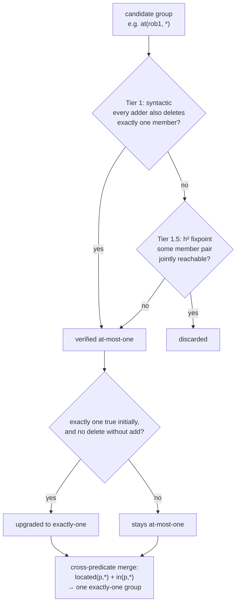
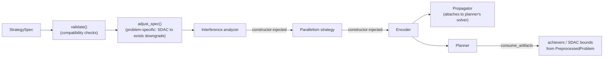

# Preprocessing and the strategy system

## The contract: `PreprocessedProblem`

`preprocessing/preprocessed_problem.hpp` is the one typed boundary between
`api::preprocess()` and `api::solve()`. It holds:

- The **canonical problem** — grounded, CWA-complete initial state (the
  closed-world assumption — anything not stated true is false — made
  explicit, so every fluent has a value at timestep 0), static fluents
  folded, pruned.
- A **verdict** — `proven_unsolvable` (and which pass proved it) and
  `lower_bound`, the tightest horizon lower bound any pass established. This
  drives `Config::planner.start_timestep`, so search doesn't waste time on
  horizons already known too short.
- **Strategy-independent artifacts** — state constraints (numeric bounds,
  conservation laws, object-fluent domains, mutex groups), symmetry data,
  disjunctive action landmarks, and a pre-built achiever analysis.

The header has one hard rule: **it must compile with no Z3 include path.**
Artifact types that use Z3 internally (`AchieversAnalysis`,
`NumericRelaxedPlanningGraph`) appear only as forward-declared classes
behind `unique_ptr` members, with the constructors/destructor/move
operations defined out-of-line in the `.cpp` so the header never needs the
type complete. This isn't about hiding Z3 for its own sake — it's what makes
the "GBFS test" in
[`architecture-overview.md`](architecture-overview.md) (see "Design philosophy")
true: a consumer of `PreprocessedProblem` that never wants to touch Z3 can
include this header without pulling Z3 in transitively.

Artifacts are also **single-consumer**: `BasePlanner::consume_artifacts()`
*moves* what a planner needs (achievers for CGB, SDAC cost bounds for
branch-and-bound) out of the bundle. A `PreprocessedProblem` cannot feed a
second `solve()` call — this is enforced at the nanobind layer too (the
`Preprocessed.consumed` flag; see
[`python-cpp-boundary.md`](python-cpp-boundary.md)).

## The pass pipeline

`api::preprocess()` (`api/solver_api.cpp`) runs a fixed pipeline of
`Pass`es, each reading and updating the `PreprocessedProblem` in place:

```mermaid
flowchart LR
    P[Problem] --> IP[Int-param instantiation]
    IP --> QE[Quantifier expansion]
    QE --> AL["[Array lowering]<br/>(arrays only)"]
    AL --> A["[Grounding]<br/>(optional)"]
    A --> B[CWA initial state]
    B --> C[Static fluent folding]
    C --> CN["[CNF normalization]<br/>(optional)"]
    CN --> D["Action pruning<br/>(RPG + goal relevance)"]
    D --> E[Mutex analysis]
    E --> L["[Landmark analysis]<br/>(goal-relevance on)"]
    L --> F["[Symmetry analysis]<br/>(optional)"]
    F --> G[Arithmetic profile]
    G --> PP[PreprocessedProblem]
```



Passes marked optional are gated by `PreprocessorOptions` flags
(`enable_grounding`, `enable_cnf_normalization`, `enable_symmetries`). The
pipeline short-circuits as soon as any pass sets `proven_unsolvable` — later
passes don't run on a problem already known to have no plan.

The two **canonicalization** passes at the front — `IntParameterInstantiationPass`
then `QuantifierExpansionPass` — run *before* grounding and are what let grounding
stay a plain object grounder. The first Cartesian-expands finite-domain integer
action parameters (`Int[lb,ub]`) into constant-valued copies and makes every
integer range-variable bound concrete; the second rewrites all `forall`/`exists`
conditions into AND/OR over their now-finite domains and expands `forall`-effects
into one concrete effect per binding. Together they replace the old Python
`QuantifiersRemover` — RantanPlan now owns all quantifier and integer-parameter
removal in C++ (see `docs/specs/numeric-action-parameters.md`). Both are no-ops on
a problem with no integer parameters and no quantifiers.

A third pre-grounding pass, `ArrayLoweringPass`, runs only when the problem has
array fluents: it compiles constant-index array accesses into ordinary scalar
cell fluents, so grounding stays array-free just as it stays quantifier-free
(see [`grounding.md`](grounding.md)). It is a no-op — and leaves the ExprPool
node order untouched — on a problem with no arrays.

`Pass` (`passes/pass.hpp`) is deliberately minimal: `apply(PreprocessedProblem&)`
and `name()` (for logging). Passes are **stateless** — every pass-specific
knob is constructor-injected from `PreprocessorOptions`, not read from a
singleton. To add a pass: subclass `Pass`, add it to `CMakeLists.txt`, and
insert it at the right point in this list (the ordering constraints are
documented inline at the insertion site in `solver_api.cpp` — for example,
static fluent folding must run before mutex analysis, or mutex groups
would be computed over fluents the encoding won't emit).

### A taxonomy of the passes

The passes look uniform behind `apply(PreprocessedProblem&)`, but they do
different *kinds* of work, along two orthogonal axes.

**Mechanism** — what a pass does to the `PreprocessedProblem`:

- **Transformers** rewrite `result.problem` (grounding, folding, pruning).
- **Analyzers** leave the problem alone and write the verdict or artifact
  fields.

The `Pass` interface deliberately erases this distinction; the contract
fields reveal it — `problem` is the transformers' output, everything else
is the analyzers'.

**Purpose** — why a pass exists:

- **Shaping**: required for downstream ingestion; skipping one breaks a
  later stage (the grounder can't handle int parameters or free effect
  variables; downstream assumes every fluent has an initial value).
- **Performance by rewriting**: the problem gets smaller or simpler, the
  plan set is preserved; skipping only costs speed.
- **Performance by annotation**: the problem is untouched; artifacts hint
  the backend (mutexes, symmetries, landmarks, achievers).
- **Deduction (verdict)**: partial solving — unsolvability proofs and
  horizon lower bounds. Its consumer is the *driver* (`lower_bound` →
  `start_timestep`), not the encoder, and it can end the run outright via
  the short-circuit.
- **Backend configuration**: classification that decides how the backend
  must encode — `ArithmeticProfilePass`'s `all_integer` flag drives Int vs
  Real sort selection, so it is soundness-relevant, not an optimization.
- **Analysis-enabling rewriting**: `CnfNormalizationPass` rewrites
  conditions not for the encoder (which translates arbitrary formulas) but
  to give the achiever/landmark machinery clause-level granularity.

Note that purpose attaches to *effects*, not passes: several passes do
work in more than one category, which is why the table below has
multi-entry rows.

| Pass | Mechanism | Purpose |
|---|---|---|
| `IntParameterInstantiationPass` | transformer | shaping |
| `QuantifierExpansionPass` | transformer | shaping |
| `ArrayLoweringPass` | transformer | shaping (no-op without arrays) |
| `GroundingPass` (optional) | transformer | shaping + rewriting + verdict — reachability grounding *is* pruning, and it sets `lower_bound`/`proven_unsolvable` |
| `CWAInitialStatePass` | transformer | shaping (sole materialiser of default initial values) |
| `StaticFluentPass` | transformer | performance by rewriting (also tightens later RPG bounds) |
| `CnfNormalizationPass` (optional) | transformer | analysis-enabling rewriting |
| `ActionPruningPass` | transformer + analyzer | rewriting + annotation + verdict — prunes, proves bounds/unsolvability, and publishes achievers, SDAC cost bounds, and the bounds/conservations/domains part of `state_constraints` |
| `MutexAnalysisPass` | analyzer | performance by annotation |
| `LandmarkAnalysisPass` (goal-relevance on) | analyzer | annotation + verdict (contributes to `lower_bound`) |
| `SymmetryAnalysisPass` (optional) | analyzer | performance by annotation |
| `ArithmeticProfilePass` | analyzer (mutates the problem's `all_integer` flag) | backend configuration — must run last |

`passes/` also holds two non-`Pass` helpers: `bound_tightening.{hpp,cpp}`
(syntactic bound tightening and conservation-law discovery, used by
`ActionPruningPass`) and `h2_mutex_checker.{hpp,cpp}` (the h² pairwise
reachability fixpoint, used by `MutexAnalysisPass`). They are analyses
in the same sense as `analysis/`'s `NumericRelaxedPlanningGraph` or
`AchieversAnalysis`, just colocated with their only consumers.

## Where the state constraints come from

The `state_constraints` the encoder re-asserts at every timestep
([`the-encoding.md`](the-encoding.md)) — numeric bounds, object-fluent
domains, conservation laws, mutex groups — have two producers, each the
single publisher of its part.

**Bounds, domains, and conservation laws: `ActionPruningPass`.** The pass
that builds the fixpoint RPG anyway publishes what the RPG proved, in
encoder-ready form. The tightened numeric intervals become per-fluent
bound constraints (`fuel(plane1) ≥ 0`, `fuel(plane1) ≤ 2326`); the RPG's
reachable-value sets for object fluents become domain constraints; and
**conservation laws** come from a syntactic scan (`bound_tightening.cpp`):
a pair `(f, g)` is conserved if every action touching either one has
constant, unconditional increase/decrease effects with `Δf + Δg = 0` —
then `f + g` equals its initial value in every reachable state
(petrobras-style loaded/free-capacity pairs are the motivating case).
Conservation laws feed back into bounds too: from `f + g = C` and `g ≥ 0`
follows `f ≤ C`.

**Mutex groups: `MutexAnalysisPass`** (`passes/mutex_analysis_pass.cpp`).
Candidate generation is purely syntactic: take each action-modified
boolean predicate, group its ground instances by fixing one argument —
all of `at(rob1, *)`, all of `in(person3, *)` — and keep groups of 2–20
members (capped at the 50 largest). Every candidate must then survive
verification:



- **Tier 1 (syntactic, microseconds):** the group can never grow past one
  true member if every action that sets a member true also sets exactly
  one member false — swap-shaped effects like `move`'s
  `¬at(?from), at(?to)`.
- **Tier 1.5 (h² fixpoint):** for the candidates Tier 1 can't verify,
  `H2MutexChecker` (`passes/h2_mutex_checker.cpp`) runs a *pairwise*
  reachability fixpoint: maintain "f is reachable" and "f and g are
  jointly reachable," grow both over the actions until nothing changes. A
  member pair never jointly reachable at fixpoint is mutex. (This is the
  h² construction from the h^m heuristic family, used as a verifier.)
- **Exactly-one upgrade:** if exactly one member is true initially and no
  action deletes a member without adding one, at-most-one strengthens to
  exactly-one — which the encoder turns into `AtLeast` + `AtMost` instead
  of `AtMost` alone.
- **Cross-predicate merge:** verified groups over *different* predicates
  of the same entity — `located(person0, *)` and `in(person0, *)` — are
  merged and re-verified into one larger exactly-one group ("person0 is in
  exactly one place, counting being aboard a plane").

You can watch both producers in any verbose run — zenotravel pfile13 gives
`[ActionPruning] rpg_bounds: 7 | conservation_laws: 0 |
domain_constraints: 0` followed by `[MutexAnalysis] mutex_candidates: 32 |
tier1_amo: 0 | h2_amo: 20 | exactly_one: 13` (see "Try it" below).

**Derived vs declared.** Everything above is *derived* — proven redundant
facts the encoder may freely skip (they only ever cost speed). Problems may
additionally carry *declared* state invariants, the bodies of PDDL
`(:constraints (always φ))` blocks: these live on `Problem` itself
(`state_invariants()`), not in `state_constraints`, precisely because they
are trusted requirements that define plan validity, not derived hints. The
encoder asserts them at every state including the goal
state, and `r2e` rejects problems that declare them. See the comment on
`GroundedEncoder::encode_state_constraints` for the full contrast.

## Landmark analysis: `LandmarkAnalysisPass`

Runs right after mutex analysis, and only when goal-relevance pruning is
on — the achiever graph it walks is `ActionPruningPass`'s `achievers`
artifact, which only exists then. An AND/OR closure over the achiever
graph (goal conditions not satisfied initially are landmarks; a condition
required by *all* achievers of a landmark is itself a landmark) produces
`LandmarkData`: disjunctive action landmarks with a uniform count semantics
— every landmark means "achiever firings must accumulate ≥ residual mass",
where linear numeric thresholds get real residuals and per-firing
contributions, and everything else takes the sound default of residual 1 —
plus natural orderings and a depth lower bound folded into the pipeline's
`lower_bound`. The CGB planner consumes this artifact for its presence
clauses, deficit budgets, and horizon jumps. The full design-and-measurement
log is `docs/pdla-optional-occurrence-roadmap.md` §5.

## Symmetry detection: `SymmetryAnalysisPass`

Gated by `--symmetries` (`enable_symmetries`). The idea is Rintanen's
symmetry reduction (*"Symmetry Reduction for SAT Representations of
Transition Systems"*, ICAPS 2003): two objects of the same type are
**symmetric** if swapping them everywhere in the problem leaves both the
initial state and the goals logically equivalent — nothing distinguishes
them, so any plan using one has a mirror plan using the other, and the
solver shouldn't explore both. `SMTSymmetryChecker`
(`symmetries/smt_symmetry_checker.cpp`) proves equivalence with Z3,
building the initial state and goals over *uninterpreted fluent functions*
(`z3core`'s `LiftedEncodingVisitor` — this is that visitor's only
consumer) and checking the swap by substitution. The pass runs in two
steps:

1. **Detect** on the original pre-grounding problem (smaller initial
   state, cheaper Z3 queries): which object pairs are swappable.
2. **Complete** on the grounded problem: for each swap, collect the
   related variable pairs (`at(rob1, room-a)` ↔ `at(rob2, room-a)`) and
   action pairs (`move(rob1, …)` ↔ `move(rob2, …)`) — the `SymmetryInfo`
   structs stored on `PreprocessedProblem`.

The *breaking* happens later, in the encoder (`encode_symmetries`,
[`the-encoding.md`](the-encoding.md)), and it's conditional: at each
timestep, **if** the state is still symmetric under the swap (all variable
pairs currently equal), **then** the swap-related action pairs must fire
in lexicographic order. The condition is what makes it sound *and* cheap —
once the plan has differentiated the two objects, the ordering constraint
disables itself. Only action pairs differing in a single parameter are
ordered (Rintanen's Table 1; the paper notes that ordering *all* pairs
overwhelms the solver).

## `Config` vs `PreprocessorOptions`

`Config` (`config/config.hpp`) is the CLI-facing singleton: sectioned
(`Global`, `RPG`, `Planner`, `Symmetry`, `FormulaExport`, `Logging`,
`LocalReasoning`), parsed by `CLIParser`, validated by `Config::validate()`.
It is read by the backend (`api::solve`) and the driver — **passes never
read it**.

`PreprocessorOptions` is what passes take instead: a feature-level
vocabulary ("run symmetry detection", "cost fluents in the RPG",
`SearchMode`) that never mentions encoders, semantics, or planner kinds.
There is exactly one place that builds one from a `Config`:
`PreprocessorOptions::from_config()`. This is a one-way rule stated
precisely in the header comment: *the spec may inform options; options
never contain a spec.* The preprocessor cannot know or care which encoder
will eventually consume its output — if it did, it couldn't be called as a
library function ahead of a strategy choice, which is the entire point of
the preprocessor/backend split (see
[`architecture-overview.md`](architecture-overview.md)).

Why this matters in practice: it's what makes `preprocess()` genuinely
reusable — the nanobind `Preprocessed` handle, a future heuristic-search
consumer, or a `--list-strategies` inspection tool can all call
`api::preprocess()` without first deciding on a `StrategySpec`.

## The strategy system

A **strategy** is a named, validated combination of five axes, expressed as
a plain `StrategySpec` (`config/strategy_spec.hpp`):

| Axis | Enum | What it controls |
|---|---|---|
| Encoder | `EncoderFamily` | Grounded, Chained, R2E |
| Semantics | `SemanticsKind` | Sequential, Forall, Exists |
| Interference | `InterferenceKind` | None / Eager·Lazy × Syntactic·Semantic |
| Propagator modules | `PropagatorFlags` (a `std::set<PropagatorModuleKind>`) | ForallEager, ForallLazy, ExistsCycle, FrameAxiom |
| Planner | `PlannerKind` | Sequential, DoubleTail, BranchAndBound, CGB |

`StrategyRegistry` (`config/strategy_registry.cpp`) maps CLI strategy names
(`"elsc"`, `"fl-dt"`, `"cgb"`, …) to `StrategyEntry { spec, description }`.
This table is the single place a new strategy gets added — see the
`/add-strategy` skill. `--list-strategies` and `test.py`'s strategy
discovery both read this registry; neither hardcodes a strategy list.

`StrategyFactory` (`api/strategy_factory.{hpp,cpp}`) turns a resolved
`StrategySpec` into live, wired objects at solve time:



**Wiring discipline**, stated in the `StrategyFactory` header comment and
worth internalizing: mandatory dependencies are constructor-injected
(interference → parallelism → encoder), so a half-wired encoder — one with
no interference analyzer at all — cannot exist as a value. Genuinely
optional inputs (symmetry data, state constraints) are applied via setters
after construction. Planners declare what preprocessing artifacts they need
via `BasePlanner::consume_artifacts()` rather than the caller
`dynamic_cast`-ing to find out (an earlier version of this code did exactly
that before being cleaned up). The one
ordering Z3 itself imposes — the propagator must attach to the planner's
solver, so the propagator is created after the planner — is the caller's
(`api::solve`'s) responsibility, not the factory's.

### Example: unpacking one strategy

The registry entry for `"elsc"` (`config/strategy_registry.cpp`) is one
line:

```cpp
{"elsc", {{E::Chained, S::Exists, I::LazySemantic, {M::ExistsCycle}, K::Sequential},
          "Exists-step, lazy semantic interference, chained encoder"}},
```

That one line packs five independent decisions. Reading the `StrategySpec`
field by field, and what `StrategyFactory` turns each one into:

| Field | Value | `StrategyFactory` builds |
|---|---|---|
| `encoder` | `EncoderFamily::Chained` | a `ChainedGroundedEncoder` |
| `semantics` | `SemanticsKind::Exists` | an `ExistsSemantics` parallelism strategy, constructor-injected into the encoder |
| `interference` | `InterferenceKind::LazySemantic` | a `SemanticInterferenceAnalysis` (see [`interference-and-propagators.md`](interference-and-propagators.md) for the eager/lazy × syntactic/semantic matrix), constructor-injected into the parallelism strategy |
| `propagator` | `{PropagatorModuleKind::ExistsCycle}` | one `ExistsCycleModule`, added to the `PropagatorStrategy` |
| `planner` | `PlannerKind::Sequential` | resolved (via `resolve_planner_kind`, satisficing mode) to an `IncrementalHorizonPlanner` — note this enum value names a *strategy role* ("use the strategy's normal single-ended search"), not the `IncrementalHorizonPlanner` class, which used to be named `SequentialPlanner` before a rename (see [`encoders-and-planners.md`](encoders-and-planners.md)) |

`elsc-dt` is the same first four fields with `planner: DoubleTail` instead —
one field changes, and it becomes a structurally different search algorithm
over the same encoder/interference/propagator combination. That's the reuse
payoff the strategy pattern is for: nobody wrote a
"chained-exists-lazy-semantic-doubletail encoder" class.

`resolve_planner_kind(SearchMode, StrategySpec)` in `strategy_spec.hpp`
handles the interaction between the CLI's search mode and the strategy's
declared planner: satisficing mode (any valid plan is acceptable — the
default) uses whatever planner the strategy names,
but optimal/anytime mode always forces `BranchAndBound` — and raises if the
strategy is double-tail or CGB, which cannot run under those modes at all
(see [`encoders-and-planners.md`](encoders-and-planners.md) for why).

## Extension points

| To add a… | You touch… |
|---|---|
| preprocessing pass | subclass `Pass`, insert into the pass list in `api::preprocess` |
| encoder | subclass `BaseEncoder`, one case in `StrategyFactory` |
| planner | subclass `BasePlanner`, one case in `StrategyFactory` |
| strategy (combination of existing pieces) | one entry in `strategy_registry.cpp` (see the `elsc` breakdown above) |
| non-SAT planner | a new consumer of `PreprocessedProblem` — no encoder or Z3 header required |

The sketches below are illustrative shape, not complete compiling code —
`BaseEncoder` in particular has more pure virtuals than shown (see
[`encoders-and-planners.md`](encoders-and-planners.md)); copy an existing
minimal implementation (`GroundedEncoder`, `IncrementalHorizonPlanner`) as
the real starting point.

### Preprocessing pass

```cpp
// passes/action_count_pass.hpp
class ActionCountPass : public Pass {
public:
    void apply(PreprocessedProblem& result) const override {
        Logger::instance().info(
            "Ground actions remaining: " +
            std::to_string(result.problem.action_count()));
    }
    std::string name() const override { return "action-count"; }
};
```

Add `src/passes/action_count_pass.cpp` to `CMakeLists.txt`, then in
`api::preprocess()` (`api/solver_api.cpp`): construct one
`ActionCountPass action_count_pass;` and `passes.push_back(&action_count_pass);`
at whatever point in the pipeline order makes sense (here: after action
pruning, so it reports the post-pruning count).

### Encoder

```cpp
// encoders/my_encoder.hpp
class MyEncoder : public BaseEncoder {
public:
    MyEncoder(const Problem& problem, z3::context& ctx,
              std::unique_ptr<ParallelismStrategy> parallelism);

    z3::expr encode_initial_state() override;  // assert each initial_state() assignment
    z3::expr encode_actions(int t) override;   // one implication per ground action: a@t -> pre@t /\ eff@(t+1)
    z3::expr encode_frames(int t) override;    // unmentioned fluents persist t -> t+1
    z3::expr encode_goal(int t) override;      // conjunction of goal ExprIDs, evaluated at t
    z3::expr encode_parallelism(int t) override { return parallelism_->encode(t); }
    // ... encode_symmetries, encode_state_constraints, extract_plan, etc.
};
```

Add one case to the `switch (spec.encoder)` in
`StrategyFactory::create_encoder` (`api/strategy_factory.cpp`), and a new
`EncoderFamily` enumerator in `strategy_spec.hpp` if this is a genuinely new
family rather than a variant of an existing one.

### Planner

```cpp
// planners/my_planner.hpp
class MyPlanner : public BasePlanner {
public:
    using BasePlanner::BasePlanner;

    Plan search() override {
        init_deadline();
        for (int h = 0; h <= Config::instance().planner.max_steps; ++h) {
            if (!apply_solver_timeout(solver_)) break;
            add_timestep_constraints(solver_, encoder_, *propagator_strategy_, h);
            if (solver_.check() == z3::sat) {
                solution_found_ = true;
                return encoder_.extract_plan(solver_.get_model(), h);
            }
        }
        return {};
    }
};
```

Add one case to the `switch` in `StrategyFactory::create_planner`. If the
planner needs a preprocessing artifact (achievers, SDAC bounds), override
`consume_artifacts(PreprocessedProblem&)` to move it out rather than reach
for `Config::instance()` or a `dynamic_cast`.

### Non-SAT planner

The "GBFS test" from
[`architecture-overview.md`](architecture-overview.md) made concrete — a
consumer that never touches `BaseEncoder`, `PropagatorStrategy`, or any Z3
header:

```cpp
class GreedyBestFirstPlanner {
public:
    explicit GreedyBestFirstPlanner(PreprocessedProblem& pre)
        : problem_(pre.problem), constraints_(pre.state_constraints) {}

    Plan search() {
        // States as fluent-value maps over problem_.actions()/fluents();
        // successor generation checks each Action's precondition_id()
        // against the current state via the shared ExprPool.
        // Heuristic fuel and pruning come from PreprocessedProblem's
        // strategy-independent artifacts: constraints_.bounds (tightened
        // numeric bounds), constraints_.mutexes, pre.landmark_data
        // (distance estimates) — no Z3 query needed for any of it.
        ...
    }

private:
    const Problem& problem_;
    const StateConstraints& constraints_;
};
```

Nothing here is wired into `StrategyFactory` or `strategy_registry.cpp` —
this is a parallel consumer of `api::preprocess()`'s output, not a new
`StrategySpec` planner kind.

## Try it

Both the registry and the pass pipeline are directly observable:

```bash
rantanplan --list-strategies      # every StrategyEntry, name + description
rantanplan -d pddl/small-test/zenotravel/domain.pddl \
           -p pddl/small-test/zenotravel/instances/pfile13.pddl \
           --strategy elsc -v
```

The verbose log's bracketed tags fire in the pipeline diagram's order —
starting at `[Grounding]` here because zenotravel has no integer parameters or
quantifiers, so the two front canonicalization passes are silent no-ops:
`[Grounding]` → `[CWA]` → `[StaticFluent]` → `[ActionPruning]` (with
`[RPG.Numeric]` and `[Achievers]` inside it, and ending with the
`rpg_bounds`/`conservation_laws`/`domain_constraints` counts it publishes
as state constraints) → `[MutexAnalysis]` → `[ArithProfile]`.
