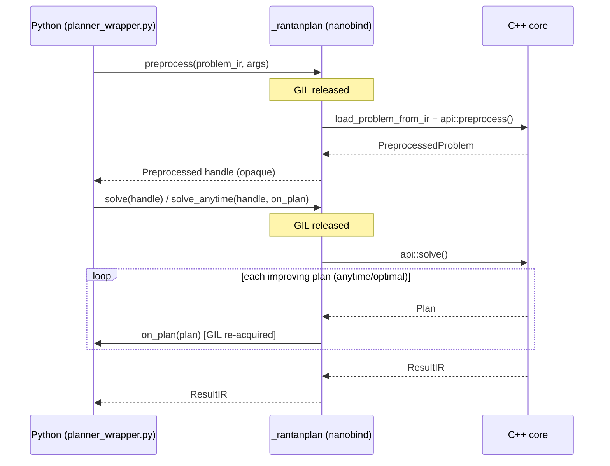

# The Python ↔ C++ boundary

## In-process, not subprocess

RantanPlan used to shell out to a separate solver process, exchanging
problems and results as serialized protobuf messages. That's gone: the C++
core is now built as `_rantanplan`, a [nanobind](https://nanobind.readthedocs.io/)
extension module imported directly into the same Python process. There is
no standalone executable and no wire format — the old CLI-driver
`main.cpp` was deleted outright (commit `97200e1`, "removed UP") rather
than kept around unreferenced.

The motivation was less about raw speed and more about what a subprocess
boundary forces on you: a serialization schema to keep in sync with the C++
struct layout, process startup cost on every solve, and no way for Python to
cancel a running search except killing the process. In-process removes all
three — the problem crosses the boundary as an in-memory struct, and a
long-running solve can be interrupted or can call back into Python
mid-search without any IPC machinery.

The one hazard this introduces: **exactly one copy of libz3 may be loaded
per process.** The extension module must link the same `libz3` the
`z3-solver` Python package loads — two copies in one process is undefined
behavior. This is why `pip install -e . --no-build-isolation` is mandatory
(see the root `CLAUDE.md`): build isolation would let the module link a
different, temporarily-fetched z3 than the one `import z3` resolves at
runtime.

## `ProblemIR`: the contract

`rantanplan/cpp/src/api/ir.hpp` defines the plain-data structs Python and
C++ agree on. The interesting part is `ProblemIR.nodes`: every expression in
the problem (preconditions, effects, goals, costs, declared state
invariants — `ProblemIR.state_invariants` carries the bodies of PDDL
`(always φ)` constraints as node indices, exactly like `goals`) is
flattened into **one shared node pool**, where each node's `children` are indices into that same
array, and — this is the part that matters — **children always precede
their parents**. The C++ loader (`ir_io.cpp`) interns the whole pool in a
single forward pass because of this invariant; it never has to look ahead or
patch up forward references.

The node `kind` values and payload shapes deliberately mirror the old
protobuf `ExpressionKind` encoding this IR replaced — not because that
encoding was special, but so the C++ loader could stay a straightforward
port of the protobuf loader rather than a redesign done at the same time as
the transport change.

**Example.** This is the same `(at rob1 room-a)` example from
[`architecture-overview.md`](architecture-overview.md), shown at the wire
level instead of the internal `ExprPool` level (`_convert`'s
`is_fluent_exp` branch in `converter.py`: it resolves the fluent's head
symbol first, *then* walks each argument, then builds the application node
— matching `ExprPool`'s head-first convention exactly). `ProblemIR.nodes`
would contain:

| index | `kind` (`ExprKindIR`) | `type_name` | `symbol` | `children` |
|---|---|---|---|---|
| 0 | `FLUENT_SYMBOL` (3) | `"up:bool"` | `"at"` | — |
| 1 | `CONSTANT` (1) | `"robot"` | `"rob1"` | — |
| 2 | `CONSTANT` (1) | `"room"` | `"room-a"` | — |
| 3 | `STATE_VARIABLE` (5) | `"up:bool"` | — | `[0, 1, 2]` |

and the action's `ActionIR.precondition` field would just be `3` — the
index of the top-level node. The main thing that differs from the internal
`ExprPool` representation covered in `architecture-overview.md`: `type_name`
here is a UP type *string* (`"up:bool"`, `"up:integer"`, or a user type
name), resolved to an integer `type_id` only once it's loaded into the C++
side's type table. Deduplication exists on the wire too, but it's coarser
than `ExprPool::intern()`'s full structural hashing: `_FNodeToIR._head()`
memoizes head symbols (fluent/function/object/variable nodes) by their
`(kind, symbol, type)` tuple — so the `"at"` `FLUENT_SYMBOL` node above is
reused everywhere `at(...)` appears — and `walk()` separately memoizes by
UP `FNode` identity, so the same shared subexpression object isn't
re-converted twice. Neither is a full structural comparison across
differently-built compound expressions the way `ExprPool::intern()` is; that
canonical, whole-tree dedup only happens once `ir_io.cpp` interns the array
into the C++ `ExprPool`.

### Why the Python side is a hand-rolled DFS, not a `DagWalker`

`rantanplan/converter.py`'s `_FNodeToIR` walks each UP `FNode` expression
DAG and appends nodes to the pool. It's tempting to write this as a UP
`DagWalker` (the idiomatic way to traverse UP expressions), but a
`DagWalker` visits a node's *arguments* before running that node's own
handler — which would insert argument nodes into the pool before the head
symbol (fluent/function name) that owns them. The hand-rolled walker
inserts the head symbol first, then arguments, matching the C++ `ExprPool`'s
expected insertion order.

This ordering isn't cosmetic. `ExprID`s are assigned by insertion order, and
several C++ encoders key `unordered_map<ExprID, ...>` structures whose
iteration order depends on those IDs. Reordering node creation — even
switching to a `DagWalker` that produces an *equally valid* set of
`ExprID`s — silently changes which (still-correct) plan the search finds
first, because it changes iteration order in those maps. If you ever touch
`converter.py`'s traversal, this is the invariant to preserve.

## The two calls: `preprocess` and `solve`

The nanobind module (`api/bindings.cpp`) mirrors the C++ two-layer API
exactly:



`preprocess()` returns a `Preprocessed` handle — an opaque C++ object owning
the `PreprocessedProblem` — rather than the struct itself, because
preprocessing artifacts are **single-consumer**: `solve()` moves achievers
(the which-action-can-supply-which-fact analysis the CGB planner consumes)
and SDAC (state-dependent action cost) bounds out of the bundle it's handed. A second `solve()` call
on an already-consumed handle raises rather than silently running without
those artifacts (`handle.consumed`, checked in `solve_handle_impl`).

By default, `solve()`/`solve_anytime()` reuse the CLI-style args list the
handle was preprocessed with (stored on the handle). You *can* pass a
different args list to `solve()`, but this is expert-only: option-dependent
preprocessing decisions (search mode, symmetry detection, RPG bounds) are
already baked into the handle and are not recomputed for the new args.

## The GIL

CPython's GIL (**G**lobal **I**nterpreter **L**ock) is the single mutex
that lets only one thread execute Python bytecode at a time — it protects
reference counts and other interpreter state, and it's why plain Python
threads never run CPU-bound work in parallel. The loophole every native
extension relies on: a C/C++ function called from Python may *release* the
GIL for the duration of a long pure-native computation (one that touches
no Python objects), letting other Python threads run meanwhile, and
re-acquire it only to hand results back. That loophole is RantanPlan's
entire threading story. (Background: the
[Python glossary entry](https://docs.python.org/3/glossary.html#term-global-interpreter-lock).)

### How RantanPlan uses it

Both `preprocess_ir` and `solve_handle_impl` release the GIL
(`nb::gil_scoped_release`) before entering C++, so a long solve doesn't
block other Python threads. The two callback paths that cross back into
Python — the anytime `on_plan` callback and `set_log_sink` — run on the
*solver thread*, and nanobind's `std::function` wrapper re-acquires the GIL
for the duration of the call. Both are documented as needing to stay cheap
and not re-enter the module, since they run inside the search loop.

Concretely, this means: a Python `Timer` thread checking on progress, a
GUI event loop, or an anytime-planner's consumer thread iterating results
from a generator can all keep running while the C++ solver churns through
timesteps — none of them are blocked by RantanPlan's own C++ code, only by
each other and by the brief GIL-reacquired windows when a plan callback or
log line actually fires.

## Cancellation

`Preprocessed.interrupt()` cancels a solve running on that handle, from any
thread. It's implemented without any GIL involvement at all: `preprocess()`
publishes the running solve's `z3::context*` into an `InterruptSlot` on the
handle (`ScopedContextPublisher`, RAII, mutex-guarded to close a
publish/use-after-free race), and `interrupt()` just flips Z3's own
interrupt flag on that context. The interrupted solve's next `solver.check()`
returns `unknown`, which the planner's timeout-handling path turns into a
`TIMEOUT` result — the same path a wall-clock timeout takes. Only the
search itself is interruptible this way; preprocessing and other non-Z3
phases ignore `interrupt()`.

## Logging and stats

`set_log_sink(callback)` redirects the C++ `Logger` singleton's output to a
Python callable instead of stdout/stderr; `None` restores the default. Like
the plan callback, it runs on the solver thread with the GIL re-acquired.
Stats (Z3 solver statistics, timing breakdowns) travel back as
`ResultIR.stats`, a flat list of `(key, value)` pairs — the C++ side no
longer writes a stats file itself; `planner_wrapper.py`'s `_write_stats_file`
does, if `--stats-file` was requested.

## Mapping a plan back

`ResultIR.plan` is a list of `(action_name, parameters)` pairs — plain
strings, not UP objects, since the IR has no reference to the original UP
`Problem`. `planner_wrapper.py`'s `_build_plan` rebuilds `ActionInstance`s by
looking up the name in the *compiled* problem's action map, then maps each
one back through whatever compilation steps ran before conversion
(quantifier removal, optional CNF compilation) via
`compilation_result.map_back_action_instance`. The result is validated
against the *original* (pre-compilation) problem before being returned.

## Try it

The libz3 hazard from the first section, made checkable — the module and
the `z3` package must report the same version, because they must be the
same shared library:

```python
from rantanplan import _rantanplan
import z3
print(_rantanplan.z3_version())   # e.g. 4.16.0.0 — what the module linked
print(z3.get_version_string())    # e.g. 4.16.0   — what `import z3` loaded
```

To see the raw boundary in action — `preprocess()`, `solve()`, and a
cross-thread `interrupt()` called directly on the module, no UP engine
wrapper — run the "Try it" snippet at the end of
[`z3-control-and-interruption.md`](z3-control-and-interruption.md).
