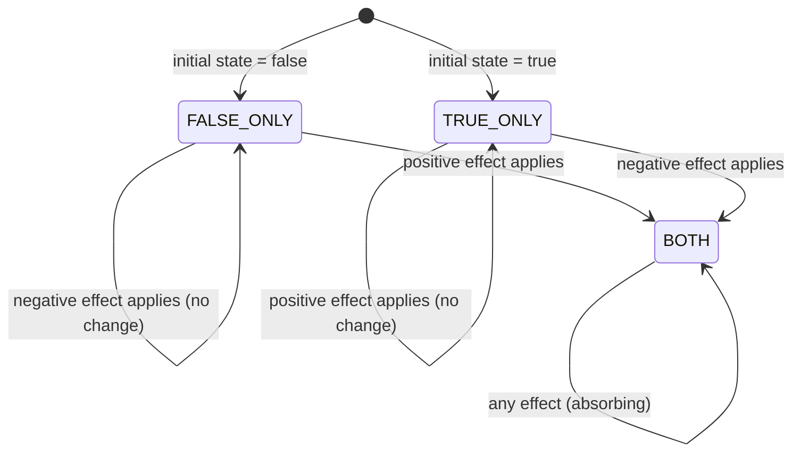
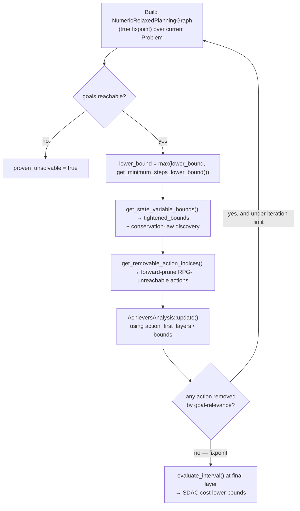

# The Relaxed Planning Graph (RPG)

This is a different, more precise reachability analysis than
[grounding](grounding.md)'s own fixpoint. `ReachabilityGrounder` computes a
coarse "ever reachable" fact set just to ground and get a rough lower
bound; `NumericRelaxedPlanningGraph` (`analysis/numeric_relaxed_planning_graph.{hpp,cpp}`)
builds a genuine **layer-by-layer** graph over the *already-ground* problem,
and is what `ActionPruningPass` actually uses for tightened bounds,
goal-relevance pruning, SDAC cost lower bounds, and achiever tracking.

*(There is a second class, `RelaxedPlanningGraph` — boolean-only, no
numeric handling — sitting in `analysis/`. It's dead code: nothing outside
its own file references it, and its own header comment says as much
("Currently unused... kept for potential lightweight/fast-path use"). This
doc is entirely about `NumericRelaxedPlanningGraph`, the one actually
built.)*

## What a "layer" is

Layer 0 is the initial state. Layer *k+1* is what you get by taking every
action *applicable* at layer *k* and applying *all* their effects
simultaneously — without ever retracting anything layer *k* already had.
Nothing is ever removed once reachable (that's the "relaxation": delete
effects are tracked for information, but never actually delete anything
from the graph), so both the fact layers and the numeric bounds only ever
grow, which is exactly what makes this a monotone fixpoint computation
instead of a search.

Three kinds of state live in each layer (`LayerState`):

- **Boolean fluents** — not a single true/false, but a 3-valued
  `BooleanReachability`: `FALSE_ONLY`, `TRUE_ONLY`, or `BOTH`. Negative
  information matters here (ADL preconditions can require a fluent to be
  false), so the graph has to track *both* "can this be true" and "can
  this be false," not just "has this ever been achieved" the way a
  classical single-valued RPG would.
- **Numeric fluents** — an `[lower, upper]` interval (the same `Interval`
  arithmetic used in [grounding.md](grounding.md)'s `NumericBoundsIndex`).
- **Object fluents** — the accumulating set of reachable values, same idea
  as `ObjectFluentIndex` in the grounder.

## Boolean reachability: why `FALSE_ONLY` jumps straight to `BOTH`

The state-transition rule (`apply_boolean_effect`) is:



The non-obvious part: a fluent that starts `FALSE_ONLY` and gets a positive
effect somewhere in the layer does **not** become `TRUE_ONLY` — it jumps
straight to `BOTH`. That's because the graph isn't simulating one
particular sequence of actions; it's accumulating *every* action that
*could* fire at this layer, without committing to which ones actually do.
Once some action *could* make the fluent true, "stays false" is still a
live possibility too (just don't run that action) — so both truth values
become reachable from this point on. `TRUE_ONLY`/`FALSE_ONLY` only really
mean anything at layer 0, where they come directly from the initial state
assignment; nothing in the transition table can produce `TRUE_ONLY` from
`FALSE_ONLY`, only `BOTH`.

## Numeric bounds: interval arithmetic, not Z3, for propagation

For each numeric fluent, the next layer's bound is the **convex union**
of every branch that could produce a value: the fluent simply persisting
unchanged, *and* the result of every applicable effect that touches it —
exactly mirroring `NumericBoundsIndex`'s persistence-plus-effects
accumulation in the grounder, just recomputed per layer instead of
incrementally. No Z3 call is needed for this — it's pure interval
arithmetic (`Interval + Interval`, `Interval - Interval`, ...).

Left unchecked, some effects (a percentage increase, a fluent that
depends on another that's already widened) would make a bound's expansion
never terminate. **Directional widening** guards against this: each
fluent tracks, per side (lower/upper), how many consecutive layers that
side has expanded; after `widening_threshold` (default 100, `--widening-threshold`)
consecutive expansions on one side, that side snaps to ±infinity. A lifted
pre-analysis (`precompute_freezes()`) additionally identifies fluent
schemas whose bound can *never* move on one side from the effect structure
alone, exempting them from widening entirely (no need to threshold what
can't move).

### Worked example

Continuing [grounding.md](grounding.md)'s trucking example, with a fuel
precondition added:

```
action drive(?v - vehicle, ?from - loc, ?to - loc)
  precondition: (at ?v ?from) AND (road ?from ?to) AND (>= (fuel ?v) 1)
  effect: not (at ?v ?from), (at ?v ?to), (decrease (fuel ?v) 1)
initial state: (at truck1 depot), (road depot siteA), (road siteA siteB),
               (fuel truck1) = 3
goal: (at truck1 siteB)
```

| Layer | `at(truck1,depot)` | `at(truck1,siteA)` | `at(truck1,siteB)` | `fuel(truck1)` |
|---|---|---|---|---|
| 0 | `TRUE_ONLY` | `FALSE_ONLY` | `FALSE_ONLY` | `[3, 3]` |
| 1 | `BOTH` (negative effect fires) | `BOTH` (positive effect fires) | `FALSE_ONLY` | `[2, 3]` — union of persisting `[3,3]` and `drive`'s `[3,3] - [1,1] = [2,2]` |
| 2 | `BOTH` | `BOTH` | `BOTH` (goal reachable here) | `[1, 3]` — union of persisting `[2,3]` and `[2,3] - [1,1] = [1,2]` |

At layer 0, `drive(truck1, depot, siteA)`'s precondition checks as: `at`
and `road` both hold (`TRUE_ONLY`), and `fuel(truck1) >= 1` evaluates
`[3,3] >= [1,1]` as `ALWAYS_TRUE` — so it's applicable, producing layer 1.
At layer 1, `drive(truck1, siteA, siteB)` becomes applicable the same way
(`at(truck1,siteA)` is `BOTH`, which counts as "can be true"), producing
layer 2, where the goal `at(truck1, siteB)` first reaches `BOTH`. So
`get_minimum_steps_lower_bound()` returns **2** — the layer index at which
the goal first became achievable, matching the pipeline-walkthrough example
in [`architecture-overview.md`](architecture-overview.md).

## Checking a formula against a layer: interval, or Z3 when asked

Two ways to answer "is this precondition/goal satisfied at layer *k*,"
selected by `--smt-rpg-checker`:

- **Interval (default)** — `evaluate_formula_interval()` walks the
  condition tree and returns one of three outcomes: `ALWAYS_TRUE` (holds
  for every point in every fluent's current box), `ALWAYS_FALSE`
  (provably can't hold — safe to prune), or `UNKNOWN` (might hold for some
  point in the box, treated as "assume satisfiable," the sound
  over-approximation direction). Fast — no solver call.
- **Z3 (`--smt-rpg-checker`)** — one SAT query per action, asserting the
  layer's box constraints plus the precondition. Needed when several
  numeric variables are correlated in ways per-fluent boxes can't capture.

That same gap between "correct per-variable" and "correct jointly" is why
**lower bound computation gets a second pass**: `evaluate_formula_interval`
checks each goal condition independently, which can be over-optimistic for
a conjunctive goal with cross-variable dependencies — the class comment's
example is a chain like `c17 >= c16+1 >= ... >= c0+17`, individually
satisfiable per-condition two layers earlier than the whole conjunction
actually is. `get_minimum_steps_lower_bound()` therefore binary-searches
for a candidate layer using the cheap interval check, then scans forward
from there re-checking with one **joint** Z3 query per layer (all goal
conditions asserted together against that layer's box constraints) until
it finds the layer the joint check actually agrees is achievable.

## Termination: how far the graph is allowed to stop early

Two independent flags control whether `build()` can stop before a true
fixpoint:

- `Config::RPG::early_goal_termination` — stop as soon as the goals become
  achievable.
- `set_stop_when_all_reachable(bool)` — stop once every action in the
  problem has appeared in some layer *and* the goals are jointly
  achievable.

`ActionPruningPass` disables both (`set_stop_when_all_reachable(false)`,
and `early_goal_termination` defaults off) and always runs to a true
fixpoint. The reason is in the class's own header comment: stopping early
gives a sound lower bound and a valid unsolvability check, but the
*variable bounds* at an early-terminated layer aren't necessarily the
tightest ones ever reachable — and `AchieversAnalysis` and the SDAC cost
lower bounds both need the tightest bounds available, not just "tight
enough to answer one question."

## How `ActionPruningPass` actually uses it



The outer loop is necessary, not incidental: removing a goal-irrelevant
action can make other actions RPG-unreachable too (they might have existed
only to enable the action just removed), so each pruning iteration rebuilds
the RPG from scratch over the shrunken problem and re-checks. The loop
stops either when an iteration removes nothing (a real fixpoint) or after
`goal_relevance_max_iterations` (default 10) as a safety cap. The RPG that
survives to the end of the pass is stored on `PreprocessedProblem` as
`fixpoint_rpg`, and its final layer's interval bounds are what
`evaluate_interval()` uses to compute a lower bound on each action's
state-dependent cost (SDAC) — see
[`preprocessing-and-strategy.md`](preprocessing-and-strategy.md) for where
`tightened_bounds`, `sdac_cost_lower_bounds`, and `fixpoint_rpg` fit into
the rest of the `PreprocessedProblem` contract.
