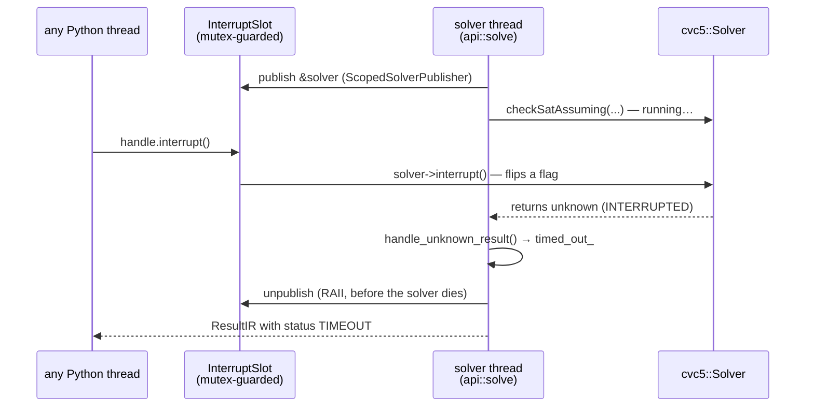

# Controlling and interrupting the solver

This doc is about *process control*: how RantanPlan drives cvc5's solver
incrementally, how it budgets and enforces timeouts, and how a solve gets
cancelled mid-search. It complements
[`interference.md`](interference.md) (what in-search parallelism reasoning
decides, and where it now lives) and
[`python-cpp-boundary.md`](python-cpp-boundary.md) (the Python-facing
`interrupt()` API) rather than repeating them.

## One solver per planner

Every `BasePlanner` owns exactly one `cvc5::Solver`, constructed once in the
`BasePlanner` constructor (`planners/base_planner.cpp`) and used for the entire
search. There is no per-timestep or per-check solver reset: constraints
accumulate in `solver_` as the horizon grows (or, for `BranchAndBoundPlanner`,
within a `push()`/`pop()` scope — see below), which is what lets the solver
reuse its learned clauses across an incrementally-growing formula instead of
re-deriving everything from scratch at every horizon.

**Options must be set before the first assertion.** cvc5 accepts options only
until the solver is initialised, so `produce-models` is enabled in the
constructor — the one point guaranteed to precede every `assertFormula` on that
solver. Model extraction is not on by default, and plan extraction reads values
back out of the model, so forgetting this is fatal rather than merely untuned.
The same lock is why the timeout is a watchdog rather than a parameter (next
section).

**`setLogic` is binding, and this is the live gotcha.** The logic is derived
from the problem's `ArithmeticProfile`, and two things about it bite:

1. The logic string must **also name the plan theory**. `setLogicString` starts
   from all-theories-false, so a bare `QF_LIA` *disables* `THEORY_PLAN` and the
   first `PLAN_*` atom throws "the logic was specified as QF_LIA, which doesn't
   include THEORY_PLAN". The fork adds a `PLAN` token for exactly this; the
   planner splices `UFPLAN` in after the `QF_` prefix, giving e.g.
   `QF_UFPLANLIA`. `UF` is unconditional — the lifted visitor emits genuine
   uninterpreted functions, and cvc5's own preprocessing introduces UF terms.
2. **Difference-logic profiles are deliberately widened, not passed through.**
   `QF_IDL`/`QF_RDL` admit only `x - y ~ c` and `x ~ c`, while the encoders
   freely emit general linear terms and ite-sums — the cardinality helper's
   Int-sum path alone puts `(+ (ite b 1 0) ...)` into any problem with a `COUNT`
   bound > 1. A binding `QF_IDL` would therefore throw at assert time, so
   `DIFFERENCE_LOGIC` is mapped to `LINEAR`. Widening a logic can only cost
   tuning, never soundness, which is the safe direction to err in.

Note `ArithmeticProfile::NONE` yields no logic string at all, so cvc5 defaults
to `ALL` — which does include `THEORY_PLAN`, hence correct but untuned.

## The timeout: a watchdog, not a solver parameter

`BasePlanner` cannot express "give this check whatever time is left" as an
option, because options are locked once the solver is initialised. So:

1. `init_deadline()` computes one absolute wall-clock deadline from
   `Config::global.timeout` (seconds from now), or `time_point::max()` if no
   timeout was requested.
2. Before every check, `apply_solver_timeout(solver_)` consults `remaining_ms()`.
   If the budget is already gone it sets `timed_out_` and returns `false`, and
   the planner breaks out of its search loop before building the next horizon's
   formula. Otherwise it starts a watchdog thread:

```cpp
void BasePlanner::start_watchdog(cvc5::Solver& solver) {
    if (watchdog_.joinable()) return;                  // already running
    watchdog_ = std::thread([this, &solver] {
        std::unique_lock<std::mutex> lock(watchdog_mutex_);
        // Wake at the deadline, or earlier if stop_watchdog() is called.
        watchdog_cv_.wait_until(lock, deadline_, [this] { return watchdog_stop_; });
        if (!watchdog_stop_) {
            solver.interrupt();      // fork patch (M1): safe from another thread
        }
    });
}
```

The watchdog is strictly *more* faithful than a per-check parameter would be:
it fires at the **absolute** deadline, so no single check can overrun the
budget. The obvious alternative — install a per-check limit once, with the first
check's budget — would let a later check run for that same duration all over
again.

`stop_watchdog()` signals the condition variable and joins, and the destructor
calls it, so the thread never outlives the planner.

## Disambiguating `unknown`

An `unknown` result is ambiguous: the timeout may have fired, an external
interrupt may have landed, or the solver may genuinely have given up. cvc5
reports the reason as an **enum on the `Result`**, so this is an exact
comparison rather than a substring match on a free-text reason:

```cpp
bool BasePlanner::handle_unknown_result(const cvc5::Result& result,
                                        const std::string& context) {
    cvc5::UnknownExplanation reason = result.getUnknownExplanation();
    if (reason == cvc5::UnknownExplanation::TIMEOUT ||
        reason == cvc5::UnknownExplanation::INTERRUPTED) {
        timed_out_ = true;
        return true;
    }
    return false;   // some other cause; logged, not treated as a timeout
}
```

`INTERRUPTED` is what both the watchdog and a cross-thread `interrupt()`
produce, and it is mapped onto `timed_out_` exactly as `TIMEOUT` is — from the
planner's point of view they are the same outcome, surfaced to Python as
`SolveStatusIR::TIMEOUT` either way.

## Cross-thread cancellation

Python's `Preprocessed.interrupt()` (see
[`python-cpp-boundary.md`](python-cpp-boundary.md)) needs to cancel a solve
running on a *different* thread, without touching the GIL and without racing
the C++ side tearing down the solver it is cancelling:



The mechanism lives in `api/solver_api.cpp`: `InterruptSlot` holds a
mutex-guarded `cvc5::Solver*`, and `ScopedSolverPublisher` publishes and
unpublishes it by RAII. It is declared immediately after the solver it
publishes, so C++'s destruction order unpublishes *before* the solver is
destroyed. Both sides take the same mutex, so there is no way to `interrupt()` a
solver that is mid-destruction, or destroy a solver an in-flight `interrupt()`
is about to dereference — one path always waits for the other.

The publish window covers strategy assembly (encoder and planner construction)
as well as the search itself, so `interrupt()` can technically fire before
search starts, though in practice that window is short.

`Solver::interrupt()` is **one of the two patches the fork carries** (the other
being `THEORY_PLAN` itself); it is not in stock cvc5. It flips an internal flag
rather than forcing an immediate stop — the next place the solver checks that
flag is where an in-flight check returns, with
`UnknownExplanation::INTERRUPTED`. Outside an active check — during
preprocessing, or between horizons while the planner builds the next formula —
`interrupt()` has nothing to interrupt and is a no-op until the next check
starts.

## Incremental search: assumptions, not push/pop, for the common case

Growing the horizon doesn't mean re-solving from scratch or wrapping each
horizon in a `push()`/`pop()` scope. `IncrementalHorizonPlanner` and
`DoubleTailPlanner` both use **assumption literals**: a fresh Boolean constant
per horizon, permanently asserted behind an implication (never asserted true),
and passed as the sole assumption to the check:

```cpp
// planners/incremental_horizon_planner.cpp
Term goal_literal = tm_.mkConst(tm_.getBooleanSort(), "goal_at_" + std::to_string(h));
solver_.assertFormula(tb_.mk_implies(goal_literal, encoder_.encode_goal(h)));

assumptions.push_back(goal_literal);
cvc5::Result result = solver_.checkSatAssuming(assumptions);
```

Because `goal_literal` is never permanently asserted, `solver_` never actually
contains "the goal holds at horizon `h`" as a hard fact — it is active only for
the duration of that one `checkSatAssuming` call. So every clause and lemma the
solver already learned while proving earlier horizons unsatisfiable stays valid
and reusable at the next horizon; nothing needs to be popped or re-derived. It
is a much cheaper style of incrementality than the classic
`push()`-solve-`pop()`-solve-again loop.

`BranchAndBoundPlanner` is the one place that *does* use explicit
`push()`/`pop()`: it opens a scope per horizon for the horizon-dependent
abstract-suffix constraints (relaxed preconditions, abstract goal, the running
cost bound), asserts permanent concrete transitions *outside* that scope, and
pops the scope before moving to the next horizon. It needs `push`/`pop` rather
than an assumption literal because it is asserting a whole family of
horizon-specific constraints, not gating a single fact.

## `persist_clauses` (removed)

There used to be a section here on `Config::global.persist_clauses` (CLI
`--persist-clauses` / `--no-persist-clauses`), which controlled whether the
former solver's unit-propagation engine kept externally-supplied theory lemmas
across backtracking.

It is **gone** as of the cvc5 migration, in every place it lived (the `Config`
field, `CLIParser`, the Python `cli.py` flags, `planner_wrapper`, and a
`local_benchmark.py` example). Three reasons, any one sufficient:

- The parameter belonged to the previous solver; cvc5 exposes no equivalent knob.
- Its only ever reader was the external propagator, and
  `src/planners/propagators/` was deleted at M4 pending `THEORY_PLAN`.
- It had already become dead code: the field was set by the parser and read by
  nothing.

For the cvc5 framing of the underlying question — what a theory does with a
lemma across backtracking — see `TheoryInferenceManager` in the fork. A
`THEORY_PLAN` conflict is its own explanation (every literal in it is currently
true), so the retain-or-rederive tradeoff this flag exposed does not arise in
the same form.

## Try it

Cross-thread cancellation, end to end — a hard instance, a 3-second fuse on
another thread, and the `interrupt → check returns unknown → TIMEOUT` path from
this doc (run from the repo root, inside the venv):

```python
import threading
from unified_planning.io import PDDLReader
from rantanplan.converter import convert_problem
from rantanplan import _rantanplan

problem = PDDLReader().parse_problem(
    "pddl/small-test/expedition/domain.pddl",
    "pddl/small-test/expedition/instances/pfile1.pddl")
handle = _rantanplan.preprocess(convert_problem(problem),
                                ["--strategy", "egs", "--verbosity", "verbose"])
threading.Timer(3.0, handle.interrupt).start()
result = _rantanplan.solve(handle)
print(_rantanplan.SolveStatus(result.status).name)   # -> TIMEOUT
```

Expedition is hard enough that the search is still climbing horizons when the
timer fires — the log shows `[Solving T10]` (or wherever it got to) cut off
mid-check, then `*** TIMEOUT during solve at horizon 10 ***`: the solver noticed
the interrupt flag, returned `unknown` with `INTERRUPTED`, and
`handle_unknown_result()` turned it into the same `TIMEOUT` a wall-clock
deadline would produce.

Pick a strategy that is actually registered — `--list-strategies` is the source
of truth, and the registry is reduced at M4 (see `strategy_registry.cpp`), so
the chained and propagator-era names (`elsc`, `els-fp`, …) are not available.
