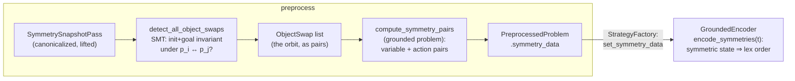

# Object symmetries

Many planning problems contain objects that are *interchangeable*: ten
identical packages, five indistinguishable blocks. Every plan that loads
package `p3` has a mirror plan that loads `p7` instead, and a SAT/SMT search
that doesn't know this will happily explore both — and the other 10! − 2
permutations too. Symmetry handling tells the solver that one representative
per family of mirror plans is enough. On `dump_trucks`' largest instance it
is the difference between 66.8s and 1.2s.

This doc follows one tiny example through all three stages — what a symmetry
(and an orbit) *is*, how RantanPlan *detects* symmetries, and how the
encoder *breaks* them. The code lives in
`symmetries/smt_symmetry_checker.{hpp,cpp}`, driven by
`SymmetryAnalysisPass` and consumed by `GroundedEncoder::encode_symmetries`.
Off by default: `--symmetries` on the CLI, `symmetries: True` through
Unified Planning.

**The running example.** One truck, three identical packages, load actions,
and a goal that wants everything loaded:

```
objects   t1 : Truck        p1, p2, p3 : Pkg
fluent    in(pk: Pkg) : bool                      (is pk in the truck?)
action    load(pk):  pre ¬in(pk)   eff in(pk) := true
init      in(p1) = in(p2) = in(p3) = false
goal      in(p1) ∧ in(p2) ∧ in(p3)
```

Nothing in this problem tells the packages apart. A sequential solver
looking for a 3-step plan faces 3! = 6 orderings of the same three loads —
six names for one plan. That factor is what we want back.



## What a symmetry is — and what an orbit is

A **symmetry** is a permutation of the objects that maps the problem onto
itself: rename the objects everywhere — initial state, goals, actions — and
you get back a problem that is indistinguishable from the original. The
unit RantanPlan detects is the simplest permutation, a **transposition**
(an `ObjectSwap`): "swap `p1` and `p2` everywhere, nothing changes".

In the example, all three package swaps qualify:

```
(p1 p2)  ✓     (p1 p3)  ✓     (p2 p3)  ✓        (t1 pairs with nothing —
                                                  it is the only Truck)
```

The **orbit** of an object is everywhere the detected swaps can send it.
Picture a graph with one node per object and one edge per detected swap:

```
      p1 ─── p2
        ╲   ╱          t1        →   orbits:  {p1, p2, p3}   {t1}
         p3
```

An orbit is a connected component — here the triangle `{p1, p2, p3}`. The
implementation stores the *edges* (the `ObjectSwap` list); orbits stay
implicit. On `dump_trucks` dt10 the same picture has 10 package nodes and
C(10,2) = 45 edges: one orbit of size 10, reported as "45 symmetric pairs".
The prize scales with the orbit: k interchangeable objects inflate the
search by up to k!, and breaking the symmetry deflates it back.

(A stronger per-orbit encoding — explicit orbits plus first-use precedence
chains — was considered and deliberately deferred. It is written up in full
in **"The deferred alternative"** below, together with the corpus evidence
that no current instance justifies building it.)

## Detection: init + goal invariance, checked with SMT

Why is it enough to look at the initial state and the goals — what about
the actions? Because the *dynamics* cannot tell same-typed objects apart by
construction: the lifted schema `load(pk: Pkg)` is one piece of text, and
renaming `p1 ↔ p2` just permutes its ground instances among themselves.
The only places an individual object can be *named* — and therefore
distinguished — are the initial state and the goals. So (following
Rintanen, *Symmetry Reduction for SAT Representations of Transition
Systems*, ICAPS 2003): **two objects are symmetric iff swapping them leaves
init ∧ goals logically unchanged.**

`detect_all_object_swaps` checks exactly that, pairwise, per type. For the
pair `(p1, p2)` it builds the formula

```
φ   =   ¬in(p1)@0 ∧ ¬in(p2)@0 ∧ ¬in(p3)@0        (initial state, step 0)
      ∧  in(p1)@1 ∧  in(p2)@1 ∧  in(p3)@1        (goals, step 1)
```

applies the SMT substitution `p1 ↔ p2` to get `φσ`, and asks the solver
whether `¬(φ ↔ φσ)` is satisfiable. Here `φσ` is literally the same
conjunction with two conjuncts swapped in place, so no interpretation can
distinguish them: **UNSAT → symmetric**.

Now break the symmetry on purpose to see the check say no. Change the
initial state to `in(p1) = true`:

```
φ    =  in(p1)@0 ∧ ¬in(p2)@0 ∧ …
φσ   =  in(p2)@0 ∧ ¬in(p1)@0 ∧ …
```

An interpretation with `in(p1)@0 = true, in(p2)@0 = false` satisfies φ and
falsifies φσ — SAT, not symmetric. One asymmetric fact is enough, which is
exactly why two benchmark domains correctly report **zero** pairs:

- `labyrinth`: every card carries distinct static `connections` facts and a
  distinct starting cell. The cards are genuinely distinguishable.
- `sokoban`: the boxes are interchangeable *goal-side* (any box may fill
  any goal cell) but start on different cells, so init invariance fails.
  That is a real limitation of the swap-equivalence definition — goal-only
  symmetry would need a weaker notion this machinery doesn't implement.

**Where the formula is built from matters.** Detection runs on a snapshot
captured mid-pipeline by `SymmetrySnapshotPass` (`api/solver_api.cpp`),
after the canonicalize lowerings and before grounding, because three
constraints pull in different directions:

- *after* `TermResolution`/`ArrayLowering`/`SetLowering`, so the SMT
  formula builder meets only scalar shapes. Taking the snapshot on the raw
  problem used to crash on set problems (`SET_CONSTANT` has no SMT
  translation) — and it is precisely the lowered membership cells
  (`pat(p_i, l1)`) that make `dump_trucks`' package symmetry visible as
  ordinary swappable atoms;
- *before* `GroundingPass`, so the formula is the small lifted initial
  state, not the CWA-materialized one;
- *before* `StaticFluentPass` — a **soundness** constraint, not a
  performance one: static facts (`connections(c1, N)`) live in the initial
  state and are exactly what distinguishes labyrinth's cards. Folding
  statics away first would erase the distinction, over-detect, and emit
  unsound breaking constraints.

## Completion: from an object swap to variable and action pairs

The encoder never sees objects — it sees ground atoms and ground actions.
`compute_symmetry_pairs` runs on the **grounded** problem (after CWA; that
ordering matters because CWA has materialized an initial value for every
reachable ground fluent, so scanning initial-state assignments covers the
whole vocabulary) and expands each swap into a `SymmetryInfo`
(`preprocessing/symmetry_info.hpp`), stored on
`PreprocessedProblem.symmetry_data`. For `(p1, p2)` in the example:

```
variable pairs:   in(p1)  ↔  in(p2)
action pairs:     load(p1) ↔ load(p2)
```

- **Variable pairs** are found structurally (`are_expressions_symmetric`):
  two atoms pair up iff they are identical node-for-node except that one
  has `p1` exactly where the other has `p2` (`in(p3)` pairs with nothing —
  it maps to itself).
- **Action pairs** are ground instances of the *same* schema whose
  parameter bindings differ exactly by the swap. This is Rintanen's
  "Table 1" shape: only σ-image pairs, never arbitrary action pairs (the
  paper reports that ordering all pairs drowns the solver).

`StrategyFactory` hands the artifact to the encoder at assembly time
(`encoder->set_symmetry_data(pre.symmetry_data)`).

## Encoding: "still symmetric ⇒ prefer one of the mirrors"

For each `SymmetryInfo` and each timestep `t`, the grounded encoder emits
one implication (`GroundedEncoder::encode_symmetries`). For our `(p1, p2)`:

```
in(p1)@t = in(p2)@t                    ← guard: state still symmetric at t
    ⇒
load(p1)@t → load(p2)@t                ← canonical choice among the mirrors
```

(The implication's direction is fixed arbitrarily-but-deterministically by
comparing the two action variable names lexicographically.)

Trace it on the example, sequential semantics, looking for a 3-step plan:

- **Step 0.** Initially `in(p1) = in(p2) = false` — the guard holds. The
  consequent forbids firing `load(p1)` without `load(p2)`; under
  one-action-per-step that outlaws starting with `load(p1)`. Together with
  the `(p1,p3)` and `(p2,p3)` constraints, of the three possible first
  loads only one survives: the six mirror plans have collapsed to one
  canonical representative.
- **Step 1.** Say `load(p2)` fired. Now `in(p2) = true ≠ in(p1)`: the
  guard is *false*, the `(p1,p2)` constraint imposes nothing, and
  `load(p1)` is freely available. This is why the guard exists and why the
  constraint is sound: once the plan has treated the two packages
  differently they are genuinely distinguishable, and any further ordering
  would cut real plans. "Symmetric so far" is precisely the condition under
  which the mirror of every completion is also a valid completion.
- **Parallel semantics.** Of the four firing patterns for the pair, the
  implication forbids only one singleton (`load(p1)` alone). Firing *both*
  in one ∃-step remains legal — breaking never serializes genuinely
  independent mirror actions.

The constraints are plain clauses conjoined into every step of the unrolled
formula — no propagator, no solver callback — consistent with the project's
repeated experience that static, horizon-guarded clauses beat propagator
machinery for this kind of pruning.

**Cost and payoff.** An orbit of k objects contributes C(k,2) entries, each
with a per-step guard and orderings — quadratic in orbit size, per
timestep. At `dump_trucks` scale that is 45 entries for k = 10, and the
measured effect (els strategy):

| instance | symmetries off | symmetries on |
|---|---|---|
| dt10 (seq) | 20.1s | 0.16s |
| dt20 (els) | 66.8s | 1.2s |

A domain with a very much larger orbit would be the trigger to revisit the
deferred explicit-orbit encoding, described next.

## The deferred alternative: explicit orbits + first-use precedence chains

The pairwise encoding above never names the orbit as a whole — it only knows
the *edges* (the `ObjectSwap` pairs) and re-derives a canonical ordering from
`C(k,2)` guarded implications per step. The deferred alternative flips that
around: compute the orbit explicitly (a connected component over the swap
edges), fix an arbitrary object index order within it — `p1 < p2 < … < pk` —
and impose that single total order **once**, with a *first-use precedence
chain* instead of a quadratic pile of pairwise rules.

**The encoding.** Give each object `o` in the orbit a monotone "has been used
by step t" indicator,

```
used(o, t)  ≡  ⋁ { a@t' : t' ≤ t, a is a ground action instance mentioning o }
used(o, t) ⇒ used(o, t+1)                          (monotone: once used, stays used)
```

and chain the indicators in index order — a higher-indexed object may only
enter the plan once every lower-indexed one already has:

```
used(p_{i+1}, t)  ⇒  used(p_i, t)     for each consecutive pair, every step t
```

That is `k − 1` chain links, **linear** in orbit size, versus the pairwise
scheme's `C(k,2)` guarded implications. It picks out exactly one of the `k!`
mirror plans — the one that uses `p1` before `p2` before … before `pk` — so
it also prunes *more* than the pairwise guards, which under ∃-step semantics
can leave some symmetric orderings alive (the guard only fires while two
specific objects still agree; a chain constrains the whole orbit at once).
Soundness comes for free from the same "symmetric so far" logic: the `used`
indicator is monotone, so the chain constrains an object only up to the point
it is first used — after that the objects are genuinely distinguished and the
chain, like the pairwise guard, imposes nothing further.

**Cost.** Two things the pairwise path avoids: the orbit must be materialised
(connected components over the edges — currently kept implicit), and each
object needs a `used(o, t)` indicator wired to its action instances, per step.
For a small orbit that is strictly more machinery for a strictly smaller win,
which is why it stays on the shelf.

**Why the shelf is the right place — the corpus evidence.** A preprocess-only
sweep of all three benchmark sets (small-test, hard-test, and the API
`benchmarks.domains` suite), scraping the `N symmetric pairs` line without
solving, shows the object-interchange well is nearly dry:

- Almost every instance detects **0 pairs** — including every grid/puzzle
  domain (n_puzzle, pancake, rush_hour, sokoban, plotting, labyrinth) and the
  logistics/numeric staples (depots, rover, drone, fo-counters).
- The only genuinely large *single* orbit is **dump_trucks**, and it is a
  clean clique that scales linearly with instance size: dt15 → 105 = C(15,2),
  dt17 → 136 = C(17,2), dt20 → 190 = C(20,2). One orbit, `k` = the package
  count.
- The other high pair-counts are **not** single orbits — satellite/pfile8
  (162), pfile7 (106) and tpp/p08 (73) match no `C(k,2)`, so they are *sums*
  over several modest orbits (multiple interchangeable types: satellites,
  instruments, directions, modes). Per-orbit `k` there is small, and the
  pairwise encoding is not stressed.

So the largest single orbit anywhere is dump_trucks at `k = 20` — 190
constraints per step, which the pairwise encoding already crushes (dt20:
66.8s → 1.2s). Nothing in the corpus makes the quadratic term hurt. The one
lever that *could* manufacture a stress case is dump_trucks' own `params(n)`
scaling: dt40, dt80, … push `k` up until `C(k,2)` (780, 3160, … clauses/step)
plausibly starts to bite. That larger-dump_trucks experiment — not more
detection — is the concrete trigger to revisit this section.

## Try it

Detection and its effect, on the corpus domain where it bites:

```python
import time
import rantanplan
from unified_planning.shortcuts import OneshotPlanner
from benchmarks.domains.dump_trucks import DOMAIN

problem = DOMAIN.build_problem("dt20")
for sym in (False, True):
    with OneshotPlanner(name="rantanplan",
                        params={"verbosity": "silent", "strategy": "els",
                                "symmetries": sym}) as planner:
        t0 = time.time()
        res = planner.solve(problem, timeout=120)
        print(f"symmetries={sym}: {res.status.name} in {time.time()-t0:.1f}s")
```

Expected: ~67s without symmetries, ~1.2s with. Add `"verbosity": "info"`
(and a log sink via `rantanplan._rantanplan.set_log_sink`) to see
`Symmetry detection: 190 symmetric pairs` — the complete pairwise encoding
of the one 20-package orbit (190 = C(20,2)).
