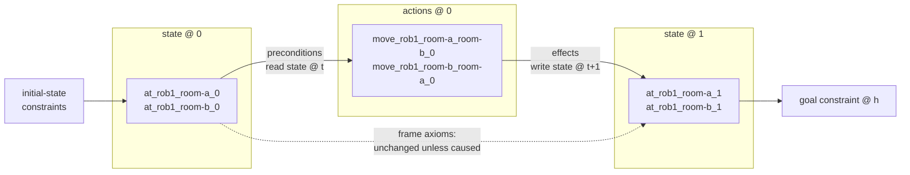

# The encoding: from ground problem to SMT formula

Everything else in these docs — pruning, interference, planners —
exists to build or exploit the formula described here. This doc shows what
that formula actually *is*: which solver variables get created, which clause
schemas the encoder emits, and the complete formula for the two-room robot
problem from [`architecture-overview.md`](architecture-overview.md). Read it
right after the overview; the rest of the docs assume this picture.

## The shape: an unrolled transition system

Fix a horizon *h*. The formula describes a trajectory of *h+1* states and
the actions taken between consecutive ones:

- a set of **state variables** for each timestep `0..h` — one solver variable
  per ground fluent per timestep,
- a set of **action variables** for each timestep `0..h-1` — one Boolean
  per ground action per timestep,
- constraints saying: timestep 0 is the initial state, every `t → t+1`
  transition is legal (preconditions hold, effects apply, nothing else
  changes), and the goal holds at *h*.

A satisfying model assigns `true` to some action variables — reading those
off, timestep by timestep, *is* the plan.



For horizons beyond 1, this block repeats: state @ 1 feeds actions @ 1,
which write state @ 2, and so on. The planners grow it incrementally —
[`solver-control-and-interruption.md`](solver-control-and-interruption.md) covers
how — but the per-timestep content is always what's shown here.

## The variables: `SmtVariableFactory`

`smtcore/smt_variable_factory.hpp` is the single owner of variable creation,
naming, and caching. Every encoder and plan-extraction path goes through it,
which is what keeps them all talking about the *same* variable for "fluent
`at(rob1, room-a)` at timestep 3". Note this matters more here than it did
under a name-interning solver: `cvc5::TermManager::mkConst` returns a *fresh*
constant on every call, so two independent calls for one logical variable
would silently produce two unrelated variables. The factory's cache is what
prevents that.

- **Naming**: name + parameters + timestep, joined by underscores. Fluent
  `at(rob1, room-a)` at timestep 0 is the variable `at_rob1_room-a_0`;
  action `move(rob1, room-a, room-b)` at timestep 0 is
  `move_rob1_room-a_room-b_0`.
- **Action variables** are always `Bool`.
- **Fluent variables** are typed by the fluent's value type: `Bool` for
  predicates; `Int` or `Real` for numeric fluents. When every numeric
  constant in the problem is an integer (`all_integer` mode, decided during
  preprocessing), `Int` is used throughout — a single sort lets the solver
  run with a tighter SMT logic hint.
- **Object-valued fluents** (`location(rover0) = waypoint3`) become numeric
  variables whose value is the object's global index, constrained by
  equality with concrete object constants. They deliberately use the same
  sort as numeric fluents — mixing `Int` and `Real` under a single-sort
  logic hint like `QF_LRA` is rejected by the solver (the comment in
  `create_object_variable` records this).
- The factory also keeps **reverse mappings** (variable name → fluent/action
  + timestep). Plan extraction uses these to interpret what the solver fixed
  or assigned.

### From `ExprID` to `Term`: the encoding visitors

The overview showed that every precondition, effect, and goal is an
`ExprID` into the interned expression pool. `smtcore/`'s
`GroundedEncodingVisitor` is the bridge: `convert_from_pool(id, t)` walks
the `ExprNode` tree once, recursively —

- a `STATE_VARIABLE` node (`(at rob1 room-a)`) becomes the factory's fluent
  variable for timestep *t*,
- a `CONSTANT` leaf becomes a literal,
- a `FUNCTION_APPLICATION` node dispatches on its `ExprOperator` to the
  matching solver operation, always via `TermBuilder` (`AND` → `mk_and`,
  `PLUS` → `add`, `GE` → `geq`, ...). cvc5 has no operator overloading for
  formulas, so `TermBuilder` is not a convenience layer — it is the only way
  these get built.

So `(and (at rob1 room-a) (>= (fuel rob1) 1))` at timestep 2 comes out as
`at_rob1_room-a_2 ∧ fuel_rob1_2 ≥ 1`. There is a second visitor,
`LiftedEncodingVisitor`, which maps fluent applications to *uninterpreted
functions* instead of per-timestep variables — it's used only by the
symmetry checker, which needs to reason about lifted expressions under
object swaps (see the symmetry section of
[`preprocessing-and-strategy.md`](preprocessing-and-strategy.md)), not by
any encoder.

## The clause schemas

`BaseEncoder` (`encoders/base_encoder.hpp`) splits the formula into named
pieces; the planner calls each per timestep and asserts the result. The
baseline implementation is `GroundedEncoder`
(`encoders/grounded_encoder.cpp`); the schemas below are its exact output.

| Method | Clause schema (per timestep *t*) | Says |
|---|---|---|
| `encode_initial_state()` | `f@0 = v` for every initial assignment | "we start here" |
| `encode_actions(t)` | `a@t → pre@t`, `a@t → eff@t+1` | "firing an action requires and causes" |
| `encode_frames(t)` | `(f@t ≠ f@t+1) → (some cause fired @t)` | "nothing changes without a cause" |
| `encode_parallelism(t)` | at-most-1 / pairwise mutexes | "which co-scheduling is legal" |
| `encode_state_constraints(t)` | mutexes, bounds, conservation laws | "facts true in every reachable state" |
| `encode_symmetries(t)` | symmetric state → lex-ordered actions | "don't explore mirror-image plans" |
| `encode_prefix_monotone(t)` | `(∀a. ¬a@t) → (∀a. ¬a@t+1)` | "empty steps only at the end" |
| `encode_goal(t)` | conjunction of goals at *t* | "we end here" |

### Initial state

One equality per assignment: `at_rob1_room-a_0 = true`. This is only
complete because the **CWA pass** ran first
([`preprocessing-and-strategy.md`](preprocessing-and-strategy.md)): the
closed-world assumption — anything not stated true initially is false — is
made explicit there, so every ground fluent has an assignment and the
encoder can just iterate, with no "everything else is false" logic of its
own. Without it, `at_rob1_room-b_0` would be unconstrained and the solver would
happily start the robot in both rooms.

### Actions: preconditions and effects

Two implications per ground action (`encode_single_action`):

```
move_rob1_room-a_room-b_0  →  at_rob1_room-a_0                                  (precondition @ t)
move_rob1_room-a_room-b_0  →  ¬at_rob1_room-a_1 ∧ at_rob1_room-b_1              (effects @ t+1)
```

Effect kinds map to (`convert_effect_to_z3`): `ASSIGN` →
`f@t+1 = value@t`, `INCREASE`/`DECREASE` → `f@t+1 = f@t ± value@t`.
Conditional effects wrap the equality in the condition evaluated at *t*:
`cond@t → (f@t+1 = ...)`. Note the implications are one-directional — an
action *may* fire only if its precondition holds, but nothing forces it to
fire. What forces actions into the plan is the goal plus the frame axioms.

### Frame axioms: nothing changes without a cause

The action implications alone leave a loophole: the solver could satisfy the goal
by simply flipping `at_rob1_room-b` to true at timestep 1 with *no action
at all* — no constraint yet connects a fluent's change to an action. A
**frame axiom** closes this: it asserts that a fluent keeps its value
across `t → t+1` unless something that can change it actually fired. This
is the *explanatory* style of frame axiom — one clause per fluent listing
its possible causes, rather than one clause per (action, untouched fluent)
pair, which would be quadratically many.

The possible causes come from the **EPC index** (effect-precondition
index, `epc_index_` in `GroundedEncoder`): a map from each ground fluent to
the `(action, effect)` pairs that can modify it, built once in the
constructor. The schema, for each ground fluent *f*:

```
(f@t ≠ f@t+1)  →  (a₁@t ∨ (a₂@t ∧ cond₂@t) ∨ ... ∨ aₙ@t)
```

where conditional effects contribute `action ∧ condition` instead of just
the action variable. A fluent no action can modify gets
`(f@t ≠ f@t+1) → false` — it can never change, which is exactly right.

(The `elsc-fp` strategy replaces these clauses entirely with a propagator
module that supplies the same information lazily during search —
`set_lazy_frames(true)` makes `encode_frames` return `true` and
`FrameAxiomModule` takes over; see
[`interference.md`](interference.md).)

### Parallelism: what may share a timestep

`encode_parallelism(t)` delegates to the constructor-injected
`ParallelismStrategy` (`encoders/parallelism/`), one class per semantics
from [`architecture-overview.md`](architecture-overview.md):

- **`SequentialSemantics`** — one pseudo-Boolean constraint,
  `AtMost(a₁@t, ..., aₙ@t; 1)`. At-most-one rather than exactly-one so
  that *empty* timesteps are legal — the prefix-monotone schema below
  depends on that.
- **`ForallSemantics`** — one mutex `¬(a@t ∧ b@t)` per directed edge of
  the interference graph. Needs the whole graph up front, which is why it
  requires an *eager* (graph-bearing) interference analysis — see
  [`interference.md`](interference.md).
- **`ExistsSemantics`** — mutexes only for interfering pairs in the *same
  strongly connected component* of the interference graph. Across
  different SCCs an execution order always exists (the SCC condensation is
  a DAG), so those pairs never need blocking; within an SCC this static
  clause form conservatively blocks the pair. The exact ∃-step semantics —
  "block only genuine cycles" — can't be expressed as a fixed clause set of
  this size, so the lazy strategies (`elsc`, ...) skip these clauses and
  enforce acyclicity with the `ExistsCycleModule` propagator during search
  instead.

### State constraints, symmetries

`encode_state_constraints(t)` re-asserts, at every timestep, invariants the
preprocessor proved hold in *every* reachable state: mutex groups
(`AtMost(members; 1)`, plus `AtLeast` for exactly-one groups), numeric
bounds (`fuel_rob1_t ≤ 3`), object-fluent domain restrictions, and
conservation laws (`f@t + g@t = C`). The solver could rediscover each of
these by search, at every horizon — asserting them up front prunes those
branches for free. Where they come from is covered in
[`preprocessing-and-strategy.md`](preprocessing-and-strategy.md).

`encode_symmetries(t)` emits, per detected object swap: *if* the state is
symmetric under the swap at *t*, *then* the swap-related action pairs must
fire in lexicographic order — cutting mirror-image plans out of the search
space without losing any genuinely distinct plan.

### Prefix-monotone and the goal

`encode_prefix_monotone(t)` — `(∀a. ¬a@t) → (∀a. ¬a@t+1)` — forces all
empty timesteps to the *end* of the trajectory. Combined with frame axioms
(which carry the final state unchanged through the empty suffix), a single
goal check at horizon *h* then also witnesses any shorter plan — the
batching trick behind non-linear horizon schedules, explained in
[`encoders-and-planners.md`](encoders-and-planners.md).

`encode_goal(t)` is just the goal conjunction evaluated at *t*. The planner
doesn't assert it permanently — it hides it behind a per-horizon assumption
literal so it can be retracted when the horizon grows
([`solver-control-and-interruption.md`](solver-control-and-interruption.md)).

## The whole formula, once

The two-room robot problem from the overview, horizon 1, `seq` strategy.
Six variables: four state (`at_rob1_room-a_{0,1}`, `at_rob1_room-b_{0,1}`),
two action (`move_rob1_room-a_room-b_0`, `move_rob1_room-b_room-a_0`).
Abbreviating `move_rob1_room-a_room-b` as `move_a_b`, `at_rob1_room-a` as
`at_a`:

```
; initial state (CWA-complete)
at_a_0 = true
at_b_0 = false

; actions @ 0: precondition + effects
move_a_b_0 → at_a_0
move_a_b_0 → (¬at_a_1 ∧ at_b_1)
move_b_a_0 → at_b_0
move_b_a_0 → (¬at_b_1 ∧ at_a_1)

; frame axioms 0 → 1 (both fluents share the same causes)
(at_a_0 ≠ at_a_1) → (move_a_b_0 ∨ move_b_a_0)
(at_b_0 ≠ at_b_1) → (move_a_b_0 ∨ move_b_a_0)

; parallelism (sequential)
AtMost(move_a_b_0, move_b_a_0; 1)

; state constraint (mutex analysis: robot is in at most one room)
AtMost(at_a_0, at_b_0; 1)
AtMost(at_a_1, at_b_1; 1)

; goal @ 1, gated behind the planner's assumption literal
goal_at_1 → at_b_1
```

The solver, asked to satisfy this under the assumption `goal_at_1`, has exactly one
way: `at_b_1` must be true (goal), so `at_b` changed, so the frame axiom
forces `move_a_b_0 ∨ move_b_a_0`; `move_b_a_0` requires the false `at_b_0`,
so `move_a_b_0` is true. `extract_plan()` walks the timesteps, finds the
one true action variable, and returns the one-step plan.

Every real solve is this, scaled up: thousands of variables per timestep,
the same eight schemas.

## Beyond the baseline: Chained and R2E

Two encoder families override parts of these schemas — both exist because
of *numeric fluents under parallel semantics*, where "apply all effects
simultaneously" stops being well-defined (two increases to the same fluent
must both count):

- **`ChainedGroundedEncoder`** keeps everything above but replaces the
  effect equalities for numeric fluents modified by more than one action
  with **chain variables** (ζ) that thread those actions' contributions
  sequentially through the timestep.
- **`R2EGroundedEncoder`** goes further: it fixes one global action order
  and substitutes intermediate values through *all* constraints, replacing
  the frame and parallelism schemas entirely.

Both are covered in [`encoders-and-planners.md`](encoders-and-planners.md).

## Try it

Export the real formula for a real problem and read it — every schema above
is visible in the SMT-LIB2 output. The module's `export_formula` builds the
encoder and prints the formula instead of solving (the problem must already
be ground, so this uses UP's grounder; export is limited to
propagator-free strategies — `seq` and `r2e`):

```python
# from the repo root, inside the venv
from unified_planning.io import PDDLReader
from unified_planning.engines import CompilationKind
from unified_planning.engines.compilers import Grounder
from rantanplan.converter import convert_problem
from rantanplan import _rantanplan

problem = PDDLReader().parse_problem(
    "pddl/small-test/zenotravel/domain.pddl",
    "pddl/small-test/zenotravel/instances/pfile13.pddl")
ground = Grounder().compile(problem, CompilationKind.GROUNDING).problem
smt2 = _rantanplan.export_formula(
    convert_problem(ground),
    ["--strategy", "seq", "--formula-timestep", "3"])
open("/tmp/plan.smt2", "w").write(smt2)
```

Skim `/tmp/plan.smt2`: the declarations follow the factory's
`name_params_timestep` convention (`located_person1_city0_0 : Bool`,
`fuel_plane1_2 : Real`, ...), and the assertions are the action
implications, frame axioms, and at-most-one constraints from this doc,
thousands of times over. The file is self-contained — a stock
`cvc5 /tmp/plan.smt2` solves it with no planner involved.
